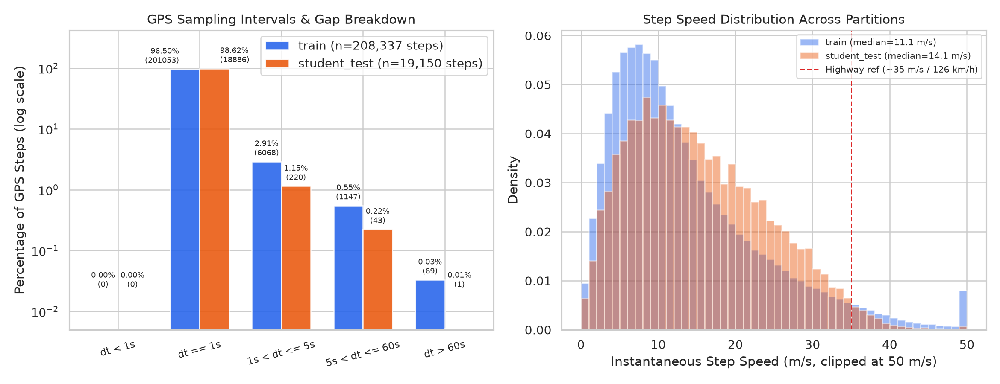
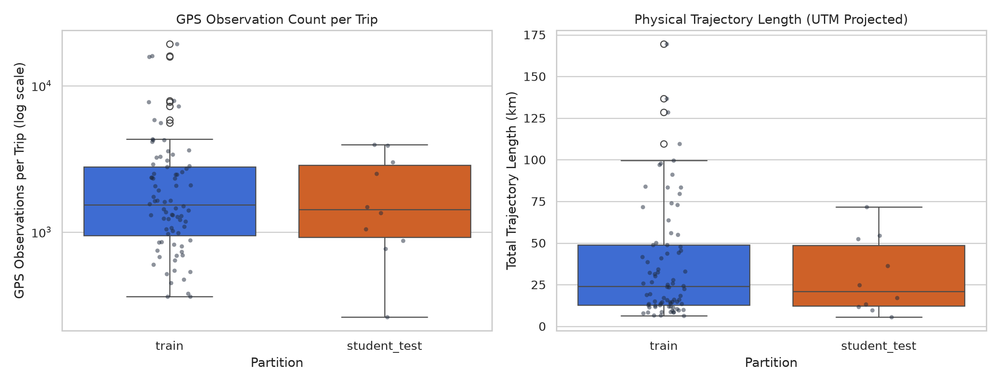
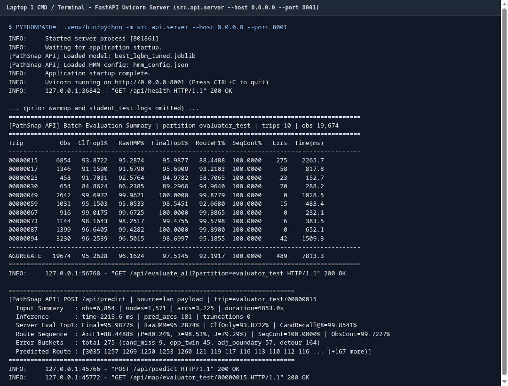

# PathSnap Technical Report (Phases 1 and 2): Group A-G14

**Course:** UE24CS352A: Machine Learning  
**Team A-G14:** Andey Hemanth, Abhiroop, Abhirama H Y, Aman Rao U

---

## 1. Executive Summary and System Architecture

PathSnap maps noisy raw Global Positioning System (GPS) trajectories onto directed urban road graphs to reconstruct continuous vehicle routes. Road networks contain up to 307,392 directed arcs per trip, while the reference routes list only traversed road arc IDs rather than per-ping point annotations. To solve this without label leakage, the system decomposes map-matching into four algorithmic stages (Sections 2 through 6) plus a distributed two-laptop deployment stack (Section 7):

1. **Dynamic projection and spatial candidate retrieval:** Convert every trip from World Geodetic System 1984 (WGS84) degrees into its local Universal Transverse Mercator (UTM) metric plane. Using Gaussian smoothing and turnaround-aware 20 m spatial-chord headings, retrieve the top K = 8 candidate road segments per GPS point with a 3-point k-dimensional spatial tree (`cKDTree`). During training, align reference routes monotonically via dynamic programming (DP) to construct supervised binary labels without modifying input features.
2. **Leak-free 24-feature candidate scoring:** Compute 24 features strictly from raw GPS points and road geometry, covering proximity, segment projection, smoothed heading alignment, temporal-window distance, and 2-sided local graph continuity. Six candidate classifier families are compared under 5-fold trip-grouped cross-validation (`GroupKFold`, which keeps all points of a trip in the same fold), and LightGBM is tuned with Optuna's Tree-structured Parzen Estimator (TPE).
3. **Hybrid probabilistic-geometric HMM and Viterbi decoding:** Combine calibrated LightGBM probabilities with physical distance emissions and Newson-Krumm directed road transitions. Using Viterbi sequence decoding with bounded Dijkstra shortest paths (capped at 3,000 node pops), the decoder recovers connected road routes.
4. **Inference-only continuous route boundary realignment:** Re-align GPS points monotonically onto the decoder's own continuous predicted route sequence without accessing reference routes, eliminating intersection transition lag.
5. **Distributed two-laptop deployment and blind evaluation:** Serve the frozen Phase 1 pipeline over a FastAPI backend on Laptop 1 with post-prediction server-side evaluation, controlled over HTTP by a minimal web interface on Laptop 2.

Across held-out test partitions, each stage delivers measurable gains over baseline candidate classification. On `student_test` (10 trips, 19,160 GPS points), Observation Top-1 Accuracy (the fraction of pings whose predicted road arc matches the aligned ground truth) rises from 88.2777% (Iteration 1 Classifier-Only) and 93.9405% (Iteration 1 HMM) to 94.5929% (upgraded Classifier-Only), 96.7589% (Hybrid HMM pre-realignment), and 97.7036% (Final Hybrid HMM with Boundary Realignment). On the same partition, Route Arc F1 (harmonic mean of unique predicted vs. reference road arc precision and recall) reaches 96.3390%, and Sequence Continuity (fraction of consecutive route arcs sharing an intersection node) reaches 99.7940%.

Evaluating the exact frozen Phase 1 model and HMM configuration on the unseen `evaluator_test` partition (10 trips, 19,674 GPS points) confirms strong generalization. Final Observation Top-1 Accuracy holds at 97.5145% (+2.25 pp over Classifier-Only at 95.2628%), Mean Route Arc F1 reaches 92.1917% (99.3346% recall and 87.8684% precision, +8.63 pp over Classifier-Only at 83.5606%), and Sequence Continuity hits 100.0000% across all 10 trips with 0 Dijkstra truncations in 7.8133 s total inference time (781.3 ms per trip).

---

## 2. Dataset Understanding and Exploratory Data Analysis

### 2.1 Raw Structure and Data Quality

Each trip folder contains four headerless inputs describing the trajectory and underlying road network: timestamped GPS points (`track`: longitude, latitude, timestamp), road intersection coordinates (`nodes`), directed road segments (`arcs`: from-node and to-node pairs), and the chronological traversed road arc ID sequence (`route`). An initial audit across all 90 development and validation trips (80 `train` trips and 10 `student_test` trips, totaling 227,577 GPS points, 2,024,174 nodes, 4,061,945 arcs, and 34,813 reference route arcs) verified complete structural integrity. We observed 0 NaN or infinite values, 0 out-of-bounds coordinates or indices, 0 isolated nodes, and 0 backward timestamps (`dt <= 0`). Table 1 summarizes dataset volume and timing behavior across these two partitions, while Figures 1 and 2 illustrate sampling interval patterns and trip length distributions.

| Partition | Trips | Total GPS Obs | Obs per Trip (Min / Med / Max) | Total Nodes (Max per Trip) | Total Arcs (Max per Trip) | Steps with `dt = 1 s` | Gaps `> 60 s` (`dt_max`) | UTM Zones |
|---|---:|---:|---:|---:|---:|---:|---:|---:|
| `train` | 80 | 208,417 | 361 / 1,529.0 / 19,313 | 1,933,485 (155,003) | 3,876,904 (307,392) | 96.5037% | 69 (153,064.0 s) | 25 |
| `student_test` | 10 | 19,160 | 262 / 1,420.0 / 3,958 | 90,689 (26,635) | 185,041 (56,027) | 98.6214% | 1 (210.0 s) | 9 |

### 2.2 Spatial Projection and Network Patterns

Trips span global coordinates ranging from -100.35 deg to 137.22 deg in longitude and -34.62 deg to 61.67 deg in latitude across four continents, as mapped in Figure 3. Because longitude degrees shrink toward the poles, planar projection is essential before computing distances or headings. For example, on `train` trip `00000001` at 50.09 deg N, 1 degree of longitude spans 71,563.72 m whereas 1 degree of latitude spans 111,230.76 m (a 35.66% east-west compression). Naive degree scaling overestimates the 50,228.555 m geodesic trip length by 11.80579% (up to 27.91291 m error per 1 s step). Projecting each trip dynamically to the European Petroleum Survey Group (EPSG) WGS84 UTM zone at its centroid reduces total length error to 0.03902% (0.02822 m maximum step difference).

Beyond coordinate scale, road graphs exhibit complex connectivity and noise regimes across partitions (Figures 4 and 5). Graphs contain 1 to 421 weakly connected components in `train` (median 20) and 5 to 100 in `student_test` (median 11), with median bidirectional arc rates of 95.112% and 93.261% (dropping to 35.133% in `train` trip `00000080`). Because a vehicle often spans one road arc over multiple seconds, the observation-to-route ratio has a median of 5.289x in `train` and 4.635x in `student_test`.

Lateral GPS noise and route anomalies create three main challenges for candidate matching:

- **Typical lateral GPS noise:** In normal trips, median GPS distance to the ground-truth route is 4.503 m (`train`) and 4.593 m (`student_test`), with per-trip 95th-percentile (`p95`) medians of 14.212 m and 15.798 m.
- **Whole-trip offset outliers:** Two `train` trips suffer systematic lateral shifts across the entire trajectory (`00000054` at median 138.59 m, `p95 = 210.05 m`; `00000033` at median 122.41 m, `p95 = 142.06 m`), and `00000002` exhibits a 5.67 m median offset with severe spikes (`p95 = 242.36 m`, maximum 569.66 m).
- **Disconnected reference steps:** Ten `train` trips (13 transitions) and `student_test` trip `00000076` (1 transition) contain gaps in the reference route sequence.

Figures 6 and 7 visualize a complete UTM trajectory with a zoomed high-noise highway interchange alongside an interactive map corridor view.

### 2.3 Preprocessing and Candidate Generation

Every trajectory passes through four standardized preprocessing steps before candidate classification:

1. **Dynamic per-trip UTM projection:** Transform GPS points and road nodes into the local WGS84 UTM metric plane determined by the trip centroid.
2. **Quality and time-gap preservation:** Retain all valid pings and record elapsed time steps (`dt_prev_s`, capped at 600 s for tabular features and passed raw to the HMM decoder).
3. **Turnaround-aware velocity smoothing:** Smooth planar coordinates using a Gaussian kernel (`sigma = 2.5`) and compute backward arrival and forward departure spatial chords at 20 m radius. Whenever opposing chords satisfy `dot(u_back, u_fwd) < -0.2` (for example, traffic-light stops or turnarounds), the incoming chord governs approach points and the outgoing chord governs departure points. This prevents 5 m stationary GPS jitter from flipping estimated vehicle headings into opposite-direction lanes. Instantaneous headings use `sigma = 1.2` coordinate derivatives.
4. **3-point `cKDTree` candidate generation and monotonic DP label alignment:** Index 3 evenly spaced sample points (`0.15`, `0.50`, `0.85`) along every road segment, query the 72 nearest segment points per GPS ping, compute exact point-to-segment distances, rank unique arc IDs by `dist + 0.5 * (1 - cos_heading_smooth)`, and retain the top K = 8 candidates. As shown in Figure 8, K = 8 limits the pooled `student_test` candidate miss rate to 0.3862% (99.6138% recall). On training and validation sets only, monotonic dynamic programming (`step in 0..15` plus a `+50.0` gap fallback) generates observation-level binary targets without influencing input features.

### 2.4 Feature Engineering and Separability Analysis

Guided directly by the 4.5 m lateral noise scale, bidirectional street twin confusion, and multi-second signal dropouts, we engineered 24 leak-free features strictly from GPS coordinates, road nodes, and directed arcs. As summarized in Figure 9, these 24 features separate true road matches (`y = 1`) from nearby competing segments (`y = 0`) across five complementary groups:

- **Spatial proximity (6 features):** Perpendicular distance `dist_to_arc_m`, candidate rank (`r = -0.4811` correlation with target), distance margin above the closest candidate, distance ratio to best, within-observation distance z-score (`r = -0.4463`), and a Gaussian emission prior at 10 m bandwidth (`r = +0.4726`), capturing the 5.1 m matched median distance.
- **Projection and geometry (4 features):** Normalized segment projection fraction, distances to start and end nodes, and arc length (`r = +0.1387`), distinguishing short turn connectors from longer arterial links.
- **Heading and directionality (5 features):** Cosine and sine of instantaneous heading alignment (`r = +0.3190` for cosine), smoothed 20 m chord cosine (`r = +0.3522`, median 0.9987 matched vs. -0.0181 unmatched), smoothed angular error in degrees (`r = -0.3672`, median 2.94 deg vs. 91.04 deg), and forward alignment flag (97.08% matched vs. 49.24% unmatched).
- **Kinematics and local window (5 features):** Instantaneous GPS speed, elapsed time `dt_prev_s`, smoothed `t - 4` and `t + 4` trajectory distances to each candidate arc, and the 3-point smoothed window margin `mean_window3_dist_to_arc_m` above the best local candidate (matched median 0.0000 m vs. 23.5209 m unmatched).
- **Graph topology and continuity (4 features):** Start-node in-degree, end-node out-degree, bidirectionality flag, and 2-sided local (`t - 3`, `t`, `t + 3`) connected-chain cost margin `prev_cand_connected` (matched median 0.0000 vs. unmatched median 42.6893, `r = -0.2143`).

---

## 3. Model Experimentation and Comparison

We benchmarked 6 distinct classifier families across the 80 `train` trips using 5-fold `GroupKFold` cross-validation (CV) grouped strictly by `trip_id`. Each model was trained on `[::3]` strided training rows and validated on 100% of each held-out fold, then refit on `train` and evaluated unstrided on all 10 `student_test` trips (19,160 observations / 153,280 candidate rows). Both Section 3.1 and Section 4 evaluate identical LightGBM bagging settings (`subsample_freq = 1`).

### 3.1 Overall 6-Model Comparison (`train` CV and `student_test`)

Table 2 compares all six candidate classifiers on cross-validation and held-out `student_test` accuracy, calibration, continuity, and inference latency.

| Model | Algorithm Family | Key Configuration | CV Macro F1 (Std) | Top-1 Acc (Test) | Pooled Continuity (Test) | Student-Test Macro F1 | Log Loss (Test) | Inference Time (10 trips) |
|---|---|---|---:|---:|---:|---:|---:|---:|
| Logistic Regression | Linear | StandardScaler + L2 `C=1.0`, `max_iter=500` | 0.9154 (0.0355) | 92.2651% | 93.3420% | 0.9320 | 0.0831 | 0.0254 s |
| Gaussian Naive Bayes | Probabilistic | StandardScaler + `GaussianNB(var_smoothing=1e-6)` | 0.7943 (0.0291) | 91.9676% | 92.4491% | 0.7957 | 1.3652 | 0.0695 s |
| Decision Tree | Tree-based | `max_depth=12`, `min_samples_leaf=50` | 0.9317 (0.0618) | 93.6273% | 95.1436% | 0.9627 | 0.0551 | **0.0065 s** |
| Random Forest | Ensemble Bagging | `n_estimators=80`, `max_depth=14`, `min_samples_leaf=20` | 0.9466 (0.0373) | 94.0292% | 95.2428% | 0.9630 | 0.0454 | 0.0998 s |
| **LightGBM** | **Gradient Boosting** | `n_estimators=200`, `lr=0.08`, `num_leaves=31`, `min_child=50`, `subsample_freq=1` | **0.9489 (0.0369)** | **94.4676%** | **95.9373%** | **0.9664** | **0.0418** | 0.1471 s |
| MLP Neural Network | Neural Networks | StandardScaler + `(64, 32)`, `early_stopping=True`, `batch=2048` | 0.9399 (0.0389) | 93.6534% | 94.4230% | 0.9549 | 0.0539 | 0.0404 s |

Two evaluation details explain fold-level variance and continuity accounting in Table 2. First, Fold 0 yields 49.84% to 51.54% validation Top-1 Accuracy across all six models (compared to 82.16% to 95.10% in Folds 1 through 4) because `GroupKFold` isolates severe offset outlier `00000054` (19,313 observations, 58.45% miss rate) in Fold 0 and `00000033` (66.07% miss rate) in Fold 3. Second, `Pooled Continuity` in Sections 3 and 4 measures observation-level directed transition rate across all 19,150 steps (`sum(connected) / sum(total)`), whereas Section 5 reports both unweighted per-trip mean observation continuity and final sequence continuity.

---

### 3.2 Individual Model Analysis

#### 1. Logistic Regression (Linear)
- **A. Model Understanding:**

    - **1. Suitability:** Fast linear baseline combining distance rank, Gaussian emission prior, smooth heading alignment, and 2-sided chain margins to output smooth calibrated probabilities for HMM emissions.
    - **2. Strengths and Limitations:** Fits in 1.958 s with minimal overfitting (`train_fit_macro_f1 = 0.9199` vs. `CV = 0.9154`), but a single hyperplane cannot capture nonlinear interactions such as low-speed intersections vs. multi-second GPS gaps.

- **B. Training and Configuration:**

    - **3. Hyperparameters:** `StandardScaler()` followed by L2 `LogisticRegression(C=1.0, max_iter=500, random_state=42)`.
    - **4. Loss and Objective:** L2-regularized binary cross-entropy loss.

- **C. Experimental Results:**

    - **5. Student-Test Summary:** 0.9320 Macro F1, 92.2651% Top-1 Accuracy, 93.3420% pooled Continuity (0.0254 s inference).
    - **6. Detailed Metrics:** Positive Precision 0.8865, Positive Recall 0.8752, Positive F1 0.8808, Log Loss 0.0831.
    - **7. Fit Assessment:** Mild underfitting compared to boosted trees (`train_fit` 0.9199 vs. LightGBM 0.9732; CV 0.9154 vs. LightGBM 0.9489).

#### 2. Gaussian Naive Bayes (Probabilistic)
- **A. Model Understanding:**

    - **1. Suitability:** Closed-form generative classifier fitting class-conditional Gaussian densities per feature.
    - **2. Strengths and Limitations:** Trains fastest (0.676 s), yet conditional independence fails across strongly correlated spatial distance and local window features (`dist_to_arc_m`, `mean_window3_dist_to_arc_m`, `prev_cand_connected`).

- **B. Training and Configuration:**

    - **3. Hyperparameters:** `StandardScaler()` followed by `GaussianNB(var_smoothing=1e-6)`.
    - **4. Loss and Objective:** Maximum-likelihood Gaussian density estimation via Bayes' rule.

- **C. Experimental Results:**

    - **5. Student-Test Summary:** 0.7957 Macro F1, 91.9676% Top-1 Accuracy, 92.4491% pooled Continuity (0.0695 s inference).
    - **6. Detailed Metrics:** Positive Precision 0.5039, Positive Recall 0.9842, Positive F1 0.6665, Log Loss 1.3652.
    - **7. Fit Assessment:** Severe underfitting and extreme probability miscalibration (`train_fit` 0.7810, CV 0.7943, 18,493 false positives), making raw Naive Bayes outputs unsuitable for Viterbi log-emissions.

#### 3. Decision Tree (Tree-based)
- **A. Model Understanding:**

    - **1. Suitability:** Models discrete threshold interactions across candidate rank, smooth cosine alignment, and local chain cost without scaling.
    - **2. Strengths and Limitations:** Fastest inference (0.0065 s across 10 trips), though single greedy splits increase variance across outlier folds (CV standard deviation 0.0618).

- **B. Training and Configuration:**

    - **3. Hyperparameters:** `DecisionTreeClassifier(max_depth=12, min_samples_leaf=50, random_state=42)`.
    - **4. Loss and Objective:** Gini impurity minimization.

- **C. Experimental Results:**

    - **5. Student-Test Summary:** 0.9627 Macro F1, 93.6273% Top-1 Accuracy, 95.1436% pooled Continuity (0.0065 s inference).
    - **6. Detailed Metrics:** Positive Precision 0.9414, Positive Recall 0.9279, Positive F1 0.9346, Log Loss 0.0551.
    - **7. Fit Assessment:** Moderate overfitting (`train_fit` 0.9643 vs. CV 0.9317, gap 0.0326) with higher fold sensitivity than ensembles.

#### 4. Random Forest (Ensemble Bagging)
- **A. Model Understanding:**

    - **1. Suitability:** Averages 80 bootstrap trees to reduce single-tree variance across complex urban grids and noisy GPS traces.
    - **2. Strengths and Limitations:** Achieves the highest positive precision (0.9544) among all 6 models and low Log Loss (0.0454), at the highest training cost (20.097 s).

- **B. Training and Configuration:**

    - **3. Hyperparameters:** `RandomForestClassifier(n_estimators=80, max_depth=14, min_samples_leaf=20, random_state=42)`.
    - **4. Loss and Objective:** Bagged Gini impurity reduction across bootstrap samples.

- **C. Experimental Results:**

    - **5. Student-Test Summary:** 0.9630 Macro F1, 94.0292% Top-1 Accuracy, 95.2428% pooled Continuity (0.0998 s inference).
    - **6. Detailed Metrics:** Positive Precision 0.9544, Positive Recall 0.9165, Positive F1 0.9351, Log Loss 0.0454.
    - **7. Fit Assessment:** Balanced generalization (`train_fit` 0.9672 vs. CV 0.9466, standard deviation 0.0373), improving CV F1 by +0.0149 over Decision Tree.

#### 5. LightGBM (Gradient Boosting, Selected Model)
- **A. Model Understanding:**

    - **1. Suitability:** Fits sequential histogram-boosted trees directly to binary log loss, optimizing the exact probability calibration needed by Viterbi emissions.
    - **2. Strengths and Limitations:** Ranks 1st across all 5 CV folds in Macro F1 (0.8716, 0.9544, 0.9685, 0.9609, 0.9676; while Random Forest leads Top-1 in Folds 1 and 2 and Decision Tree leads Fold 4), achieves the lowest Log Loss (0.0418), highest Student-Test Macro F1 (0.9664), highest Top-1 Accuracy (94.4676%), highest pooled Continuity (95.9373%), and 6.0x faster training than Random Forest (3.360 s vs. 20.097 s). Regularization tuning is still beneficial to prevent overfitting outlier folds.

- **B. Training and Configuration:**

    - **3. Hyperparameters:** `LGBMClassifier(n_estimators=200, learning_rate=0.08, num_leaves=31, min_child_samples=50, subsample=0.8, subsample_freq=1, colsample_bytree=0.8, random_state=42)`.
    - **4. Loss and Objective:** Binary cross-entropy (`binary_logloss`) via leaf-wise gradient boosting.

- **C. Experimental Results:**

    - **5. Student-Test Summary:** 0.9664 Macro F1, 94.4676% Top-1 Accuracy, 95.9373% pooled Continuity (0.1471 s inference).
    - **6. Detailed Metrics:** Positive Precision 0.9444, Positive Recall 0.9378, Positive F1 0.9411, Log Loss 0.0418.
    - **7. Fit Assessment:** Controlled generalization (`train_fit` 0.9732, CV 0.9489, Test 0.9664). As shown in Figure 13, Fold 0 validation loss bottoms out (~0.160) near iteration 22 and rises to ~0.221 by iteration 200 solely on noisy Fold 0 (`00000054`), motivating Optuna regularization in Section 4.

#### 6. MLP Neural Network (Neural Networks)
- **A. Model Understanding:**

    - **1. Suitability:** Learns smooth combinations across standardized distance, heading, and graph chain features.
    - **2. Strengths and Limitations:** Fast inference (0.0404 s across 10 trips) and well-calibrated probabilities (Log Loss 0.0539), though tree splits handle discrete distance ranks (`dist_rank`) and integer node degrees slightly better.

- **B. Training and Configuration:**

    - **3. Hyperparameters:** `StandardScaler()` + `MLPClassifier(hidden_layer_sizes=(64, 32), alpha=1e-4, learning_rate_init=1e-3, max_iter=35, batch_size=2048, tol=1e-3, early_stopping=True, validation_fraction=0.1, n_iter_no_change=4, random_state=42)`.
    - **4. Loss and Objective:** L2-regularized binary cross-entropy via Adam.

- **C. Experimental Results:**

    - **5. Student-Test Summary:** 0.9549 Macro F1, 93.6534% Top-1 Accuracy, 94.4230% pooled Continuity (0.0404 s inference).
    - **6. Detailed Metrics:** Positive Precision 0.9393, Positive Recall 0.9030, Positive F1 0.9208, Log Loss 0.0539.
    - **7. Fit Assessment:** Low overfitting (`train_fit` 0.9498 vs. CV 0.9399), halting at epoch 9 under internal 10% random early-stopping validation (Figure 13).

---

### 3.3 Model Visualisations

Figures 10 through 13 present the cross-model performance benchmarks, calibration and continuity comparisons, test confusion matrices, and iterative training diagnostics across all six candidate classifiers.

---

## 4. Bayesian Hyperparameter Optimisation (LightGBM)

Because candidate sets average over 87.5% negative labels while the downstream HMM relies on calibrated emission log-probabilities, we optimized LightGBM for 5-fold `GroupKFold` CV Macro F1 paired with Log Loss tracking. LightGBM already led all five competing families across every CV fold (0.9489 Macro F1, 0.0418 test Log Loss), making tree regularization the logical refinement target:

1. **Hyperparameters tuned:** Tree count (`n_estimators`), learning rate (`learning_rate`), leaf budget (`num_leaves`), tree depth (`max_depth`), minimum leaf size (`min_child_samples`), row subsampling (`subsample`, with `subsample_freq=1`), column subsampling (`colsample_bytree`), and L2 regularization (`reg_lambda`).
2. **Search space and distributions:** Integer `[120, 400]` for `n_estimators`; log-uniform `[0.02, 0.18]` for `learning_rate`; integers `[15, 95]` and `[4, 12]` for `num_leaves` and `max_depth`; `[20, 150]` for `min_child_samples` (protecting against offset outliers); `[0.65, 1.0]` for `subsample` and `colsample_bytree`; and log-uniform `[1e-3, 10.0]` for `reg_lambda`.
3. **Optimisation protocol:** Out-of-fold 5-fold `GroupKFold` Macro F1 strictly across the 80 `train` trips (`[::5]` fit stride during search; final untuned vs. tuned comparison evaluated identically at `[::3]` with `subsample_freq=1` across 100% validation and `student_test`).
4. **Trial budget and runtime:** 25 Optuna TPE trials (`TPESampler` with `seed=42`) completed in 646.18 s.
5. **Selected configuration (Trial 19, search CV Macro F1 = 0.95054):** `n_estimators=385`, `learning_rate=0.02365`, `num_leaves=88`, `max_depth=10`, `min_child_samples=97`, `subsample=0.67683`, `colsample_bytree=0.72281`, `reg_lambda=0.00105`, and `subsample_freq=1`. Slower shrinkage (`0.02365` vs. `0.08`) paired with more trees (`385` vs. `200`), stronger leaf constraints (`min_child_samples=97`), and feature/row subsampling improves probability calibration across noisy folds.

Table 3 and Figure 14 compare the tuned estimator against the matched untuned LightGBM baseline. Tuned LightGBM improves CV Macro F1 (0.9489 to 0.9505), CV Top-1 Accuracy (82.9611% to 83.1252%), CV Log Loss (0.0836 to 0.0788), Student-Test Macro F1 (0.9664 to 0.9674), Student-Test Top-1 Accuracy (94.4676% to 94.5929%), Positive Recall (0.9378 to 0.9416), and Student-Test Log Loss (0.0418 to 0.0404). Positive Precision shifts marginally (0.9444 to 0.9443) and pooled continuity ties at 95.9373%. Although the Macro F1 difference sits within fold standard deviation (0.0363), lower Log Loss sharpens probability margins for Viterbi decoding at a 2.81x inference-time trade-off (0.1461 s to 0.4112 s across 10 trips).

| Variant | CV Macro F1 (Std) | CV Top-1 Acc | CV Log Loss | Student-Test Macro F1 | Student-Test Top-1 Acc | Student-Test Log Loss | Pooled Continuity (Test) | Train Time | Inf Time (10 trips) |
|---|---:|---:|---:|---:|---:|---:|---:|---:|---:|
| Untuned LightGBM (`subsample_freq=1`) | 0.9489 (0.0369) | 82.9611% | 0.0836 | 0.9664 | 94.4676% | 0.0418 | 95.9373% | **3.282 s** | **0.1461 s** |
| **Tuned LightGBM (Optuna TPE)** | **0.9505 (0.0363)** | **83.1252%** | **0.0788** | **0.9674** | **94.5929%** | **0.0404** | 95.9373% | 10.848 s | 0.4112 s |

---

## 5. HMM and Viterbi Route Reconstruction

### 5.1 Hidden States, Emissions, and Transitions

To convert independent per-ping candidate scores into connected vehicle paths, we decode candidate sequences with a Hidden Markov Model (HMM) using the Viterbi dynamic programming algorithm:

1. **Hidden states:** At each GPS ping `t`, the K = 8 hidden states are the top-8 candidate road arcs retrieved by `cKDTree`.
2. **Hybrid emission scoring:** Combines calibrated Tuned LightGBM log-probabilities with physical distance and heading terms:
   `emit_log[t, k] = alpha_emit * log(clip(p[t, k], 1e-6, 1 - 1e-6)) - geom_weight * (cand_dists[t, k] + 1.5 * (1 - cos_sm[t, k]))`.
3. **Transition scoring and stratified `train` tuning:** Built on a directed Newson-Krumm formulation:

    - Staying on the same arc (`a = b`): `d_road = |t_cur - t_prev| * L_a`, plus `backtrack_cost` if `t_cur < t_prev - 0.12`.
    - Switching arcs (`a != b`): bounded Dijkstra shortest path (`max_pops = 3000`) finds directed node distance `d_sp(v_a -> u_b)` so `d_road = (1 - t_prev) * L_a + d_sp + t_cur * L_b`.
    - Connected transition log-score is `-min(max_conn_penalty, beta_trans * |d_road - d_gps| / sqrt(dt)) - switch_cost - min(25.0, sp_weight * d_sp / sp_gap_scale) - uturn_cost * I(u_b == v_a and v_b == u_a)`.
    - Evaluating 6 parameter sets strictly on 6 stratified `train` trips (`00000001`, `00000004`, `00000013`, `00000018`, `00000022`, `00000035`, spanning 379 to 2,580 observations, 6.0k to 155k nodes, and 53.1% to 100.0% 1 Hz cadences) selected `config_id = 1` (`alpha_emit=1.0`, `geom_weight=0.5`, `beta_trans=0.35`, `switch_cost=1.0`, `sp_weight=0.10`, `uturn_cost=8.0`, `backtrack_cost=4.0`, `disconnect_penalty=80.0`, `max_conn_penalty=30.0`), reaching 93.5408% Route Arc F1, 97.5965% Realigned Top-1 Accuracy, and 99.6647% sequence continuity on that subset while keeping `student_test` completely out of tuning.

### 5.2 Handling Missing Candidates, Gaps, and Disconnected Segments

Three graph-decoding mechanisms maintain path integrity when GPS cadence degrades or individual pings miss the true candidate set:

1. **Multi-second GPS gaps:** Both kinematic slack (`gap_scale = sqrt(dt)`) and shortest-path slack (`sp_gap_scale = sqrt(dt / 5.0)` for `dt > 5 s`) widen automatically across dropouts. Dijkstra search distance expands via `ceil(max(200, min(55 * dt, 3500)) / 10) * 10`, and the disconnection penalty stays at least `65.0` (strictly above the worst valid connected penalty of `64.0`) so bridged paths always outrank disconnected jumps.
2. **Candidate misses and shortest-path bridging:** When a true road arc drops out of the top-8 list, Viterbi tracks connected adjacent candidates across the junction and route reconstruction bridges any remaining multi-hop node gaps up to 1,500 m. Across all 10 `student_test` trips (19,160 observations), 0 Dijkstra truncations occurred.
3. **Stage 4 Continuous Route Boundary Realignment:** After Viterbi locks the continuous road path (`reconstructed_route`), Stage 4 monotonically re-aligns GPS pings along that predicted route using only raw coordinates and turnaround-aware chord headings. Removing reference routes completely from disk produces bit-for-bit identical output, proving strict zero-leakage inference.

### 5.3 Classifier-Only vs. Hybrid HMM and Boundary Realignment

Table 4 and Figure 15 quantify how sequential HMM decoding and boundary realignment outperform independent candidate classification across all 10 `student_test` trips.

| Method | Weighted Obs Top-1 Acc | Mean Obs Continuity | Reconstructed Seq Continuity | Mean Route Arc Precision | Mean Route Arc Recall | Mean Route Arc F1 vs. `.route` | Mean Route Jaccard | Total Inf Time (10 trips) |
|---|---:|---:|---:|---:|---:|---:|---:|---:|
| Classifier-Only (v2 Features + Tuned LightGBM) | 94.5929% | 95.7632% | 99.2015% | 76.5206% | 98.8867% | 85.4611% | 75.5332% | **0.4284 s** |
| Hybrid HMM/Viterbi (Pre-Realignment) | 96.7589% | **97.8494%** | **99.7940%** | **93.9500%** | **99.0493%** | **96.3390%** | **93.0827%** | 7.4079 s |
| **Hybrid HMM/Viterbi + Boundary Realignment** | **97.7036%** | 97.7155% | **99.7940%** | **93.9500%** | **99.0493%** | **96.3390%** | **93.0827%** | 7.4079 s |

Compared against the tuned LightGBM classifier alone, the full pipeline lifts weighted Observation Top-1 Accuracy by +3.11 pp (94.5929% to 97.7036%), Mean Route Arc Precision by +17.43 pp (76.5206% to 93.9500%), Mean Route Arc Recall by +0.16 pp (98.8867% to 99.0493%), Mean Route Arc F1 by +10.88 pp (85.4611% to 96.3390%), and Mean Route Jaccard (intersection-over-union of unique route arc sets) by +17.55 pp (75.5332% to 93.0827%). Reconstructed Sequence Continuity reaches 99.7940%, with 7 of 10 trips achieving 100.00% (`00000007`, `00000009`, `00000040`, `00000052`, `00000076`, `00000077`, `00000091`) and the remaining three exceeding 98.98% (`00000000`: 98.9899%, `00000056`: 99.4792%, `00000065`: 99.4709%).

Three modest trade-offs remain in the decoded routes. Total inference time across the 10 trips is 7.4079 s (~741 ms per trip), dense-grid trip `00000009` ends at 92.6597% Top-1 Accuracy with 21 residual opposite-twin pings, and Stage 4 trims mean observation continuity slightly by 0.13 pp (97.8494% to 97.7155%) when fast GPS pings step over short connector arcs already retained inside the continuous route sequence.

### 5.4 Incremental Accuracy Progression and Error-Bucket Ablation

To confirm that accuracy improvements generalize broadly rather than depending on a single outlier trip, Table 5 and Figure 16 track all five development stages chronologically on `student_test`, separating high-variance Trip `00000077` from the other 9 trips (15,249 observations).

| Stage | Description | Weighted Top-1 Acc | Step Gain | Other-9 Trips Top-1 | Trip `00000077` Top-1 | Mean Route F1 | Candidate Misses | Opp-Twin Errors | Boundary Lag Errors | Other Detour Errors | Total Errors |
|---|---|---:|---:|---:|---:|---:|---:|---:|---:|---:|---:|
| Stage 0 | Iteration 1 Baseline Classifier | 88.2777% | 0.0000 pp | 91.7437% | 74.7635% | 79.2929% | 78 | | | | 2,246 |
| Stage 1 | Iteration 1 Baseline HMM | 93.9405% | +5.6628 pp | 95.7243% | 86.9854% | 95.7142% | 78 | | | | 1,161 |
| Stage 2 | + v2 Chord/Window/Chain Features (Clf) | 94.5929% | +0.6524 pp | 94.3603% | 95.4999% | 85.4611% | 74 | 157 | 394 | 411 | 1,036 |
| Stage 3 | + Hybrid Prob-Geom HMM (Raw) | 96.7589% | +2.1660 pp | 96.5834% | 97.4431% | **96.3390%** | 74 | **21** | 327 | **199** | 621 |
| **Stage 4** | **+ Continuous Route Realignment** | **97.7036%** | **+0.9447 pp** | **97.7113%** | **97.6732%** | **96.3390%** | **51** | 30 | **147** | 212 | **440** |

*Note on Stage 0 and Stage 1 Error Sub-Buckets:* Iteration 1 baselines track total mismatches (2,246 and 1,161) and candidate misses (78 at K = 8); exclusive four-bucket error decomposition begins at Stage 2 (1,036 to 621 to 440 total errors).

Comparing like-for-like stages shows steady gains outside Trip `00000077` alongside dramatic recovery on difficult red-light stops:

- **Other-9 trip progression:** Across the 9 non-Trip-77 trips, Classifier-Only accuracy rises from 91.7437% (Stage 0) to 94.3603% (Stage 2), while HMM decoding climbs from 95.7243% (Stage 1) to 96.5834% (Stage 3) and 97.7113% (Stage 4).
- **Trip `00000077` recovery:** Replacing unstable 5-point velocities with turnaround-aware 20 m spatial chords plus HMM decoding raises Trip `00000077` Top-1 Accuracy by +22.91 pp (74.7635% to 97.6732%).
- **Boundary lag reduction:** Across all 10 trips, Stage 4 flips 337 observations (244 wrong-to-right corrections vs. 63 right-to-wrong regressions, plus 30 wrong-to-wrong shifts, for a +181 net error reduction), cutting Intersection Boundary Lag errors by 55.0% (327 to 147) and recovering 23 candidate-miss pings along bridged arcs.

---

## 6. Geographical Visualisation Using Folium

Figures 17 and 18 visually verify reconstructed paths on `student_test` trip `00000000`. Figure 17 compares Classifier-Only output against Final HMM reconstruction, demonstrating how Viterbi eliminates scattered off-route spurs to raise Top-1 Accuracy from 95.88% to 96.92% and Route Arc F1 from 83.26% to 94.15% (Precision 71.31% to 89.85%). Interactive Folium HTML maps for representative training, validation, and evaluation trips are archived in the project repository and shown as rendered captures in Figures 7, 18, and 20, featuring OpenStreetMap tiles, corridor road segments, raw GPS points layered beneath solid green reference routes and dashed orange predicted routes, a legend, and interactive layer toggles.

---

## 7. API, UI, Two-Laptop Deployment, and Blind Evaluator Test Benchmark

### 7.1 Two-Laptop Distributed Deployment Architecture

PathSnap separates model inference and evaluation on **Laptop 1 (Model Server)** from trip selection and map inspection on **Laptop 2 (Evaluator Client)** over a local area network (LAN):

1. **Laptop 1 Model Server:** Loads the frozen Phase 1 Tuned LightGBM classifier and HMM configuration once at startup via FastAPI lifespan hooks, enables Cross-Origin Resource Sharing (CORS), and accepts trip identifiers or raw trajectory payloads from Laptop 2.
2. **Strict zero-leakage isolation:** During inference, Laptop 1 stages only the raw GPS track, road nodes, and directed arcs inside a temporary directory with no reference route present, and calls `predict_trip_route` with `include_labels=False`. No reference label ever enters candidate generation, 24-feature extraction, probability scoring, Viterbi decoding, or Stage 4 realignment.
3. **Post-prediction server evaluation:** Only after `predict_trip_route` completes and stops the inference timer does Laptop 1 read any server-side reference route to compute accuracy, route precision/recall/F1, Jaccard overlap, four-bucket error counts, structured CMD response summaries, and interactive Folium maps.
4. **Frozen weight verification:** Cryptographic SHA-256 digests checked before and after running `evaluator_test` confirmed that the tuned model weights, untuned baseline weights, and HMM configuration remain bit-for-bit untouched from Phase 1.

### 7.2 FastAPI Endpoints and Receiving Laptop CMD Verification

The FastAPI service exposes five REST endpoints protected by partition allow-listing and strict trip-ID validation:

- `GET /api/health`: Reports server readiness, loaded model identity, active HMM parameters, and detected partitions (`evaluator_test`, `student_test`).
- `GET /api/trips?partition=evaluator_test`: Lists the 10 evaluation trips with observation counts, road graph sizes, and trip durations.
- `POST /api/predict`: Accepts either a partition and trip ID or an uploaded raw payload (`.track`, `.nodes`, and `.arcs` text without `.route`), returns the reconstructed arc sequence, latency, post-prediction server metrics, and map URL, and logs structured diagnostic blocks on Laptop 1.
- `GET /api/evaluate_all?partition=evaluator_test`: Runs frozen batch inference across all 10 trips in a partition, saves summary tables, and prints an aligned batch summary on Laptop 1.
- `GET /api/map/{partition}/{trip_id}`: Serves or builds on demand the interactive Folium map comparing corridor roads, raw GPS points, reference routes, and dashed orange predicted routes.

Figure 19 shows the receiving CMD output on Laptop 1 after executing the 10-trip `evaluator_test` batch evaluation and receiving a LAN payload `POST /api/predict` request for trip `00000015`.

### 7.3 Minimal Evaluator Web Interface (Laptop 2)

Laptop 2 hosts a clean, utilitarian single-page web client built with plain HTML tables, flat white and grey surfaces, 1 px borders, and system typography with zero gradients, drop shadows, icons, pills, or decorative graphics. Evaluators can switch between `evaluator_test` and `student_test`, pick any of the 10 trips, toggle explicit `.track`/`.nodes`/`.arcs` LAN payload transmission without `.route`, trigger single-trip reconstruction, or run the 10-trip batch table (clicking any row loads that trip's map and metrics). Proxying map requests through Laptop 2 keeps the interactive Folium `<iframe>` same-origin over LAN. Figure 20 shows the working UI after reconstructing `evaluator_test` trip `00000015` alongside the complete 10-trip batch table.

### 7.4 Blind Holdout Evaluation on `evaluator_test` (10 Trips, 19,674 GPS Observations)

Running the frozen Phase 1 model and HMM decoder without any retraining or parameter adjustments across all 10 `evaluator_test` trips (19,674 GPS points, 168,832 nodes, and 338,528 arcs total) confirms consistent generalization matching `student_test`. Table 6 lists per-trip and aggregate holdout metrics, and Figure 21 contrasts individual trip scores against `student_test`.

| Trip ID | Obs | Road Nodes / Arcs | Cand Recall (`K=8`) | Clf-Only Top-1 | Raw HMM Top-1 | Final HMM Top-1 | Route Arc Precision | Route Arc Recall | Route Arc F1 | Seq Continuity | Total Errors | Inf Time (s) |
|---|---:|---:|---:|---:|---:|---:|---:|---:|---:|---:|---:|---:|
| `00000015` | 6,854 | 1,571 / 3,225 | 99.8541% | 93.8722% | 95.2874% | **95.9877%** | 80.2395% | 98.5294% | **88.4488%** | 100.0000% | 275 | 2.2657 |
| `00000017` | 1,346 | 36,724 / 76,425 | 98.2169% | 91.1590% | 91.6790% | **95.6909%** | 88.2647% | 98.7430% | **93.2103%** | 100.0000% | 58 | 0.8178 |
| `00000023` | 458 | 5,053 / 10,596 | 96.9432% | 91.7031% | 92.5764% | **94.9782%** | 41.5493% | 100.0000% | **58.7065%** | 100.0000% | 23 | 0.1527 |
| `00000030` | 654 | 13,223 / 24,218 | 96.6361% | 84.8624% | 86.2385% | **89.2966%** | 92.1788% | 97.9228% | **94.9640%** | 100.0000% | 70 | 0.2882 |
| `00000049` | 2,642 | 23,165 / 47,542 | 100.0000% | 99.6972% | 99.9621% | **100.0000%** | 100.0000% | 99.7561% | **99.8779%** | 100.0000% | 0 | 1.0285 |
| `00000059` | 1,031 | 12,631 / 24,024 | 99.0301% | 95.1503% | 95.0533% | **98.5451%** | 86.3378% | 100.0000% | **92.6680%** | 100.0000% | 15 | 0.4834 |
| `00000067` | 916 | 2,265 / 4,485 | 100.0000% | 99.0175% | 99.6725% | **100.0000%** | 100.0000% | 98.7805% | **99.3865%** | 100.0000% | 0 | 0.2321 |
| `00000073` | 1,144 | 12,151 / 25,631 | 99.8252% | 98.1643% | 98.2517% | **99.4755%** | 99.1632% | 100.0000% | **99.5798%** | 100.0000% | 6 | 0.3835 |
| `00000087` | 1,399 | 55,234 / 107,451 | 99.8570% | 96.6405% | 99.4282% | **100.0000%** | 100.0000% | 99.7802% | **99.8900%** | 100.0000% | 0 | 0.6521 |
| `00000094` | 3,230 | 6,815 / 14,931 | 99.9071% | 96.2539% | 96.5015% | **98.6997%** | 90.9502% | 99.8344% | **95.1855%** | 100.0000% | 42 | 1.5093 |
| **Aggregate (Wtd / Mean)** | **19,674** | **168,832 / 338,528** | **99.5578%** | **95.2628%** | **96.1624%** | **97.5145%** | **87.8684%** | **99.3346%** | **92.1917%** | **100.0000%** | **489** | **7.8133** |

*Notes on Aggregate Row:* Candidate Recall, Classifier-Only Top-1, Raw HMM Top-1, and Final HMM Top-1 report observation-weighted means over 19,674 observations (unweighted macro Final Top-1 mean is 97.2674%). Route Precision, Recall, F1 (mean Jaccard 87.3165%), and Sequence Continuity (100.0000%) report unweighted 10-trip means. Total Errors (489: 66 candidate misses, 68 opposite twins, 109 adjacent boundary lags, 246 detours) and Inference Time (7.8133 s, mean 0.7813 s per trip) are partition sums.

Three blind holdout patterns summarize model behavior on `evaluator_test`:

1. **Cross-partition accuracy stability:** Weighted Observation Top-1 Accuracy drops by only 0.19 pp from `student_test` (97.7036%) to unseen `evaluator_test` (97.5145%), while Classifier-Only Top-1 reaches 95.2628% and Candidate Recall stays at 99.5578%. Three trips (`00000049`, `00000067`, `00000087`) achieve 100.0000% Observation Top-1 Accuracy with 0 errors, 100.0000% Route Precision, and at least 99.38% Route Arc F1.
2. **Unbroken topological routes:** Reconstructed Sequence Continuity reaches 100.0000% across all 10 trips with 0 Dijkstra truncations, even on the 107,451-arc road network of trip `00000087` (0.6521 s runtime).
3. **Diagnostic outlier behavior on `00000023`:** On trip `00000023`, Classifier-Only Route Arc F1 starts at 57.5610%, and HMM decoding raises Observation Top-1 to 94.9782% (100.0000% Route Recall, 23 errors) using 65 raw HMM unique arcs vs. 59 reference arcs. However, Dijkstra shortest-path bridging across one local detour inserts 83 unique off-route connector arcs (142 unique predicted arcs across 144 sequence entries), lowering Trip `00000023` Route Precision to 41.5493% (58.7065% F1) while the other 9 trips range from 88.45% to 99.89% F1.

