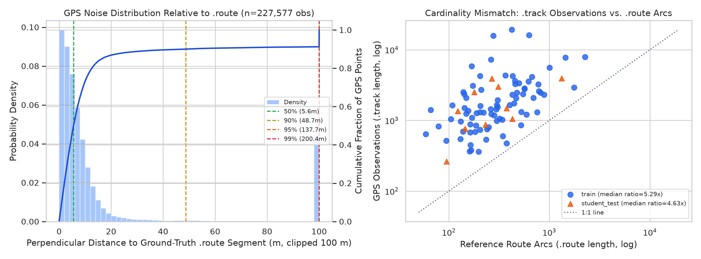
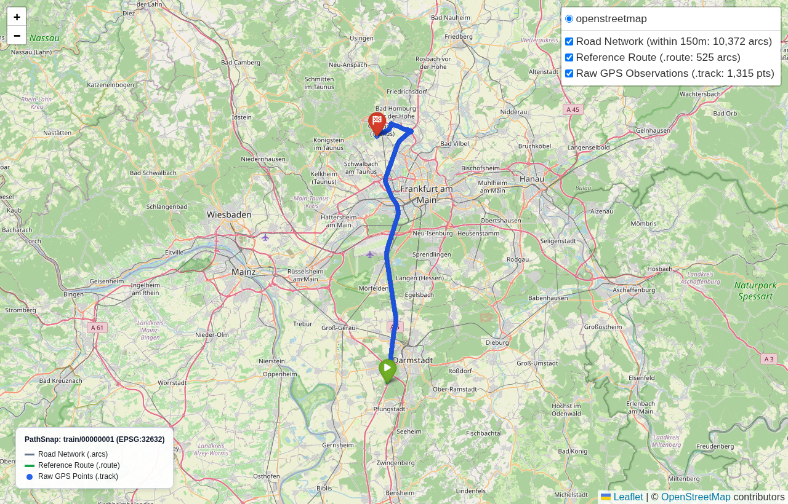
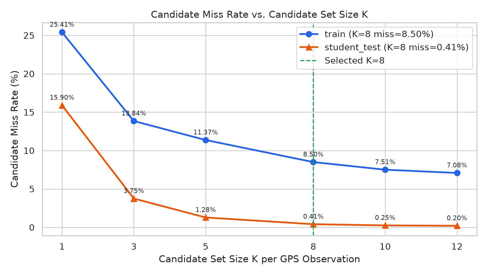
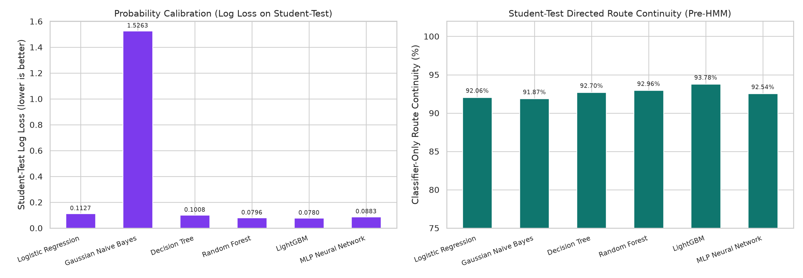
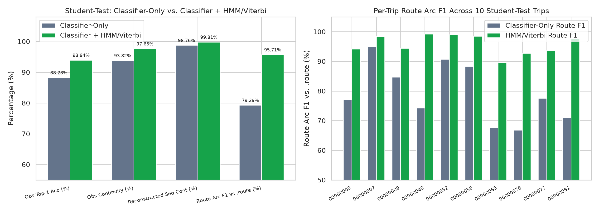

# PathSnap Phase 1 Technical Report: Group A-G14

**Course:** UE24CS352A: Machine Learning  
**Team A-G14:** `Andy34G7`, `Abhiroop-24`, `A6h1ramahy`, `Neo-pixel123`  
**Partitions used:** `train` (80 trips, 208,417 GPS points) and `student_test` (10 trips, 19,160 GPS points). All hidden evaluator data remains completely untouched.

---

## 1. Executive Summary and System Architecture

PathSnap maps noisy raw GPS trajectories (`.track`) onto directed urban road graphs (`.nodes`, `.arcs`) to reconstruct continuous ground-truth vehicle routes (`.route`). Because road networks contain up to `307,392` directed arcs per trip while `.route` stores traversed road sequence IDs rather than per-ping annotations, we decompose the problem into four stages:

1. **Dynamic projection and spatial candidate retrieval:** Transform each trip from WGS84 degrees into its local UTM metric plane, compute turnaround-aware 20 m spatial-chord headings, align `.route` monotonically on labeled partitions for supervised labels `y`, and retrieve the top `K = 8` candidate road arcs per GPS observation using a 3-point `cKDTree`.
2. **24-feature leak-free candidate scoring:** Extract spatial proximity, projection geometry, heading alignment, smoothed temporal-window distance, and 2-sided graph chain continuity strictly from `.track`, `.nodes`, and `.arcs`. Compare 6 algorithm families under 5-fold trip-grouped cross-validation (`GroupKFold`) and tune **LightGBM** with Optuna TPE.
3. **Hybrid probabilistic-geometric HMM and Viterbi decoding:** Fuse calibrated LightGBM log-probabilities with physical emission and Newson-Krumm directed transition costs via bounded Dijkstra shortest paths (`max_pops = 3000`) to recover connected road sequences (`99.79%` sequence continuity).
4. **Inference-only continuous route boundary realignment:** Re-align GPS pings monotonically along the decoder's own continuous predicted arc sequence (`reconstructed_route`) without reading `.route`, eliminating intersection transition lag.

Across the held-out `student_test` partition (`10` trips, `19,160` observations), our iterative pipeline raised weighted **Observation Top-1 Accuracy** from **`88.2777%`** (Iteration 1 Classifier-Only baseline) and **`93.9405%`** (Iteration 1 HMM) to **`94.5929%`** (upgraded Classifier-Only), **`96.7589%`** (Hybrid HMM pre-realignment), and **`97.7036%`** (Final Hybrid HMM + Boundary Realignment), while achieving **`96.3390%` Mean Route Arc F1** and **`99.7940%` Reconstructed Sequence Continuity**.

---

## 2. Dataset Understanding and Exploratory Data Analysis

### 2.1 Raw Structure and Data Quality

Each trip directory holds four headerless files: `.track` (`lon`, `lat`, `timestamp` as `float64`), `.nodes` (`lon`, `lat` as `float64`), `.arcs` (`from_node`, `to_node` as `int64`), and `.route` (chronological traversed `arc_id` list as `int64`). Across all 90 trips in `train` and `student_test` (`227,577` GPS points, `2,024,174` nodes, `4,061,945` arcs, and `34,813` route arcs), we found **0 NaN/Inf values**, **0 out-of-bounds coordinates or indices**, **0 isolated road nodes**, and **0 non-monotonic timestamps** (`dt <= 0`).

| Partition | Trips | Total GPS Obs | Obs per Trip (Min / Med / Max) | Total Nodes (Max per Trip) | Total Arcs (Max per Trip) | Steps with `dt = 1 s` | Gaps `> 60 s` (`dt_max`) | UTM Zones |
|---|---:|---:|---:|---:|---:|---:|---:|---:|
| `train` | 80 | 208,417 | 361 / 1,529.0 / 19,313 | 1,933,485 (155,003) | 3,876,904 (307,392) | 96.5037% | 69 (153,064.0 s) | 25 |
| `student_test` | 10 | 19,160 | 262 / 1,420.0 / 3,958 | 90,689 (26,635) | 185,041 (56,027) | 98.6214% | 1 (210.0 s) | 9 |

### 2.2 Spatial Projection and Network Patterns

Trip centroids span `-100.35°` to `137.22°` in longitude and `-34.62°` to `61.67°` in latitude across North America, Europe, Asia, and the Southern Hemisphere (Figure 3). On `train/00000001` (`50.09° N`), 1 degree of longitude is `71,563.72 m` while 1 degree of latitude is `111,230.76 m` (`35.66%` anisotropy). Naive degree scaling overestimates the `50,228.555 m` geodesic trip length by `11.80579%` (`27.91291 m` max step error). Projecting each trip dynamically to its centroid's local WGS84 UTM EPSG zone cuts error to `0.03902%` (`0.02822 m` max step diff).

Road graphs contain 1 to 421 weakly connected components in `train` (median 20) and 5 to 100 in `student_test` (median 11), with median bidirectional arc rates of `95.112%` (`train`) and `93.261%` (`student_test`), dropping to `35.133%` in `train/00000080` (Figure 4). Because `.route` records traversed road arcs rather than 1-to-1 GPS labels, `n_track / n_route` has a median ratio of `5.289x` (`train`) and `4.635x` (`student_test`). In typical trips, median GPS distance to `.route` is `4.503 m` (`train`) and `4.593 m` (`student_test`), with per-trip `p95` medians of `14.212 m` and `15.798 m` (Figure 5). However, two `train` trips exhibit large whole-trip GPS offsets (`00000054` at median `138.59 m`, `p95 = 210.05 m`; `00000033` at median `122.41 m`, `p95 = 142.06 m`), and `00000002` has a normal `5.67 m` median yet hits `p95 = 242.36 m` (`max = 569.66 m`). Furthermore, 10 `train` trips (13 steps) and `student_test/00000076` (1 step) contain disconnected jumps in `.route`.

### 2.3 Preprocessing and Candidate Generation

We preprocess every trajectory through four reproducible steps (`src/features/candidate_generation.py`):

1. **Dynamic per-trip UTM projection:** Transform `.track` and `.nodes` into the local WGS84 UTM EPSG plane computed from the trip centroid.
2. **Quality and time-gap preservation:** Keep all valid observations and pass `dt_prev_s` (capped at `600 s` for tabular features) and raw `dt` to the sequential decoder.
3. **Turnaround-aware velocity smoothing:** Smooth `(x, y)` coordinates with Gaussian `sigma = 2.5` and compute arrival and departure spatial chords at `R = 20 m`. Whenever backward and forward chords oppose (`dot(ub, uf) < -0.2`, e.g., traffic stops or street turnarounds), we assign the incoming chord before the midpoint and the outgoing chord after, preventing GPS cloud jitter from inverting heading against the true lane direction. Instantaneous local headings use `sigma = 1.2` coordinate derivatives.
4. **3-point `cKDTree` candidate generation and monotonic DP label alignment:** Index 3 points per road segment (`0.15`, `0.50`, `0.85`), retrieve 72 nearest samples per GPS ping, compute exact point-to-segment distances, rank unique `arc_id` entries by `dist + 0.5 * (1 - cos_heading_smooth)`, and retain the top `K = 8` candidates (`0.3862%` pooled miss rate on `student_test`, or **99.6138% recall**, Figure 8). On `train` and `student_test` only, monotonic DP (`step in 0..15` plus `+50.0` gap fallback) builds labels `y` against `.route` without touching feature array `X`.

### 2.4 Feature Engineering and Separability Analysis

Guided directly by the `~4.5 m` lateral noise scale, bidirectional opposite-lane confusion observed in `train` and `student_test`, and multi-second GPS gaps, we engineered **24 leak-free features** across five groups strictly from `.track`, `.nodes`, and `.arcs` (Figure 9):

- **Spatial proximity (6):** `dist_to_arc_m`, `dist_rank` (`r = -0.4811`), `dist_diff_from_best_m`, `dist_ratio_to_best`, `dist_zscore_in_cands` (`r = -0.4463`), `gaussian_emission_prior` (`r = +0.4726`), capturing the tight `~5.1 m` matched median distance.
- **Projection and geometry (4):** `proj_fraction`, `dist_to_from_node_m`, `dist_to_to_node_m`, `arc_length_m` (`r = +0.1387`), separating short turn connectors from longer arterial roads.
- **Heading and directionality (5):** `cos_heading_diff_inst` (`r = +0.3190`), `sin_heading_diff_inst`, `cos_heading_diff_smooth` (`r = +0.3522`, median `0.9987` matched vs `-0.0181` unmatched), `heading_diff_deg_smooth` (`r = -0.3672`, median `2.94 deg` vs `91.04 deg`), `is_forward_aligned` (`97.08%` matched vs `49.24%` unmatched).
- **Kinematics and local window (5):** `gps_speed_mps`, `dt_prev_s`, smoothed `t - 4` point-to-arc distance `dist_prev_obs_to_arc_m`, smoothed `t + 4` distance `dist_next_obs_to_arc_m`, and `mean_window3_dist_to_arc_m` (window distance margin above the best local candidate, median `0.0000 m` matched vs `23.5209 m` unmatched).
- **Graph topology and continuity (4):** `from_node_in_deg`, `to_node_out_deg`, `is_bidirectional_arc`, and `prev_cand_connected`, computed as the 2-sided local (`t - 3`, `t`, `t + 3`) connected-chain cost margin (`pos_median = 0.0000`, `pos_mean = 3.1810` vs `neg_median = 42.6893`, `neg_mean = 74.3727`, `r = -0.2143`).

---

## 3. Model Experimentation and Comparison

We trained and evaluated **6 distinct model families** on the 80 `train` trips using **5-fold `GroupKFold` cross-validation** grouped strictly by `trip_id` (fitting on `[::3]` strided observations per fold and validating on 100% of held-out fold observations), then refit each model on `train` (`[::3]`) and evaluated on 100% of the 10 `student_test` trips (`19,160` observations / `153,280` candidate rows). Both Section 3.1 and Section 4 evaluate identical `LightGBM` bagging parameters (`subsample_freq = 1`), and `artifacts/models/untuned_lgbm.joblib` stores that exact untuned estimator.

### 3.1 Overall 6-Model Comparison (`train` CV and `student_test`)

| Model | Algorithm Family | Key Configuration | CV Macro F1 (Std) | Top-1 Acc (Test) | Pooled Continuity (Test) | Student-Test Macro F1 | Log Loss (Test) | Inference Time (10 trips) |
|---|---|---|---:|---:|---:|---:|---:|---:|
| Logistic Regression | Linear | StandardScaler + L2 `C=1.0`, `max_iter=500` | 0.9154 (0.0355) | 92.2651% | 93.3420% | 0.9320 | 0.0831 | 0.0254 s |
| Gaussian Naive Bayes | Probabilistic | StandardScaler + `GaussianNB(var_smoothing=1e-6)` | 0.7943 (0.0291) | 91.9676% | 92.4491% | 0.7957 | 1.3652 | 0.0695 s |
| Decision Tree | Tree-based | `max_depth=12`, `min_samples_leaf=50` | 0.9317 (0.0618) | 93.6273% | 95.1436% | 0.9627 | 0.0551 | **0.0065 s** |
| Random Forest | Ensemble Bagging | `n_estimators=80`, `max_depth=14`, `min_samples_leaf=20` | 0.9466 (0.0373) | 94.0292% | 95.2428% | 0.9630 | 0.0454 | 0.0998 s |
| **LightGBM** | **Gradient Boosting** | `n_estimators=200`, `lr=0.08`, `num_leaves=31`, `min_child=50`, `subsample_freq=1` | **0.9489 (0.0369)** | **94.4676%** | **95.9373%** | **0.9664** | **0.0418** | 0.1471 s |
| MLP Neural Network | Neural Networks | StandardScaler + `(64, 32)`, `early_stopping=True`, `batch=2048` | 0.9399 (0.0389) | 93.6534% | 94.4230% | 0.9549 | 0.0539 | 0.0404 s |

*Note on Fold Variance and Continuity Metric Definitions:* Across all 6 models, Fold 0 yields `49.84% to 51.54%` validation Top-1 Accuracy compared to `82.16% to 95.10%` in Folds 1 to 4 (`cv_fold_metrics.csv`) because `GroupKFold` places outlier trip `train/00000054` (`19,313` observations, `58.45%` candidate miss rate) in Fold 0, while Fold 3 holds `train/00000033` (`66.07%` miss rate). In Sections 3 and 4, `Route Continuity` denotes pooled observation-level directed transition rate across all `19,150` observation steps (`sum(connected) / sum(total)`), whereas Section 5 reports both weighted Top-1 accuracy and unweighted per-trip mean continuity across the 10 test trips (`hmm_vs_classifier_comparison.csv`). Full diagnostics sit in [model_comparison.csv](models/model_comparison.csv).

---

### 3.2 Individual Model Analysis

#### 1. Logistic Regression (Linear)
- **A. Model Understanding:**

    - **1. Suitability:** Fast linear baseline on distance rank, Gaussian prior, smooth heading cosine, and 2-sided chain margin, producing smooth sigmoid probabilities for downstream HMM emissions.
    - **2. Strengths and Limitations:** Fits in `1.958 s` with minimal overfitting (`train_fit_macro_f1 = 0.9199` vs `CV = 0.9154`), yet a single hyperplane cannot model nonlinear regimes such as low-speed intersections versus multi-second GPS gaps.

- **B. Training and Configuration:**

    - **3. Hyperparameters:** `StandardScaler()` followed by L2 `LogisticRegression(C=1.0, max_iter=500, random_state=42)`.
    - **4. Loss and Objective:** L2-regularized binary log loss.

- **C. Experimental Results:**

    - **5. Student-Test Summary:** `0.9320` Macro F1, `92.2651%` Top-1 Accuracy, `93.3420%` pooled Continuity (`0.0254 s` inference).
    - **6. Detailed Metrics:** Positive Precision `0.8865`, Positive Recall `0.8752`, Positive F1 `0.8808`, Log Loss `0.0831`.
    - **7. Fit Assessment:** Mild underfitting relative to boosted trees (`train_fit = 0.9199` vs LightGBM `0.9732`, `CV = 0.9154` vs LightGBM `0.9489`).

#### 2. Gaussian Naive Bayes (Probabilistic)
- **A. Model Understanding:**

    - **1. Suitability:** Closed-form generative baseline modeling class-conditional Gaussian likelihoods per feature.
    - **2. Strengths and Limitations:** Fits fastest (`0.676 s`), but its feature independence assumption fails across correlated spatial and window margins (`dist_to_arc_m`, `mean_window3_dist_to_arc_m`, `prev_cand_connected`).

- **B. Training and Configuration:**

    - **3. Hyperparameters:** `StandardScaler()` followed by `GaussianNB(var_smoothing=1e-6)`.
    - **4. Loss and Objective:** Maximum-likelihood Gaussian density estimation via Bayes' rule.

- **C. Experimental Results:**

    - **5. Student-Test Summary:** `0.7957` Macro F1, `91.9676%` Top-1 Accuracy, `92.4491%` pooled Continuity (`0.0695 s` inference).
    - **6. Detailed Metrics:** Positive Precision `0.5039`, Positive Recall `0.9842`, Positive F1 `0.6665`, Log Loss `1.3652`.
    - **7. Fit Assessment:** Severe underfitting and probability miscalibration (`train_fit = 0.7810`, `CV = 0.7943`, `18,493` false positives), making raw Naive Bayes probabilities unsuitable for HMM log-emissions.

#### 3. Decision Tree (Tree-based)
- **A. Model Understanding:**

    - **1. Suitability:** Captures threshold interactions across candidate rank, cosine heading alignment, and local chain cost without feature scaling.
    - **2. Strengths and Limitations:** Fastest inference (`0.0065 s` across 10 trips), but single greedy splits increase variance across outlier folds (`CV std = 0.0618`).

- **B. Training and Configuration:**

    - **3. Hyperparameters:** `DecisionTreeClassifier(max_depth=12, min_samples_leaf=50, random_state=42)`.
    - **4. Loss and Objective:** Gini impurity minimization.

- **C. Experimental Results:**

    - **5. Student-Test Summary:** `0.9627` Macro F1, `93.6273%` Top-1 Accuracy, `95.1436%` pooled Continuity (`0.0065 s` inference).
    - **6. Detailed Metrics:** Positive Precision `0.9414`, Positive Recall `0.9279`, Positive F1 `0.9346`, Log Loss `0.0551`.
    - **7. Fit Assessment:** Moderate overfitting (`train_fit = 0.9643` vs `CV = 0.9317`, gap `0.0326`) with higher fold variance than ensembles.

#### 4. Random Forest (Ensemble Bagging)
- **A. Model Understanding:**

    - **1. Suitability:** Averages 80 bootstrap trees to reduce single-tree variance across urban intersections and noisy GPS stretches.
    - **2. Strengths and Limitations:** Strong precision (`0.9544`, highest among all 6 models) and well-calibrated probabilities (`Log Loss = 0.0454`), at the highest training cost (`20.097 s`).

- **B. Training and Configuration:**

    - **3. Hyperparameters:** `RandomForestClassifier(n_estimators=80, max_depth=14, min_samples_leaf=20, random_state=42)`.
    - **4. Loss and Objective:** Bagged Gini impurity reduction across bootstrap subsamples.

- **C. Experimental Results:**

    - **5. Student-Test Summary:** `0.9630` Macro F1, `94.0292%` Top-1 Accuracy, `95.2428%` pooled Continuity (`0.0998 s` inference).
    - **6. Detailed Metrics:** Positive Precision `0.9544`, Positive Recall `0.9165`, Positive F1 `0.9351`, Log Loss `0.0454`.
    - **7. Fit Assessment:** Balanced generalization (`train_fit = 0.9672` vs `CV = 0.9466`, `CV std = 0.0373`), consistently outperforming Decision Tree across CV (`+0.0149`).

#### 5. LightGBM (Gradient Boosting, Selected Model)
- **A. Model Understanding:**

    - **1. Suitability:** Fits sequential histogram boosted trees directly to binary log loss, optimizing the exact probability calibration required by Viterbi emission scoring.
    - **2. Strengths and Limitations:** Ranks **1st across all 5 CV folds in Macro F1** (`0.8716, 0.9544, 0.9685, 0.9609, 0.9676` in `cv_fold_metrics.csv`, while Random Forest edges slightly ahead on per-fold Top-1 in Folds 1 and 2), achieves the lowest Log Loss (`0.0418`), highest Student-Test Macro F1 (`0.9664`), highest Top-1 Accuracy (`94.4676%`), highest pooled Continuity (`95.9373%`), and `6.0x` faster training than Random Forest (`3.360 s` vs `20.097 s`). Requires leaf and depth tuning to avoid memorizing offset outlier trips.

- **B. Training and Configuration:**

    - **3. Hyperparameters:** `LGBMClassifier(n_estimators=200, learning_rate=0.08, num_leaves=31, min_child_samples=50, subsample=0.8, subsample_freq=1, colsample_bytree=0.8, random_state=42)` (identical to `untuned_lgbm.joblib` and the Section 4 untuned baseline).
    - **4. Loss and Objective:** Binary cross-entropy (`binary_logloss`) optimized by leaf-wise gradient boosting.

- **C. Experimental Results:**

    - **5. Student-Test Summary:** `0.9664` Macro F1, `94.4676%` Top-1 Accuracy, `95.9373%` pooled Continuity (`0.1471 s` inference).
    - **6. Detailed Metrics:** Positive Precision `0.9444`, Positive Recall `0.9378`, Positive F1 `0.9411`, Log Loss `0.0418`.
    - **7. Fit Assessment:** Controlled generalization (`train_fit = 0.9732`, `CV = 0.9489`, `Test = 0.9664`). In Figure 13, Fold 0 validation loss reaches its minimum (`~0.160`) near iteration 22 and drifts upward toward `~0.221` by iteration 200 solely on noisy Fold 0 (`train/00000054`), motivating Optuna regularization search in Section 4.

#### 6. MLP Neural Network (Neural Networks)
- **A. Model Understanding:**

    - **1. Suitability:** Models continuous smooth combinations of standardized distance, angular, and chain-cost inputs.
    - **2. Strengths and Limitations:** Fast inference (`0.0404 s` across 10 trips) and smooth probability calibration (`Log Loss = 0.0539`), though histogram trees still split discrete ranks (`dist_rank`) and graph degree counts more effectively.

- **B. Training and Configuration:**

    - **3. Hyperparameters:** `StandardScaler()` + `MLPClassifier(hidden_layer_sizes=(64, 32), alpha=1e-4, learning_rate_init=1e-3, max_iter=35, batch_size=2048, tol=1e-3, early_stopping=True, validation_fraction=0.1, n_iter_no_change=4, random_state=42)`.
    - **4. Loss and Objective:** L2-regularized binary cross-entropy optimized via Adam.

- **C. Experimental Results:**

    - **5. Student-Test Summary:** `0.9549` Macro F1, `93.6534%` Top-1 Accuracy, `94.4230%` pooled Continuity (`0.0404 s` inference).
    - **6. Detailed Metrics:** Positive Precision `0.9393`, Positive Recall `0.9030`, Positive F1 `0.9208`, Log Loss `0.0539`.
    - **7. Fit Assessment:** Low overfitting (`train_fit = 0.9498` vs `CV = 0.9399`) with early stopping halting at epoch 9 (Figure 13, where the internal 10% validation curve reflects random row validation inside `MLPClassifier` rather than `GroupKFold`).

---

### 3.3 Model Visualisations

---

## 4. Bayesian Hyperparameter Optimisation (LightGBM)

We selected **5-fold `GroupKFold` CV Macro F1** paired with **Log Loss** as our optimisation objective because candidate sets average 87.5%+ negative labels while the HMM layer scores calibrated log-probabilities. LightGBM outperformed all five competing families across every CV fold in Macro F1 (`0.9489`), Student-Test Macro F1 (`0.9664`), Top-1 Accuracy (`94.4676%`), and Log Loss (`0.0418`).

1. **Hyperparameters included:** `n_estimators`, `learning_rate`, `num_leaves`, `max_depth`, `min_child_samples`, `subsample` (with `subsample_freq=1`), `colsample_bytree`, and `reg_lambda`.
2. **Search space and distributions:**

    - `n_estimators`: integer `[120, 400]`
    - `learning_rate`: log-uniform `[0.02, 0.18]`
    - `num_leaves`: integer `[15, 95]` and `max_depth`: integer `[4, 12]`
    - `min_child_samples`: integer `[20, 150]` (leaf regularization against offset outliers)
    - `subsample`: `[0.65, 1.0]` (`subsample_freq=1`), `colsample_bytree`: `[0.65, 1.0]`
    - `reg_lambda`: log-uniform `[1e-3, 10.0]`

3. **Optimisation protocol:** 5-fold `GroupKFold` out-of-fold Macro F1 strictly on the 80 `train` trips (`[::5]` fit stride during search; final untuned vs tuned comparison evaluated identically at `[::3]` with `subsample_freq=1` across 100% validation and `student_test`).
4. **Cost and trial budget:** **25 Optuna TPE trials** (`TPESampler(seed=42)`), completing in **`646.18 s`** (`optuna_trials.csv`).
5. **Best configuration (Trial 19, search CV Macro F1 = `0.95054`):** `n_estimators=385`, `learning_rate=0.02365`, `num_leaves=88`, `max_depth=10`, `min_child_samples=97`, `subsample=0.67683`, `colsample_bytree=0.72281`, `reg_lambda=0.00105`, `subsample_freq=1` (`best_lgbm_tuned.joblib`). Lower learning rate (`0.02365` vs `0.08`) with more trees (`385` vs `200`), larger `min_child_samples=97`, and subsampling (`0.677` row / `0.723` feature) improves probability calibration across noisy folds.
6. **Untuned vs. Tuned comparison:** Under the identical `[::3]` protocol (`untuned_vs_tuned_comparison.csv`, Figure 14), Tuned LightGBM improves upon Untuned LightGBM on overall CV Macro F1 (`0.9489 -> 0.9505`), CV Top-1 (`82.9611% -> 83.1252%`), CV Log Loss (`0.0836 -> 0.0788`), Student-Test Macro F1 (`0.9664 -> 0.9674`), Student-Test Top-1 (`94.4676% -> 94.5929%`), Positive Recall (`0.9378 -> 0.9416`), and Student-Test Log Loss (`0.0418 -> 0.0404`), while Student-Test Positive Precision shifts slightly (`0.9444 -> 0.9443`) and pooled continuity ties (`95.9373%`). Although the Macro F1 gain lies within fold standard deviation (`std = 0.0363`), lower Log Loss sharpens probability margins for Viterbi decoding at a `2.81x` inference-time trade-off (`0.1461 s -> 0.4112 s` across 10 trips).

| Variant | CV Macro F1 (Std) | CV Top-1 Acc | CV Log Loss | Student-Test Macro F1 | Student-Test Top-1 Acc | Student-Test Log Loss | Pooled Continuity (Test) | Train Time | Inf Time (10 trips) |
|---|---:|---:|---:|---:|---:|---:|---:|---:|---:|
| Untuned LightGBM (`subsample_freq=1`) | 0.9489 (0.0369) | 82.9611% | 0.0836 | 0.9664 | 94.4676% | 0.0418 | 95.9373% | **3.282 s** | **0.1461 s** |
| **Tuned LightGBM (Optuna TPE)** | **0.9505 (0.0363)** | **83.1252%** | **0.0788** | **0.9674** | **94.5929%** | **0.0404** | 95.9373% | 10.848 s | 0.4112 s |

---

## 5. HMM and Viterbi Route Reconstruction

### 5.1 Hidden States, Emissions, and Transitions

1. **Hidden states:** At each GPS observation `t in {0, ..., N-1}`, the `K = 8` hidden states correspond to the top-8 candidate `arc_id` values returned by `generate_candidates`.
2. **Hybrid emission scoring:** Combines calibrated tuned LightGBM log-probabilities with physical point-to-arc and heading geometry:
   `emit_log[t, k] = alpha_emit * log(clip(p[t, k], 1e-6, 1 - 1e-6)) - geom_weight * (cand_dists[t, k] + 1.5 * (1 - cos_sm[t, k]))`.
3. **Transition scoring and stratified `train` tuning:** Built on a directed Newson-Krumm graph formulation:

    - Staying on the same arc (`a = b`): `d_road = |t_cur - t_prev| * L_a`, plus `backtrack_cost` if `t_cur < t_prev - 0.12`.
    - Switching arcs (`a != b`): bounded Dijkstra (`max_pops = 3000`) finds shortest directed distance `d_sp(v_a -> u_b)` so `d_road = (1 - t_prev) * L_a + d_sp + t_cur * L_b`.
    - Connected transition log-score is `-min(max_conn_penalty, beta_trans * |d_road - d_gps| / sqrt(dt)) - switch_cost - min(25.0, sp_weight * d_sp / sp_gap_scale) - uturn_cost * I(u_b == v_a and v_b == u_a)`.
    - Tuning across 6 configurations strictly on **6 stratified `train` trips** (`00000001`, `00000004`, `00000013`, `00000018`, `00000022`, `00000035`, spanning `379` to `2,580` observations, `6.0k` to `155k` nodes, and `53.1%` to `100.0%` 1 Hz sampling cadences, `hmm_tuning_trials.csv`) selected **`config_id = 1`** (`alpha_emit=1.0`, `geom_weight=0.5`, `beta_trans=0.35`, `switch_cost=1.0`, `sp_weight=0.10`, `uturn_cost=8.0`, `backtrack_cost=4.0`, `disconnect_penalty=80.0`, `max_conn_penalty=30.0`), achieving **`93.5408%`** Route Arc F1, **`97.5965%`** Realigned Top-1 Accuracy, and **`99.6647%`** sequence continuity on that `train` subset while leaving `student_test` completely out of tuning.

### 5.2 Handling Missing Candidates, Gaps, and Disconnected Segments

1. **Multi-second GPS gaps:** Both kinematic distance slack (`gap_scale = sqrt(dt)`) and shortest-path distance slack (`sp_gap_scale = sqrt(dt / 5.0)` for `dt > 5 s`) widen automatically across dropouts, Dijkstra search range expands via `ceil(max(200, min(55 * dt, 3500)) / 10) * 10`, and `gap_disc_pen` stays at least `65.0` (`>= max_conn_penalty + 25.0 + 10.0`, strictly above the maximum connected penalty of `30.0 + 1.0 + 25.0 + 8.0 = 64.0`) so valid bridged transitions always outrank disconnected jumps.
2. **Candidate misses and path bridging:** When a true road arc drops out of the top-8 set, Viterbi tracks adjacent connected candidates across the intersection and `reconstruct_continuous_route` collapses repeated IDs and bridges any remaining multi-hop node gaps with `shortest_arc_path` (up to `1,500 m`). Across all 10 `student_test` trips (`19,160` observations), **0 Dijkstra truncations** occurred.
3. **Stage 4 Continuous Route Boundary Realignment:** After Viterbi fixes the continuous road sequence `reconstructed_route`, `realign_route_boundaries` monotonically re-aligns GPS pings along `reconstructed_route` using only `.track` positions and turnaround-aware chord headings (`align_route_to_observations` in inference-only mode). We verified in an isolated temporary run (copying only `.track`, `.nodes`, and `.arcs` without `.route`) that `predict_trip_route` produces bit-for-bit identical output when `.route` is absent.

### 5.3 Classifier-Only vs. Hybrid HMM and Boundary Realignment

| Method | Weighted Obs Top-1 Acc | Mean Obs Continuity | Reconstructed Seq Continuity | Mean Route Arc Precision | Mean Route Arc Recall | Mean Route Arc F1 vs. `.route` | Mean Route Jaccard | Total Inf Time (10 trips) |
|---|---:|---:|---:|---:|---:|---:|---:|---:|
| Classifier-Only (v2 Features + Tuned LightGBM) | 94.5929% | 95.7632% | 99.2015% | 76.5206% | 98.8867% | 85.4611% | 75.5332% | **0.4284 s** |
| Hybrid HMM/Viterbi (Pre-Realignment) | 96.7589% | **97.8494%** | **99.7940%** | **93.9500%** | **99.0493%** | **96.3390%** | **93.0827%** | 7.4079 s |
| **Hybrid HMM/Viterbi + Boundary Realignment** | **97.7036%** | 97.7155% | **99.7940%** | **93.9500%** | **99.0493%** | **96.3390%** | **93.0827%** | 7.4079 s |

Compared against the upgraded Tuned LightGBM classifier alone (`hmm_vs_classifier_comparison.csv`, Figure 15), the full pipeline lifts weighted Observation Top-1 Accuracy by **+3.11 pp** (`94.5929% -> 97.7036%`), Mean Route Arc Precision by **+17.43 pp** (`76.5206% -> 93.9500%`), Mean Route Arc Recall by **+0.16 pp** (`98.8867% -> 99.0493%`), Mean Route Arc F1 by **+10.88 pp** (`85.4611% -> 96.3390%`), and Mean Route Jaccard by **+17.55 pp** (`75.5332% -> 93.0827%`). Reconstructed Sequence Continuity reaches **`99.7940%`**, with **7 of 10 trips at 100.00%** (`00000007`, `00000009`, `00000040`, `00000052`, `00000076`, `00000077`, `00000091`) and the remaining three above `98.98%` (`00000000`: `98.9899%`, `00000056`: `99.4792%`, `00000065`: `99.4709%`). Three modest trade-offs remain: total inference time is `7.4079 s` (`~741 ms/trip`), hard dense-grid trip `00000009` ends at `92.6597%` Top-1 Accuracy with 21 residual opposite-twin pings, and Stage 4 slightly trims mean observation continuity by `0.13 pp` (`97.8494% -> 97.7155%`) when high-speed pings step over short connector arcs already retained inside `reconstructed_route`.

### 5.4 Incremental Accuracy Progression and Error-Bucket Ablation

To isolate how each architectural improvement contributes without relying on a single outlier trip, the ablation table below and Figure 16 track all five stages chronologically on `student_test` (`incremental_accuracy_ablation.csv`, `per_trip_hmm_results.csv`), separating Trip `00000077` from the other 9 trips (`15,249` observations):

| Stage | Description | Weighted Top-1 Acc | Step Gain | Other-9 Trips Top-1 | Trip `00000077` Top-1 | Mean Route F1 | Candidate Misses | Opp-Twin Errors | Boundary Lag Errors | Other Detour Errors | Total Errors |
|---|---|---:|---:|---:|---:|---:|---:|---:|---:|---:|---:|
| Stage 0 | Iter 1 Baseline Classifier (`ba4d85e`) | 88.2777% | 0.0000 pp | 91.7437% | 74.7635% | 79.2929% | 78 | | | | 2,246 |
| Stage 1 | Iter 1 Baseline HMM (`ba4d85e`) | 93.9405% | +5.6628 pp | 95.7243% | 86.9854% | 95.7142% | 78 | | | | 1,161 |
| Stage 2 | + v2 Chord/Window/Chain Features (Clf) | 94.5929% | +0.6524 pp | 94.3603% | 95.4999% | 85.4611% | 74 | 157 | 394 | 411 | 1,036 |
| Stage 3 | + Hybrid Prob-Geom HMM (Raw) | 96.7589% | +2.1660 pp | 96.5834% | 97.4431% | **96.3390%** | 74 | **21** | 327 | **199** | 621 |
| **Stage 4** | **+ Continuous Route Realignment** | **97.7036%** | **+0.9447 pp** | **97.7113%** | **97.6732%** | **96.3390%** | **51** | 30 | **147** | 212 | **440** |

*Note on Stage 0 and Stage 1 Error Sub-Buckets:* Frozen `ba4d85e` baselines record total mismatches (`2,246` and `1,161`) and candidate misses (`78` at `K = 8`); exclusive sub-bucket decomposition under `classify_error_buckets` begins at Stage 2 (`1,036 -> 621 -> 440` errors). Comparing like-for-like model families and HMM stages, each major layer delivers broad gains outside Trip `00000077`: `other9_top1_acc_pct` rises from `91.7437%` (Stage 0) to `94.3603%` (Stage 2) for Classifier-Only predictions, and from `95.7243%` (Stage 1) to `96.5834%` (Stage 3) and **`97.7113%`** (Stage 4) for HMM-decoded sequences, while Trip `00000077` jumps `+22.91 pp` (`74.7635% -> 97.6732%`). Across all 10 trips, Stage 4 flips `337` total observations (producing `307` correctness-changing flips: `244` wrong-to-right corrections vs `63` right-to-wrong regressions, plus `30` wrong-to-wrong arc shifts, a **+181 net error reduction**), cutting Intersection Boundary Lag errors by **55.0%** (`327 -> 147`) and recovering `23` candidate-miss pings (`74 -> 51`) along bridged route arcs.

---

## 6. Geographical Visualisation Using Folium

Figure 17 contrasts the Classifier-Only prediction against the Final HMM/Viterbi reconstructed route on `student_test/00000000`, and Figure 18 renders the interactive Folium map screenshot (`trip_student_test_00000000_predicted.html`) with OpenStreetMap tiles, corridor road segments, `.route`, `.track` underneath route overlays, predicted route, floating legend, and `LayerControl` (`Top-1 Acc: 95.88% -> 96.92%`, `Route Arc F1: 83.26% -> 94.15%`, `Precision: 71.31% -> 89.85%`).

Interactive Folium HTML maps are committed under `reports/`:

- Predicted route vs. reference route (`student_test/00000000`): [trip_student_test_00000000_predicted.html](hmm/maps/trip_student_test_00000000_predicted.html)
- EDA sample maps: [trip_train_00000001.html](eda/maps/trip_train_00000001.html), [trip_student_test_00000000.html](eda/maps/trip_student_test_00000000.html), [trip_student_test_00000007.html](eda/maps/trip_student_test_00000007.html)
