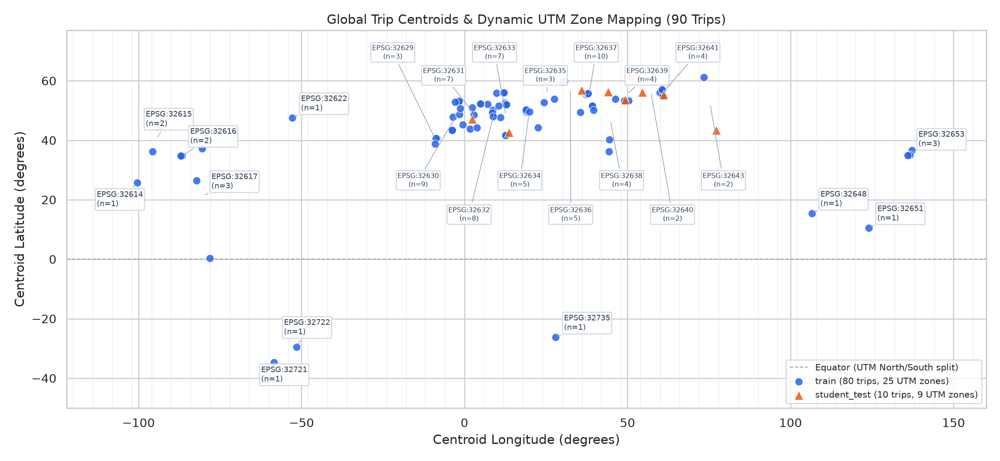
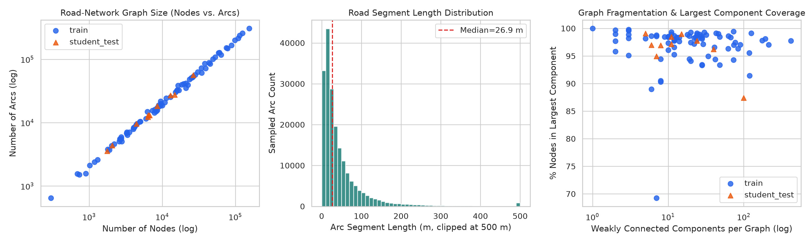
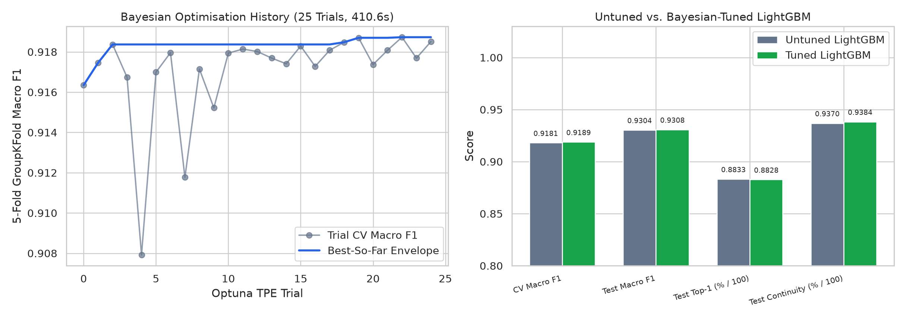
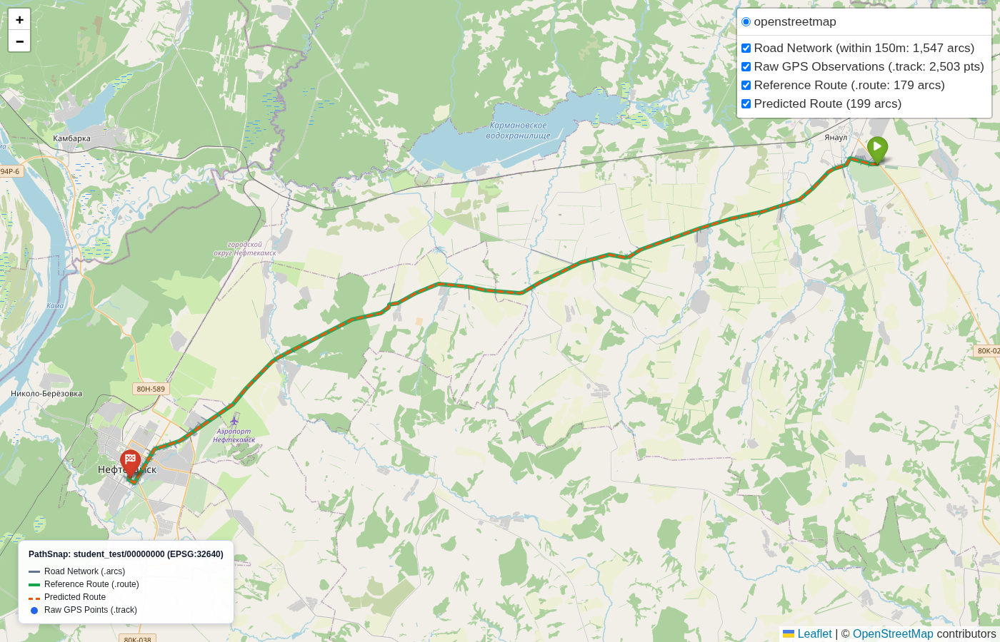
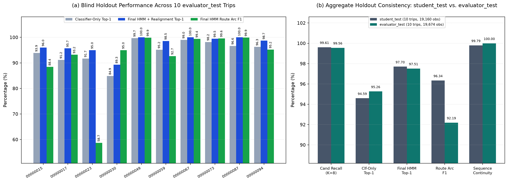

# PathSnap Technical Report: Group A-G14

**Course:** UE24CS352A Machine Learning  
**Team A-G14:** Andey Hemanth, Abhiroop, Abhirama H Y, Aman Rao U

---

## 1. Dataset Understanding and Exploratory Data Analysis

### 1.1 Data Preprocessing and Candidate Retrieval

Imagine tracking a vehicle driving through a city while its GPS receiver logs coordinates once a second. Those raw points rarely sit on the true road centerline because signal noise pulls positions sideways by several meters.

So why not just pick the closest road segment for every ping? Simple, right? On a two-way street or busy junction, snapping to the nearest arc fails right away. Parallel lanes sit almost on top of each other, so slight drift flips points into oncoming traffic or onto side streets. Every reference route in our data is also stored as an ordered list of road arcs rather than point labels.

Our development data covers 80 trips in `train` (208,417 points) and 10 trips in `student_test` (19,160 points), each packing raw GPS pings alongside a directed road graph. Ground-truth routes stay offline for training and local validation. Before building any features, we run four preprocessing steps purely on those GPS coordinates and road edges:

1. **Dynamic metric projection:** Each trip maps WGS84 coordinates into its local UTM meter plane, choosing the EPSG zone from the trip center. Working in metric meters avoids warped latitude and longitude degrees right from the start.
2. **Time-gap preservation:** Every valid GPS ping stays in temporal sequence. Tabular features cap elapsed time gaps at 600 s so extreme dropouts do not blow up feature scaling, while sequential decoding keeps exact durations intact.
3. **Turnaround-aware velocity smoothing:** Fixed five-point velocity windows break down when cars stop at traffic lights. Stationary jitter bounces back and forth, flipping the velocity vector backward into oncoming lanes. That single bug dragged baseline accuracy on `student_test` trip `00000077` down to 74.7635% (Section 4.4). To fix it, we smooth planar coordinates with a Gaussian filter (`sigma = 2.5`) and extend chords outward until displacement hits 20 m. Whenever arrival and departure chords oppose, incoming vectors govern points before the stop and outgoing vectors govern points after. On `train`, median matched heading error holds at 2.94 deg against 91.04 deg on false arcs, while instantaneous headings still use lighter `sigma = 1.2` derivatives.
4. **Three-point spatial indexing:** Highway segments stretch up to 9,357.6 m across our road graphs. Indexing only arc midpoints would miss valid matches near junctions. Instead, we sample three evenly spaced points per segment inside a spatial tree. Each ping queries 72 nearby samples and ranks unique roads by distance and heading offset to keep top `K = 8` candidates. As Figure 1 shows, `K = 8` cuts the `student_test` candidate miss rate to 0.3862% (99.6138% recall).

For supervised training only, monotonic dynamic programming (DP) aligns GPS points against ground-truth routes. Allowing 0 to 15 segment steps with a `+50.0` fallback penalty produces binary target labels (`y = 1` or `0`) without modifying input features.

### 1.2 Data Exploration and Visual Checks

Before tuning models, we audited data quality across all 90 trips in `train` and `student_test`. Together they contain 227,577 GPS observations across road graphs totaling 2,024,174 vertices and 4,061,945 directed edges (with 34,813 ground-truth route arcs).

Sanity checks came back clean. Every partition had zero missing values and zero invalid node indices. Timestamps also moved forward strictly across every trip (`dt > 0`). Table 1 breaks down sample scale and timing gaps per partition, while Figures 2 and 3 plot sampling intervals and trip lengths.

| Partition | Trips | Total GPS Obs | Obs per Trip (Min / Med / Max) | Total Nodes (Max per Trip) | Total Arcs (Max per Trip) | Steps with `dt = 1 s` | Gaps `> 60 s` (`dt_max`) | UTM Zones |
|---|---:|---:|---:|---:|---:|---:|---:|---:|
| `train` | 80 | 208,417 | 361 / 1,529.0 / 19,313 | 1,933,485 (155,003) | 3,876,904 (307,392) | 96.5037% | 69 (153,064.0 s) | 25 |
| `student_test` | 10 | 19,160 | 262 / 1,420.0 / 3,958 | 90,689 (26,635) | 185,041 (56,027) | 98.6214% | 1 (210.0 s) | 9 |

One quick check on global coordinates explains why local UTM projection is essential. Trip centroids span -100.35 deg to 137.22 deg longitude and -34.62 deg to 61.67 deg latitude across 25 UTM zones (Figure 4). Far from the equator, meridians converge fast. On `train` trip `00000001` near 50.09 deg N, one longitude degree spans only 71,563.7 m against 111,230.8 m per latitude degree. That 35.66% east-west squeeze makes raw degree distance overestimate total trip length by 11.81% (up to 27.91 m off per step). Local UTM projection shrinks that length error to 0.04%.

Looking past coordinates, graph connectivity and GPS noise reveal three big patterns across Figures 5 and 6:

- **Network fragmentation:** Road graphs split into 1 to 421 weakly connected components in `train` (median 20) and 5 to 100 in `student_test` (median 11). Most streets are bidirectional (95.112% median in `train`, dropping to 35.133% on trip `00000080`). Because vehicles spend multiple seconds driving along one road edge, GPS points outnumber route segments by 5.289x median in `train` (4.635x in `student_test`).
- **Lateral noise and outliers:** Ordinary trips track reference paths tightly, sitting at median offsets of 4.503 m (`train`) and 4.593 m (`student_test`) with `p95` medians near 15 m. Still, outliers exist. Two `train` trips suffer massive whole-trip shifts (`00000054` at 138.59 m median, `00000033` at 122.41 m). Trip `00000002` also holds a sustained excursion reaching 569.66 m (`p95 = 242.36 m`).
- **Route sequence breaks:** Ground-truth routes aren't always 100% contiguous either. Ten `train` trips contain disconnected hops (13 steps total), alongside one jump in `student_test` trip `00000076`.

To see those street quirks up close, Figures 7 and 8 show zoomed UTM trajectories alongside an interactive Folium map on `train` trip `00000001`.

### 1.3 Feature Extraction and Selection Rationale

Exploration gave us a clear target: ~4.5 m typical noise plus heavy two-way lane ambiguity. Using only GPS tracks and road geometry, we engineered 24 candidate features across five groups. Figure 9 shows how well those signals pull matched roads (`y = 1`) apart from wrong candidates (`y = 0`) on `train`:

- **Spatial proximity (6 features):** Perpendicular distance (5.12 m matched median vs. 33.42 m unmatched) and within-ping distance rank (target correlation `r = -0.4811`) give the strongest direct signal. Distance gap (`22.17 m` unmatched median) and ratio over the closest arc capture local dominance. A within-ping z-score (`r = -0.4463`) and 10 m Gaussian emission prior (`r = +0.4726`) then normalize tight matches across dense intersections.
- **Projection and geometry (4 features):** Segment projection fraction locates where each ping projects along a street, supported by distances to both endpoint vertices. Longer segments (94.45 m matched median vs. 51.94 m unmatched) help models filter out tiny junction stubs.
- **Heading and directionality (5 features):** Instantaneous heading sine and cosine capture quick turns. Our 20 m turnaround-aware chord cosine then breaks opposite-direction twin ties cleanly (`0.9987` matched median vs. `-0.0181` unmatched). Median matched chord error drops to 2.94 deg against 91.04 deg on wrong arcs, backed up by a binary forward flag (97.08% vs. 49.24%).
- **Kinematics and local window (5 features):** Raw GPS speed and elapsed interval `dt` flag stops or signal blackouts. Distances from adjacent smoothed pings (`t - 4` and `t + 4`) build a 3-point window margin (`0.0000 m` matched vs. `23.5209 m` unmatched), rewarding roads that fit the whole trajectory sweep.
- **Graph topology and continuity (4 features):** Endpoint in-degree and out-degree capture junction structure alongside a binary two-way flag. A two-sided connected-chain margin across `t - 3` and `t + 3` then checks whether neighboring candidates connect seamlessly (`0.0000 m` matched vs. `42.6893 m` unmatched).

---

## 2. Model Experimentation and Comparison

Consecutive 1 Hz pings usually sit on the exact same road at the same speed. If you split rows randomly, cross-validation (CV) cheats by peeking at adjacent seconds of the same trip. To test how models generalize to unseen cities, we grouped everything by trip ID using 5-fold `GroupKFold`.

Each fold trains on every third observation to keep runtime manageable and validates across every held-out fold ping. We then refit on all 80 `train` trips and test unstrided on all 10 `student_test` trips (`19,160` observations, `153,280` candidate pairs).

### 2.1 Consolidated Model Comparison

Table 2 stacks all six model families side by side across `train` CV and `student_test`. Two things jump off the table right away. Tree models split discrete distance ranks and node degrees much better than linear or neural baselines. Meanwhile, Gaussian Naive Bayes ranks reasonably well per ping (`91.97%` Top-1) yet blows its probability loss sky high (`1.3652`).

| Model | Algorithm Family | Key Configuration | CV Macro F1 (Std) | Top-1 Acc (Test) | Route Continuity (Test) | Student-Test Macro F1 | Log Loss (Test) | Inference Time (10 trips) |
|---|---|---|---:|---:|---:|---:|---:|---:|
| Logistic Regression | Linear | StandardScaler + L2 `C=1.0`, `max_iter=500` | 0.9154 (0.0355) | 92.2651% | 93.3420% | 0.9320 | 0.0831 | 0.0254 s |
| Gaussian Naive Bayes | Probabilistic | StandardScaler + `GaussianNB(var_smoothing=1e-6)` | 0.7943 (0.0291) | 91.9676% | 92.4491% | 0.7957 | 1.3652 | 0.0695 s |
| Decision Tree | Tree-based | `max_depth=12`, `min_samples_leaf=50` | 0.9317 (0.0618) | 93.6273% | 95.1436% | 0.9627 | 0.0551 | **0.0065 s** |
| Random Forest | Ensemble Bagging | `n_estimators=80`, `max_depth=14`, `min_samples_leaf=20` | 0.9466 (0.0373) | 94.0292% | 95.2428% | 0.9630 | 0.0454 | 0.0998 s |
| **LightGBM** | **Gradient Boosting** | `n_estimators=200`, `lr=0.08`, `num_leaves=31`, `min_child=50`, `subsample_freq=1` | **0.9489 (0.0369)** | **94.4676%** | **95.9373%** | **0.9664** | **0.0418** | 0.1471 s |
| MLP Neural Network | Neural Networks | StandardScaler + `(64, 32)`, `early_stopping=True`, `batch=2048` | 0.9399 (0.0389) | 93.6534% | 94.4230% | 0.9549 | 0.0539 | 0.0404 s |

Two quirks in Table 2 are worth calling out. First, every single model drops to roughly `50%` Top-1 Accuracy in Fold 0 (`49.84%` to `51.54%`) compared to `82.16%` to `95.10%` across Folds 1 through 4. That happens because `GroupKFold` drops the huge `138.59 m` outlier trip `00000054` (`19,313` pings) straight into Fold 0. Keeping that brutal split keeps our validation honest. Second, while LightGBM wins Macro F1 on every fold, Top-1 leaders swap slightly per fold (`Random Forest` takes Folds 1 and 2, `Decision Tree` takes Fold 4).

Also keep in mind what `Route Continuity` measures here versus later in Section 4. Sections 2 and 3 track pooled step transitions across all `19,150` adjacent `student_test` pairs, whereas Section 4 reports unweighted per-trip continuity after route reconstruction.

---

### 2.2 Individual Model Analysis

Table 2 gives the high-level scorecard, so let's break down how each model actually behaves on the problem.

#### 1. Logistic Regression (Linear)
- **A. Model Understanding:**
  - **Suitability:** Fitting a weighted sum over distance rank and spatial priors gives smooth log-odds probabilities. Think of it as our clean sanity-check baseline before pulling out nonlinear models.
  - **Strengths and limitations:** Refitting across `train` takes `1.958 s` with almost zero overfitting. Still, one flat hyperplane just cannot bend around red-light jitter or complex multi-way intersections.
- **B. Training and Configuration:**
  - **Hyperparameters:** Standardized features feed L2-penalized `LogisticRegression(C=1.0, max_iter=500, random_state=42)`.
  - **Objective function:** Minimizes L2-regularized binary cross-entropy loss.
- **C. Experimental Results:**
  - **Student-test behavior:** Inference finishes in `0.0254 s` with steady precision (`0.8865`) and recall (`0.8752`), giving `0.8808` Positive F1 and `93.3420%` pooled Route Continuity.
  - **Observation scores:** Top-1 Accuracy sits at `92.2651%` with `0.9320` Macro F1 and `0.0831` Log Loss.
  - **Fit assessment:** Classic underfitting. Training Macro F1 (`0.9199`) nearly matches CV (`0.9154`), leaving plenty of signal on the table relative to LightGBM (`0.9732` train).

#### 2. Gaussian Naive Bayes (Probabilistic)
- **A. Model Understanding:**
  - **Suitability:** Modeling class-conditional Gaussian distributions per feature is fast and simple to interpret.
  - **Strengths and limitations:** Full refit finishes in just `0.676 s`. However, Naive Bayes assumes features are independent, which breaks down when spatial distance and graph chain margins track the same road geometry. Multiplying correlated likelihoods pushes predicted probabilities to extreme `0` or `1`.
- **B. Training and Configuration:**
  - **Hyperparameters:** Scaled features feed `GaussianNB(var_smoothing=1e-6)`.
  - **Objective function:** Maximum likelihood estimates per-feature Gaussian class parameters via Bayes' rule.
- **C. Experimental Results:**
  - **Student-test behavior:** Saturated scores flood positive predictions (`0.9842` Recall against `0.5039` Precision), crashing Positive F1 to `0.6665` with `92.4491%` continuity (`0.0695 s` inference).
  - **Observation scores:** Taking the per-ping argmax still recovers `91.9676%` Top-1 Accuracy, yet Macro F1 sinks to `0.7957`. Its `1.3652` Log Loss would poison Hidden Markov Model (HMM) emission scores if passed to Viterbi decoding.
  - **Fit assessment:** Severe underfitting across both training (`0.7810` Macro F1) and cross-validation (`0.7943`) due to rigid independence assumptions.

#### 3. Decision Tree (Tree-based)
- **A. Model Understanding:**
  - **Suitability:** Trees handle integer distance ranks and node degrees natively using threshold splits without scaling inputs.
  - **Strengths and limitations:** Depth limits give us our fastest inference across all six models (`0.0065 s` for 10 trips). On the flip side, greedy single-tree splits bounce around between regional folds (CV std `0.0618`).
- **B. Training and Configuration:**
  - **Hyperparameters:** Configured as `DecisionTreeClassifier(max_depth=12, min_samples_leaf=50, random_state=42)`.
  - **Objective function:** Recursive splits minimize node Gini impurity.
- **C. Experimental Results:**
  - **Student-test behavior:** Precision (`0.9414`) and recall (`0.9279`) push Positive F1 to `0.9346`, lifting pooled Route Continuity to `95.1436%` over linear and Naive Bayes models.
  - **Observation scores:** Student-test Top-1 Accuracy climbs to `93.6273%` (`0.9627` Macro F1) while Log Loss improves to `0.0551`.
  - **Fit assessment:** Moderate overfitting. Training Macro F1 (`0.9643`) pulls `0.0326` ahead of CV (`0.9317`), showing why single trees are noisier than ensembles.

#### 4. Random Forest (Ensemble Bagging)
- **A. Model Understanding:**
  - **Suitability:** Averaging 80 bootstrap trees smooths out brittle split boundaries at dense multi-lane junctions.
  - **Strengths and limitations:** Bagging takes the crown for highest Positive Precision (`0.9544`) while slashing CV variance compared to a single tree. The catch is slow training (`20.097 s`).
- **B. Training and Configuration:**
  - **Hyperparameters:** Configured as `RandomForestClassifier(n_estimators=80, max_depth=14, min_samples_leaf=20, random_state=42)`.
  - **Objective function:** Bootstrap trees minimize Gini impurity independently on random sample subsets.
- **C. Experimental Results:**
  - **Student-test behavior:** Conservative splits score `0.9351` Positive F1 (`0.9165` Recall) alongside `95.2428%` Route Continuity in `0.0998 s`.
  - **Observation scores:** Log Loss drops to `0.0454` with `0.9630` Macro F1, lifting Top-1 Accuracy to `94.0292%`.
  - **Fit assessment:** Balanced generalization with training Macro F1 (`0.9672`) tracking closely above CV (`0.9466`, std `0.0373`).

#### 5. LightGBM (Gradient Boosting, Selected Model)
- **A. Model Understanding:**
  - **Suitability:** Histogram gradient boosting minimizes binary log loss iteratively, giving us sharp, low-loss probabilities ready for HMM emission scoring.
  - **Strengths and limitations:** LightGBM leads every single CV fold in Macro F1 (`0.8716` to `0.9685`). It refits `6.0x` faster than Random Forest (`3.360 s` vs. `20.097 s`) and runs 10-trip inference in `0.1471 s`. Only its late-iteration Fold 0 validation loss needs tighter tree constraints.
- **B. Training and Configuration:**
  - **Hyperparameters:** `LGBMClassifier(n_estimators=200, learning_rate=0.08, num_leaves=31, min_child_samples=50, subsample=0.8, subsample_freq=1, colsample_bytree=0.8, random_state=42)`. Row subsampling stays active (`subsample_freq=1`) across all boosting runs.
  - **Objective function:** Leaf-wise boosting directly minimizes binary cross-entropy loss.
- **C. Experimental Results:**
  - **Student-test behavior:** Balanced Positive Precision (`0.9444`) and Recall (`0.9378`) lift Positive F1 to `0.9411`, leading all baselines at `95.9373%` Route Continuity.
  - **Observation scores:** LightGBM tops `student_test` on both Top-1 Accuracy (`94.4676%`) and Macro F1 (`0.9664`), while also posting our lowest Log Loss (`0.0418`).
  - **Fit assessment:** Aggregate generalization looks healthy (`0.9732` train vs. `0.9489` CV). Looking at Fold 0 in Figure 13, though, validation loss bottoms out early before creeping back up across later iterations. Section 3 searches sampling and leaf-size settings to tighten that curve.

#### 6. MLP Neural Network (Neural Networks)
- **A. Model Understanding:**
  - **Suitability:** A two-layer Multi-Layer Perceptron (MLP) learns smooth nonlinear surfaces across scaled geometry and trajectory features.
  - **Strengths and limitations:** Batch inference finishes fast (`0.0404 s`) with clean Log Loss (`0.0539`). Smooth weights still trail trees slightly when thresholding discrete candidate distance ranks and integer node degrees.
- **B. Training and Configuration:**
  - **Hyperparameters:** Standardized inputs feed `MLPClassifier(hidden_layer_sizes=(64, 32), alpha=1e-4, learning_rate_init=1e-3, max_iter=35, batch_size=2048, tol=1e-3, early_stopping=True, validation_fraction=0.1, n_iter_no_change=4, random_state=42)`.
  - **Objective function:** Adam optimizes L2-regularized binary cross-entropy.
- **C. Experimental Results:**
  - **Student-test behavior:** Hits `0.9393` Precision and `0.9030` Recall (`0.9208` Positive F1) with `94.4230%` pooled Route Continuity.
  - **Observation scores:** Achieves `93.6534%` Top-1 Accuracy alongside `0.9549` Macro F1 and `0.0539` Log Loss.
  - **Fit assessment:** Low variance between training (`0.9498`) and CV (`0.9399`), with early stopping monitoring internal validation accuracy across epochs (Figure 13).

---

### 2.3 Model Visualizations

Numbers in a table only tell half the story. Figures 10 and 11 plot cross-partition gaps and probability loss against continuity. Figures 12 and 13 then show the confusion matrices and actual measured training curves.

---

## 3. Bayesian Hyperparameter Optimization

LightGBM already led every model on CV Macro F1 (`0.9489`) and Log Loss (`0.0418`). Instead of burning compute on a brute-force grid search across thousands of combinations, we ran Optuna's Tree-structured Parzen Estimator (TPE) to explore eight parameters efficiently:-

1. **Hyperparameters included:** We tuned tree count (`n_estimators`) and learning rate (`learning_rate`). Tree capacity bounds include `num_leaves` plus `max_depth`, alongside minimum leaf size (`min_child_samples`). To reduce variance, we tuned L2 regularization (`reg_lambda`) alongside observation subsampling (`subsample`) and feature fraction (`colsample_bytree`), keeping `subsample_freq=1` active.
2. **Search ranges:** Integer bounds explored `n_estimators` (`[120, 400]`) and `num_leaves` (`[15, 95]`), while depth and leaf constraints spanned `max_depth` (`[4, 12]`) and `min_child_samples` (`[20, 150]`). Continuous sampling drew log-uniform `learning_rate` (`[0.02, 0.18]`) alongside `reg_lambda` (`[1e-3, 10.0]`), while `subsample` and `colsample_bytree` covered `[0.65, 1.0]`.
3. **Objective function:** Every Optuna trial maximized 5-fold `GroupKFold` out-of-fold Macro F1 on `train` (fitting on every fifth observation for search speed). For final Table 3 verification, both untuned and tuned models fit identically on every third training observation and score full validation folds plus `student_test`. Standalone timing inside Table 3 puts untuned inference at `0.1461 s` (within `1 ms` of Table 2) and refit time at `3.282 s`.
4. **Number of trials:** We ran 25 seeded Optuna TPE trials totaling `646.04 s`.
5. **Best hyperparameters:** Trial 19 scored the highest search CV Macro F1 (`0.95054`), picking smaller gradient steps (`learning_rate=0.02365`) over `n_estimators=385` trees (`num_leaves=88`, `max_depth=10`). Stronger subsampling and leaf limits settled at `min_child_samples=97` with `subsample=0.67683`, while `colsample_bytree=0.72281` and `reg_lambda=0.00105` finished the configuration.
6. **Did the tuned model outperform the untuned model?** Yes, though the gain comes mostly in probability quality rather than a huge F1 jump (Table 3 and Figure 14). Smaller gradient steps with heavier subsampling drop CV Log Loss from `0.0836` to `0.0788`, and `student_test` Log Loss from `0.0418` to `0.0404`. Top-1 Accuracy inches up to `94.5929%` (`0.9674` Macro F1). That sits well inside fold variance (`0.0363` std) and slows batch inference `2.81x` (`0.4112 s` vs. `0.1461 s`), yet tighter Log Loss gives Viterbi cleaner margins on tricky junctions.

| Variant | CV Macro F1 (Std) | CV Top-1 Acc | CV Log Loss | Student-Test Macro F1 | Student-Test Top-1 Acc | Student-Test Log Loss | Route Continuity (Test) | Train Time | Inf Time (10 trips) |
|---|---:|---:|---:|---:|---:|---:|---:|---:|---:|
| Untuned LightGBM (`subsample_freq=1`) | 0.9489 (0.0369) | 82.9611% | 0.0836 | 0.9664 | 94.4676% | 0.0418 | 95.9373% | **3.282 s** | **0.1461 s** |
| **Tuned LightGBM (Optuna TPE)** | **0.9505 (0.0363)** | **83.1252%** | **0.0788** | **0.9674** | **94.5929%** | **0.0404** | 95.9373% | 10.848 s | 0.4112 s |

---

## 4. HMM and Viterbi Route Reconstruction

Even a strong classifier scores every GPS ping in isolation. One noisy coordinate can push a prediction onto a side street for a single second and jump straight back on the next ping. Decoding the entire sequence through a Hidden Markov Model (HMM) with Viterbi dynamic programming fixes that myopia.

### 4.1 Hidden States and Graph Transitions

Think of route reconstruction as finding the highest-scoring walk across a sequence of candidate road states:-

1. **Hidden states:** At every GPS point `t`, the `K = 8` hidden states are the top-8 candidate segments returned by our spatial tree.
2. **Emission log-probabilities:** Each candidate score blends LightGBM confidence `p[t, k]` with spatial distance `d_arc[t, k]` and 20 m smoothed chord alignment `cos_sm[t, k]`:
   `emit_log[t, k] = alpha_emit * log(clip(p[t, k], 1e-6, 1 - 1e-6)) - geom_weight * (d_arc[t, k] + 1.5 * (1 - cos_sm[t, k]))`.
3. **Transition log-probabilities:** Transitions check whether driving along the road graph (`d_road`) actually matches straight-line GPS displacement (`d_gps`) over time gap `dt`. Let `f_prev` and `f_cur` be normalized projection fractions in `[0, 1]` along the previous and current edges:
   - Staying on arc `a` (`length = L_a`) sets `d_road = |f_cur - f_prev| * L_a`, paying no switching penalty (`switch_cost`). Its score is `-min(max_conn_penalty, beta_trans * |d_road - d_gps| / sqrt(dt)) - backtrack_cost * I(f_cur < f_prev - 0.12)`, where `I(...)` flags backward slips below `f_prev - 0.12`.
   - Switching from arc `a` (`u_a -> v_a`) to arc `b` (`u_b -> v_b` with length `L_b`) runs bounded Dijkstra from `v_a` to `u_b` (`3,000`-pop limit) to find shortest path `d_sp`. Total road distance becomes `d_road = (1 - f_prev) * L_a + d_sp + f_cur * L_b`. Reachable jumps score `-min(max_conn_penalty, beta_trans * |d_road - d_gps| / sqrt(dt)) - switch_cost - min(25.0, sp_weight * d_sp / sp_gap_scale) - uturn_cost * I(u_b == v_a and v_b == u_a)`. Here `I(...)` penalizes U-turns, while `sp_gap_scale` stays `1.0` up to `5 s` and expands to `sqrt(dt / 5.0)` beyond.
   - If no directed path reaches `u_b` within bounds, the step incurs `-gap_disc_pen`.

To avoid tuning transitions on `student_test`, we tested six configs across 6 stratified `train` trips (`379` to `2,580` points). Config 1 won on both Route F1 (`93.5408%`) and realigned Top-1 (`97.5965%`), reaching `99.6647%` continuity. It weights emissions using `alpha_emit=1.0` and `geom_weight=0.5`, with step costs `beta_trans=0.35` and `switch_cost=1.0`. Shortest-path settings keep `sp_weight=0.10` with `max_conn_penalty=30.0` (`disconnect_penalty=80.0`), while reversal penalties sit at `uturn_cost=8.0` and `backtrack_cost=4.0`.

### 4.2 GPS Gaps and Disconnected Routes

Real urban drives drop GPS fixes in tunnels and sometimes omit tiny intersection links from top-8 candidates. Here is how the decoder handles both:-

1. **Missing candidates and GPS blackouts:** Distance tolerance scales by `sqrt(dt)`, while shortest-path slack widens as `sqrt(dt / 5.0)` past `5 s`. Bounded Dijkstra also opens its search radius dynamically up to `3,500 m` across long gaps while keeping its `3,000`-pop cap. Disconnection penalty `gap_disc_pen` uses `max(max_conn_penalty + 35.0, disconnect_penalty / sp_gap_scale)`, holding at least `65.0`. Since `65.0` beats the worst connected penalty (`64.0`), true road bridges still win over disconnected teleports.
2. **Disconnected consecutive segments:** Even when a connector segment drops out of top-8 candidates, Viterbi locks onto valid edges before and after the break. Route assembly then drops repeated IDs and stitches gaps up to `1,500 m` along shortest directed paths. Across all 10 `student_test` trips, zero Dijkstra truncations occurred.
3. **Continuous boundary realignment:** Because switching arcs pays `switch_cost`, raw Viterbi paths sometimes trail real intersection crossings by a second or two. Once the continuous route sequence is assembled, boundary realignment runs monotonic DP along those predicted segments using raw positions and smoothed chords. Delete ground-truth routes from disk and predictions remain untouched.

### 4.3 Classifier Versus HMM Performance

Table 4 compares standalone tuned LightGBM against raw HMM decoding and full boundary realignment on `student_test`. Alongside ping-level Top-1 Accuracy, Precision through Jaccard measure unique-arc set agreement against ground truth. Notice right away why ping accuracy alone hides whole-route quality.

| Method | Weighted Obs Top-1 Acc | Mean Obs Continuity | Reconstructed Seq Continuity | Mean Route Arc Precision | Mean Route Arc Recall | Mean Route Arc F1 vs. Reference Route | Mean Route Jaccard | Total Inf Time (10 trips) |
|---|---:|---:|---:|---:|---:|---:|---:|---:|
| Classifier-Only (Upgraded Features + Tuned LightGBM) | 94.5929% | 95.7632% | 99.2015% | 76.5206% | 98.8867% | 85.4611% | 75.5332% | **0.4284 s** |
| Hybrid HMM/Viterbi (Pre-Realignment) | 96.7589% | **97.8494%** | **99.7940%** | **93.9500%** | **99.0493%** | **96.3390%** | **93.0827%** | 7.4079 s |
| **Hybrid HMM/Viterbi + Boundary Realignment** | **97.7036%** | 97.7155% | **99.7940%** | **93.9500%** | **99.0493%** | **96.3390%** | **93.0827%** | 7.4079 s |

**Did HMM decoding improve the final route?** Yes, across both point accuracy and topological path quality. LightGBM alone reaches `94.5929%` Top-1 Accuracy, yet tiny 1-second detours onto side streets pull Mean Route Arc Precision down to `76.5206%` (`85.4611%` Route F1). Adding Viterbi plus boundary realignment strips away those noisy flips, lifting Top-1 Accuracy `+3.11` percentage points (`pp`) to `97.7036%`.

Set-level route metrics jump even higher (Figure 15). Mean Route Arc Precision climbs `+17.43 pp` to `93.9500%`, pushing Mean Route Arc F1 up `+10.88 pp` to `96.3390%`. Sequence Continuity reaches `99.7940%`, hitting `100.00%` on seven trips and above `98.98%` on the rest.

Still, sequential decoding leaves three practical trade-offs:-

- **Higher inference latency:** Bounded Dijkstra queries push 10-trip latency from `0.4284 s` up to `7.4079 s` (~`741 ms` per trip).
- **Dense two-way grids:** Tight city blocks can still confuse close headings. Trip `00000009` ends at `92.6597%` Top-1 with `21` remaining opposite-lane pings. Later on unseen trip `00000059` (Section 6.2), raw HMM dips slightly below classifier accuracy (`95.0533%` vs. `95.1503%`) before boundary realignment recovers `98.5451%`.
- **Short fillet step-over:** Boundary realignment trades `0.13 pp` of Mean Observation Continuity (`97.8494%` to `97.7155%`) when fast pings step cleanly past short turn fillets, though those edges stay intact inside the continuous route list.

### 4.4 Incremental Gains Across Stages

Did our upgrades merely fix trip `00000077`'s turnaround bug, or do they lift normal trips too? To check, Table 5 isolates trip `00000077` from the other nine `student_test` trips (`15,249` observations) across Stages 0 through 4.

| Stage | Description | Weighted Top-1 Acc | Step Gain | Other-9 Trips Top-1 | Trip `00000077` Top-1 | Mean Route F1 | Candidate Misses | Opp-Twin Errors | Boundary Lag Errors | Other Detour Errors | Total Errors |
|---|---|---:|---:|---:|---:|---:|---:|---:|---:|---:|---:|
| Stage 0 | Iteration 1 Baseline Classifier | 88.2777% | 0.0000 pp | 91.7437% | 74.7635% | 79.2929% | 78 | | | | 2,246 |
| Stage 1 | Iteration 1 Baseline HMM | 93.9405% | +5.6628 pp | 95.7243% | 86.9854% | 95.7142% | 78 | | | | 1,161 |
| Stage 2 | + Upgraded Chord/Window/Chain Features (Clf) | 94.5929% | +0.6524 pp | 94.3603% | 95.4999% | 85.4611% | 74 | 157 | 394 | 411 | 1,036 |
| Stage 3 | + Hybrid Prob-Geom HMM (Raw) | 96.7589% | +2.1660 pp | 96.5834% | 97.4431% | **96.3390%** | 74 | **21** | 327 | **199** | 621 |
| **Stage 4** | **+ Continuous Route Realignment** | **97.7036%** | **+0.9447 pp** | **97.7113%** | **97.6732%** | **96.3390%** | **51** | 30 | **147** | 212 | **440** |

*Note on Error Breakdown:* Baseline Stages 0 and 1 tracked total point errors (`2,246` and `1,161`) and candidate misses (`78` at `K=8`), whereas full four-bucket taxonomy logging started at Stage 2.

Every upgrade transfers across the other nine trips as well (Figure 16). Outside trip `00000077`, classifier accuracy gains `+2.62 pp` from Stage 0 to Stage 2 (`91.7437%` to `94.3603%`), while HMM decoding pushes those nine trips from `95.7243%` (Stage 1) to `97.7113%` (Stage 4). Trip `00000077` jumps `+22.91 pp` end-to-end (`74.7635%` to `97.6732%`). Across all 10 trips, Stage 4 flips `337` points (`244` corrections against `63` regressions and `30` shifts), cutting boundary lag errors by `55.0%` (`327` to `147`).

---

## 5. Geographical Visualization Using Folium

Quantitative tables hide local mistakes, so plotting predictions on real city blocks helps catch corner cases fast. On `student_test` trip `00000000` (Figure 17), stripping away classifier detours nudges Top-1 Accuracy from `95.88%` to `96.92%` while sending Route Precision jumping from `71.31%` to `89.85%` (`83.26%` to `94.15%` Route F1).

Interactive Folium maps are available across partitions, with rendered views shown earlier in Figure 8 and below in Figures 18 and 20. Each map pairs OpenStreetMap street tiles with gray road-graph geometry and raw GPS points beneath a thick green reference route and dashed orange prediction, complete with a fixed legend and layer toggles.

---

## 6. Distributed API and Evaluation

### 6.1 System Architecture and Evaluator Interface

**PathSnap** splits model inference from evaluator browsing across two networked machines over LAN:-

1. **Model Server (Laptop 1):** Runs a FastAPI backend exposing REST endpoints over CORS. Frozen LightGBM weights and HMM parameters load once on startup as read-only state, while every request runs inside a label-free temp folder containing only GPS pings and road geometry.
2. **Isolated Post-Prediction Scoring:** Feature extraction and Viterbi decoding never touch ground-truth files. After prediction finishes and stops the timer, Laptop 1 checks optional server-side reference routes only to compute evaluation metrics and build Folium overlays.
3. **REST Endpoints:** Health checks (`/api/health`) and trip listing (`/api/trips`) support live status inspection. Inference runs via `/api/predict` (accepting optional uploaded payloads), while partition benchmarks (`/api/evaluate_all`) and interactive map rendering (`/api/map/{partition}/{trip_id}`) serve full evaluation views.
4. **Evaluator Client (Laptop 2):** Evaluators can pick trips across `evaluator_test` and `student_test` or upload raw unlabeled trips over HTTP. The browser shows per-trip metric tables next to predicted road IDs and embeds interactive Folium overlays straight on the page.

Figures 19 and 20 show a live LAN run on blind trip `00000015` from both the receiving server console and the browser client.

### 6.2 Blind Holdout Evaluation

Running our frozen weights and transition parameters across 10 unseen `evaluator_test` trips with zero retraining tests how well everything holds up out of sample. Those ten trips span `19,674` GPS pings over graphs totaling `168,832` nodes and `338,528` edges. Table 6 reports every per-trip score, while Figure 21 contrasts blind results against `student_test`.

| Trip ID | Obs | Road Nodes / Arcs | Cand Recall (`K=8`) | Clf-Only Top-1 | Raw HMM Top-1 | Final HMM Top-1 | Route Arc Precision | Route Arc Recall | Route Arc F1 | Seq Continuity | Total Errors | Inf Time (s) |
|---|---:|---:|---:|---:|---:|---:|---:|---:|---:|---:|---:|---:|
| `00000015` | 6,854 | 1,571 / 3,225 | 99.8541% | 93.8722% | 95.2874% | **95.9877%** | 80.2395% | 98.5294% | **88.4488%** | 100.0000% | 275 | 2.2657 |
| `00000017` | 1,346 | 36,724 / 76,425 | 98.2169% | 91.1590% | 91.6790% | **95.6909%** | 88.2647% | 98.7430% | **93.2103%** | 100.0000% | 58 | 0.8178 |
| `00000023` | 458 | 5,053 / 10,596 | 96.9432% | 91.7031% | 92.5764% | **94.9782%** | 41.5493% | 100.0000% | **58.7065%** | 100.0000% | 23 | 0.1527 |
| `00000030` | 654 | 13,223 / 24,218 | 96.6361% | 84.8624% | 86.2385% | **89.2966%** | 92.1788% | 97.9228% | **94.9640%** | 100.0000% | 70 | 0.2882 |
| `00000049` | 2,642 | 23,165 / 47,542 | 100.0000% | 99.6972% | 99.9621% | **100.0000%** | 100.0000% | 99.7561% | **99.8779%** | 100.0000% | 0 | 1.0285 |
| `00000059` | 1,031 | 12,631 / 24,024 | 99.0301% | 95.1503% | 95.0533% | **98.5451%** | 86.3378% | 100.0000% | **92.6680%** | 100.0000% | 15 | 0.4834 |
| `00000067` | 916 | 2,265 / 4,485 | 100.0000% | 99.0175% | 99.6725% | **100.0000%** | 100.0000% | 98.7805% | **99.3865%** | 100.0000% | 0 | 0.2321 |
| `00000073` | 1,144 | 12,151 / 25,631 | 99.8252% | 98.1643% | 98.2517% | **99.4755%** | 99.1632% | 100.0000% | **99.5798%** | 100.0000% | 6 | 0.3835 |
| `00000087` | 1,399 | 55,234 / 107,451 | 99.8570% | 96.6405% | 99.4282% | **100.0000%** | 100.0000% | 99.7802% | **99.8900%** | 100.0000% | 0 | 0.6521 |
| `00000094` | 3,230 | 6,815 / 14,931 | 99.9071% | 96.2539% | 96.5015% | **98.6997%** | 90.9502% | 99.8344% | **95.1855%** | 100.0000% | 42 | 1.5093 |
| **Aggregate (Wtd / Mean)** | **19,674** | **168,832 / 338,528** | **99.5578%** | **95.2628%** | **96.1624%** | **97.5145%** | **87.8684%** | **99.3346%** | **92.1917%** | **100.0000%** | **489** | **7.8133** |

*Notes on Aggregate Row:* Point accuracy columns (`Cand Recall` through `Final HMM Top-1`) report observation-weighted averages across all `19,674` pings (`97.2674%` unweighted macro Final Top-1 mean). Sequence Continuity (`100.0000%`) and route metrics report unweighted 10-trip averages (`87.3165%` mean Route Jaccard). Across all 10 trips, total errors reach `489` points (`66` candidate misses and `68` opposite twins, plus `109` boundary lags and `246` detours), decoded in `7.8133 s` total (`0.7813 s/trip` mean).

Three results stand out in Table 6:-

1. **Consistent holdout accuracy:** Weighted Top-1 Accuracy drops by only `0.19 pp` between `student_test` (`97.7036%`) and blind `evaluator_test` (`97.5145%`). Classifier-Only Top-1 hits `95.2628%` at `99.5578%` candidate recall. Three blind trips achieve `100.0000%` Top-1 Accuracy with zero errors (Table 6), each beating `99.38%` Route Arc F1.
2. **Continuity on huge graphs:** Reconstructed Sequence Continuity hits `100.0000%` across every trip with zero Dijkstra truncations, even solving trip `00000087`'s `107,451`-arc network in `0.6521 s`.
3. **What happened on trip `00000023`:** Short trip `00000023` separates point accuracy (`94.9782%` Top-1) from Route Arc F1 (`58.7065%`). Predictions recover every single one of the `59` reference segments (`100.0000%` recall) with `23` total point errors (`18` detour errors). Yet producing a continuous path includes `83` predicted arcs outside the reference route (`142` unique arcs over `144` steps). That pulls set precision down to `41.5493%` on that short trip, while the remaining nine trips hold `88.45%` to `99.89%` F1.

