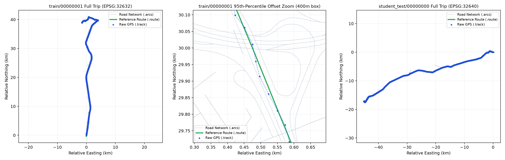
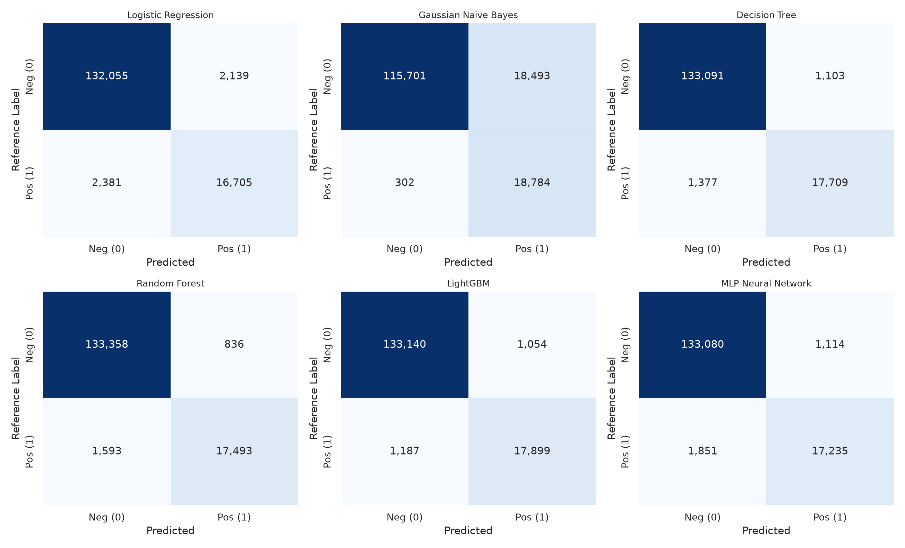
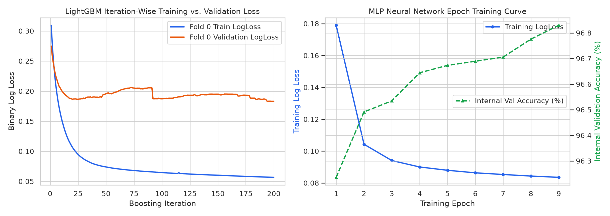
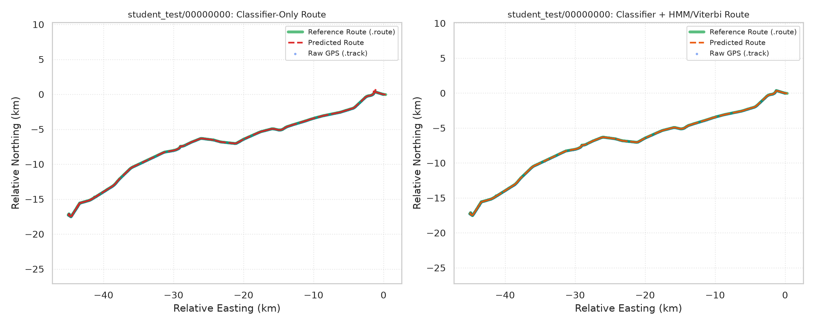

# PathSnap Phase 1 Technical Report: Group A-G14

**Course:** UE24CS352A: Machine Learning  
**Team A-G14:** `Andy34G7`, `Abhiroop-24`, `A6h1ramahy`, `Neo-pixel123`  
**Partitions used:** `train` (80 trips, 208,417 GPS points) and `student_test` (10 trips, 19,160 GPS points). All evaluator-testing data remains completely untouched.

---

## 2.2 Dataset Understanding and Exploratory Data Analysis

### Raw Structure and Data Quality
Each trip directory holds four headerless files: `.track` (`lon`, `lat`, `timestamp` as `float64`), `.nodes` (`lon`, `lat` as `float64`), `.arcs` (`from_node`, `to_node` as `int64`), and `.route` (chronological traversed `arc_id` list as `int64`). Across all 90 trips in `train` and `student_test` (227,577 GPS points, 2,024,174 nodes, 4,061,945 arcs, and 34,813 route arcs), we found **0 NaN/Inf values**, **0 out-of-bounds coordinates or indices**, **0 isolated road nodes**, and **0 non-monotonic timestamps** (`dt <= 0`).

| Partition | Trips | Total GPS Obs | Obs per Trip (Min / Med / Max) | Total Nodes (Max per Trip) | Total Arcs (Max per Trip) | Steps with `dt = 1 s` | Gaps `> 60 s` (`dt_max`) | UTM Zones |
|---|---:|---:|---:|---:|---:|---:|---:|---:|
| `train` | 80 | 208,417 | 361 / 1,529.0 / 19,313 | 1,933,485 (155,003) | 3,876,904 (307,392) | 96.5037% | 69 (153,064.0 s) | 25 |
| `student_test` | 10 | 19,160 | 262 / 1,420.0 / 3,958 | 90,689 (26,635) | 185,041 (56,027) | 98.6214% | 1 (210.0 s) | 9 |

### Spatial Projection and Network Patterns
Trip centroids span `-100.35°` to `137.22°` in longitude and `-34.62°` to `61.67°` in latitude across North America, Europe, Asia, and the Southern Hemisphere (Figure 3). On `train/00000001` (`50.09° N`), 1 degree of longitude is `71,563.72 m` while 1 degree of latitude is `111,230.76 m` (35.66% anisotropy). Naive degree scaling overestimates the `50,228.555 m` geodesic trip length by `11.80579%` (up to `27.91291 m` error per step). Projecting each trip dynamically to its centroid's local WGS84 UTM EPSG zone cuts error to `0.03902%` (`0.02822 m` max step diff).

Road graphs are fragmented into 1 to 421 weakly connected components in `train` (median 20) and 5 to 100 in `student_test` (median 11), with median bidirectional arc rates of 95.112% (`train`) and 93.261% (`student_test`), dropping to 35.133% in `train/00000080` (Figure 4). Because `.route` records traversed arcs rather than 1-to-1 GPS labels, `n_track / n_route` has a median ratio of `5.289x` (`train`) and `4.635x` (`student_test`). In typical trips, median GPS distance to `.route` is `4.503 m` (`train`) and `4.593 m` (`student_test`), with per-trip `p95` median `14.212 m` and `15.798 m` (Figure 5). However, two `train` trips have large median offsets (`00000054` at median `138.59 m`, `p95 = 210.05 m`; `00000033` at median `122.41 m`, `p95 = 142.06 m`), and `00000002` has a normal `5.67 m` median yet hits `p95 = 242.36 m` (`max = 569.66 m`). Furthermore, 10 `train` trips (13 steps) and `student_test/00000076` (1 step) contain disconnected jumps in `.route`.

### Q1: How Did We Preprocess the Data?
1. **Dynamic per-trip UTM projection:** Transform `.track` and `.nodes` into the local WGS84 UTM EPSG plane computed from the trip centroid.
2. **Quality & time-gap preservation:** Keep all valid observations and pass `dt` (`dt_prev_s`, capped at `600 s` for feature scaling) and raw `dt` to the decoder.
3. **3-point `cKDTree` candidate generation:** Index 3 points per road segment (`0.15`, `0.50`, `0.85`), retrieve 72 nearest samples per GPS ping, compute exact point-to-segment distances, rank unique `arc_id`s by `dist + 0.5 * (1 - cos_heading_smooth)`, and retain the top `K = 8` candidates (`0.4071%` miss rate on `student_test`, or **99.5929% recall**, Figure 7).
4. **Monotonic DP label alignment:** On `train` and `student_test` only, align GPS observations onto `.route` indices (`step in 0..15` plus gap fallback) to build training labels `y` without modifying `X`.

### Q2: Which Patterns Observed in EDA Motivated Our Features?
We engineered **24 leak-free features** across five groups strictly from `.track`, `.nodes`, and `.arcs` (Figure 8):

- **Spatial proximity (6):** `dist_to_arc_m`, `dist_rank` (`r = -0.4758`), `dist_diff_from_best_m`, `dist_ratio_to_best`, `dist_zscore_in_cands` (`r = -0.4476`), `gaussian_emission_prior` (`r = +0.4737`), capturing the tight `~4.5 m` median noise regime.
- **Projection & geometry (4):** `proj_fraction`, `dist_to_from_node_m`, `dist_to_to_node_m`, `arc_length_m` (`r = +0.1392`), distinguishing short turn segments from long road corridors.
- **Heading & directionality (5):** `cos_heading_diff_inst` (`r = +0.2897`), `sin_heading_diff_inst`, `cos_heading_diff_smooth` (`r = +0.3117`, median `0.9901` matched vs `-0.0224` unmatched), `heading_diff_deg_smooth` (`r = -0.3234`, median `8.08°` vs `91.28°`), `is_forward_aligned` (`91.22%` vs `49.38%`), separating opposite lanes on two-way streets.
- **Kinematics & local window (5):** `gps_speed_mps`, `dt_prev_s`, `dist_prev_obs_to_arc_m`, `dist_next_obs_to_arc_m`, `mean_window3_dist_to_arc_m` (`r = -0.1853`), smoothing single-ping GPS jitter.
- **Graph topology & continuity (4):** `from_node_in_deg`, `to_node_out_deg`, `is_bidirectional_arc`, `prev_cand_connected` (`94.71%` matched vs `56.20%` unmatched, `r = +0.2508`).

---

## 3. Model Experimentation and Comparison

We trained and evaluated **6 distinct models** on the 80 `train` trips using **5-fold `GroupKFold` cross-validation** grouped strictly by `trip_id` (training on `[::3]` strided observations per fold and validating on 100% of held-out fold observations), then refit each model on `train` (`[::3]`) and evaluated on 100% of the 10 `student_test` trips (`19,160` observations / `153,280` candidate rows).

### 3.1 Overall Model Comparison (`train` CV and `student_test`)

| Model | Algorithm Family | Key Configuration | CV Macro F1 (Std) | Top-1 Acc (Test) | Route Continuity (Test) | Student-Test Macro F1 | Log Loss (Test) | Inference Time (10 trips) |
|---|---|---|---:|---:|---:|---:|---:|---:|
| Logistic Regression | Linear | StandardScaler + L2 `C=1.0`, `max_iter=500` | 0.8918 (0.0284) | 86.5292% | 92.0574% | 0.9084 | 0.1127 | 0.0436 s |
| Gaussian Naive Bayes | Probabilistic | StandardScaler + `GaussianNB(var_smoothing=1e-6)` | 0.7576 (0.0241) | 85.8299% | 91.8747% | 0.7533 | 1.5263 | 0.1284 s |
| Decision Tree | Tree-based | `max_depth=12`, `min_samples_leaf=50` | 0.9042 (0.0459) | 87.3695% | 92.7050% | 0.9253 | 0.1008 | **0.0067 s** |
| Random Forest | Ensemble Bagging | `n_estimators=80`, `max_depth=14`, `min_samples_leaf=20` | 0.9150 (0.0310) | 87.3225% | 92.9556% | 0.9266 | 0.0796 | 0.0958 s |
| **LightGBM** | **Gradient Boosting** | `n_estimators=200`, `lr=0.08`, `num_leaves=31`, `min_child=50` | **0.9180 (0.0320)** | **88.2672%** | **93.7755%** | **0.9297** | **0.0780** | 0.1538 s |
| MLP Neural Network | Neural Networks | StandardScaler + `(64, 32)`, `early_stopping=True`, `batch=2048` | 0.9113 (0.0328) | 87.1086% | 92.5379% | 0.9236 | 0.0883 | 0.0343 s |

*Note on Fold Variance & Training Diagnostics:* Across all 6 models, Fold 0 yields only `47.28% to 48.85%` validation Top-1 Accuracy compared to `79.68% to 90.06%` in Folds 1 to 4 (`cv_fold_metrics.csv`). This occurs because `GroupKFold` assigns outlier trip `train/00000054` (`19,313` observations, `60.57%` candidate miss rate) to Fold 0, while Fold 3 holds `train/00000033` (`66.17%` miss rate). Companion diagnostic metrics (`train_fit_macro_f1`, `pos_precision`, `pos_recall`, `train_time_s`) are stored in [model_comparison.csv](models/model_comparison.csv).

---

### 3.2 Compulsory Analysis for Every Model

#### 1. Logistic Regression (Linear)
- **A. Model Understanding:**
  1. *Suitability:* Provides a fast, interpretable linear baseline on distance, rank, and cosine heading features, outputting calibrated sigmoid probabilities directly usable as HMM emissions.
  2. *Strengths & Limitations:* Converges reliably in `3.345 s` with almost zero overfitting (`train_fit_macro_f1 = 0.8955` vs `CV = 0.8918`), but its linear hyperplane cannot model nonlinear interactions such as heading alignment gated by speed or GPS gap duration.
- **B. Training & Configuration:**
  5. *Hyperparameters:* `StandardScaler()` followed by L2 `LogisticRegression(C=1.0, max_iter=500, random_state=42)`.
  6. *Loss & Objective:* L2-regularized binary cross-entropy (log loss).
- **C. Experimental Results:**
  7. *Student-Test Performance:* `0.9084` Macro F1, `86.5292%` Top-1 Accuracy, `92.0574%` Route Continuity.
  8. *Detailed Student-Test Metrics:* Positive Precision `0.8489`, Positive Recall `0.8302`, Positive F1 `0.8394`, Log Loss `0.1127`.
  9. *Overfitting / Underfitting:* Mild underfitting. `train_fit_macro_f1` (`0.8955`) sits `0.0505` below LightGBM `train_fit` (`0.9460`), and `CV` (`0.8918`) sits `0.0262` below LightGBM `CV` (`0.9180`), showing linear bias.

#### 2. Gaussian Naive Bayes (Probabilistic)
- **A. Model Understanding:**
  1. *Suitability:* Serves as a closed-form generative baseline modeling conditional Gaussian likelihoods per feature.
  2. *Strengths & Limitations:* Fastest to fit (`1.485 s`), yet its conditional independence assumption breaks severely across correlated distance and window features (`dist_to_arc_m`, `dist_diff_from_best_m`, `mean_window3_dist_to_arc_m`).
- **B. Training & Configuration:**
  5. *Hyperparameters:* `StandardScaler()` followed by `GaussianNB(var_smoothing=1e-6)`.
  6. *Loss & Objective:* Maximum-likelihood class-conditional Gaussian parameter estimation via Bayes' rule.
- **C. Experimental Results:**
  7. *Student-Test Performance:* `0.7533` Macro F1, `85.8299%` Top-1 Accuracy, `91.8747%` Route Continuity.
  8. *Detailed Student-Test Metrics:* Positive Precision `0.4406`, Positive Recall `0.9616`, Positive F1 `0.6043`, Log Loss `1.5263`.
  9. *Overfitting / Underfitting:* Severe underfitting and miscalibration. `train_fit_macro_f1` (`0.7569`) matches `CV` (`0.7576`), while multiplying redundant spatial likelihoods produces extreme overconfident false positives (`Log Loss = 1.5263`), making its probabilities unsuitable for HMM emission scoring.

#### 3. Decision Tree (Tree-based)
- **A. Model Understanding:**
  1. *Suitability:* Captures thresholded nonlinear rules (for example, `dist_rank == 0` combined with `cos_heading_diff_smooth > 0.5`) without needing feature scaling.
  2. *Strengths & Limitations:* Fastest inference (`0.0067 s` for 10 trips), but greedy single-tree axis splits overfit training trajectories and show the widest fold-to-fold variance (`CV std = 0.0459`).
- **B. Training & Configuration:**
  5. *Hyperparameters:* `DecisionTreeClassifier(max_depth=12, min_samples_leaf=50, random_state=42)`.
  6. *Loss & Objective:* Gini impurity minimization at each binary split.
- **C. Experimental Results:**
  7. *Student-Test Performance:* `0.9253` Macro F1, `87.3695%` Top-1 Accuracy, `92.7050%` Route Continuity.
  8. *Detailed Student-Test Metrics:* Positive Precision `0.8773`, Positive Recall `0.8610`, Positive F1 `0.8691`, Log Loss `0.1008`.
  9. *Overfitting / Underfitting:* Noticeable overfitting. `train_fit_macro_f1` (`0.9365`) exceeds `CV` (`0.9042`) by `0.0323`, and coarse leaf empirical frequencies raise Log Loss (`0.1008`) compared to ensembles.

#### 4. Random Forest (Ensemble Bagging)
- **A. Model Understanding:**
  1. *Suitability:* Reduces single-tree variance across noisy GPS trips by averaging 80 bootstrap trees with random feature subsampling.
  2. *Strengths & Limitations:* Strong generalization (`CV std = 0.0310`) and calibrated probabilities (`Log Loss = 0.0796`), at the cost of the slowest training time (`17.706 s`).
- **B. Training & Configuration:**
  5. *Hyperparameters:* `RandomForestClassifier(n_estimators=80, max_depth=14, min_samples_leaf=20, random_state=42)`.
  6. *Loss & Objective:* Bagged Gini impurity reduction across bootstrap samples.
- **C. Experimental Results:**
  7. *Student-Test Performance:* `0.9266` Macro F1, `87.3225%` Top-1 Accuracy, `92.9556%` Route Continuity.
  8. *Detailed Student-Test Metrics:* Positive Precision `0.8975` (highest among all 6 models), Positive Recall `0.8459`, Positive F1 `0.8709`, Log Loss `0.0796`.
  9. *Overfitting / Underfitting:* Moderate variance gap (`train_fit = 0.9396` vs `CV = 0.9150`, a `+0.0108` CV gain over Decision Tree), generalizing cleanly to `student_test` (`0.9266`).

#### 5. LightGBM (Gradient Boosting, Selected Model)
- **A. Model Understanding:**
  1. *Suitability:* Sequentially fits shallow histogram trees to binary log-loss gradients, directly optimizing calibrated candidate probabilities needed by the HMM emission layer.
  2. *Strengths & Limitations:* Ranks **1st across all 5 folds in CV Macro F1** over Random Forest (`cv_fold_metrics.csv`), achieves the lowest Log Loss (`0.0780`), highest Student-Test Macro F1 (`0.9297`), highest Top-1 Accuracy (`88.2672%`), and fast training (`3.194 s`). Needs regularization tuning to balance `num_leaves` and `min_child_samples` against noisy offset trips.
- **B. Training & Configuration:**
  5. *Hyperparameters:* `LGBMClassifier(n_estimators=200, learning_rate=0.08, num_leaves=31, min_child_samples=50, subsample=0.8, colsample_bytree=0.8, random_state=42)`. Note that without `subsample_freq`, LightGBM leaves row subsampling inactive (`subsample_freq=0` in `untuned_lgbm.joblib`); Section 4 explicitly activates `subsample_freq=1` so the Section 3.1 LightGBM row (`0.9180`) and Section 4 untuned row (`0.9181`) differ by that setting.
  6. *Loss & Objective:* Binary cross-entropy (`binary_logloss`) via leaf-wise gradient boosting.
- **C. Experimental Results:**
  7. *Student-Test Performance:* `0.9297` Macro F1, `88.2672%` Top-1 Accuracy, `93.7755%` Route Continuity.
  8. *Detailed Student-Test Metrics:* Positive Precision `0.8868`, Positive Recall `0.8667`, Positive F1 `0.8766`, Log Loss `0.0780`.
  9. *Overfitting / Underfitting:* Well-controlled fit (`train_fit = 0.9460` vs `CV = 0.9180`, `Test = 0.9297`). In Figure 12, Fold 0 validation loss drops to about `0.187` near iteration 22, drifts up to about `0.206` around iterations 75 to 90 on noisy Fold 0 (`train/00000054`), and then settles near `0.183` at iteration 200 without diverging.

#### 6. MLP Neural Network (Neural Networks)
- **A. Model Understanding:**
  1. *Suitability:* Learns smooth continuous combinations of standardized spatial, angular, and topological features without axis-aligned tree boundaries.
  2. *Strengths & Limitations:* Very fast inference (`0.0343 s` for 10 trips) and clean probability outputs (`Log Loss = 0.0883`), but requires strict scaling and underperforms histogram boosting on tabular rank and degree thresholds.
- **B. Training & Configuration:**
  5. *Hyperparameters:* `StandardScaler()` + `MLPClassifier(hidden_layer_sizes=(64, 32), alpha=1e-4, learning_rate_init=1e-3, max_iter=35, batch_size=2048, tol=1e-3, early_stopping=True, validation_fraction=0.1, n_iter_no_change=4, random_state=42)`.
  6. *Loss & Objective:* L2-regularized binary log loss optimized via Adam.
- **C. Experimental Results:**
  7. *Student-Test Performance:* `0.9236` Macro F1, `87.1086%` Top-1 Accuracy, `92.5379%` Route Continuity.
  8. *Detailed Student-Test Metrics:* Positive Precision `0.8953`, Positive Recall `0.8378`, Positive F1 `0.8656`, Log Loss `0.0883`.
  9. *Overfitting / Underfitting:* Low overfitting (`train_fit = 0.9205` vs `CV = 0.9113`) because early stopping halted training at epoch 9 (Figure 12). Note that `MLPClassifier`'s internal 10% validation accuracy (`96.8%`) uses a random row split rather than trip grouping and is shown solely as internal optimization progress.

---

### 3.3 Model Visualisations

---

## 4. Bayesian Hyperparameter Optimisation (LightGBM)

We chose **5-fold `GroupKFold` CV Macro F1** alongside **Log Loss** as our primary selection criteria because each observation produces 8 candidates (at most 1 positive match and 7 to 8 negatives, or 87.5%+ negative rows), so raw binary accuracy is dominated by negatives while the HMM emission layer depends directly on calibrated `log(p)`. We selected **LightGBM** because it ranked 1st across all 5 CV folds in Macro F1 (`0.9180`), achieved the highest Student-Test Top-1 Accuracy (`88.2672%`), and yielded the lowest Log Loss (`0.0780`), while training `5.5x` faster than Random Forest (`3.194 s` vs `17.706 s`).

1. **Hyperparameters included:** `n_estimators`, `learning_rate`, `num_leaves`, `max_depth`, `min_child_samples`, `subsample` (with `subsample_freq=1`), `colsample_bytree`, and `reg_lambda`.
2. **Search space & ranges:**

   - `n_estimators`: integer `[120, 400]`
   - `learning_rate`: log-uniform `[0.02, 0.18]`
   - `num_leaves`: integer `[15, 95]` and `max_depth`: integer `[4, 12]`
   - `min_child_samples`: integer `[20, 150]` (controlling leaf regularization on noisy trips)
   - `subsample`: `[0.65, 1.0]` (`subsample_freq=1`), `colsample_bytree`: `[0.65, 1.0]`
   - `reg_lambda`: log-uniform `[1e-3, 10.0]`
3. **Optimisation objective:** 5-fold `GroupKFold` out-of-fold **CV Macro F1-score** computed exclusively across the 80 `train` trips (strided `[::5]` during search for speed, with final apples-to-apples refit and comparison evaluated at `[::3]` with matching `subsample_freq=1`). `student_test` never touched the search.
4. **Number of trials & cost:** **25 Optuna TPE trials** (`TPESampler(seed=42)`), completing in **`410.61 s`** (`~16.4 s` per trial across 5 folds).
5. **Best configuration (Trial 22, search CV Macro F1 = `0.91873`):** `n_estimators=196`, `learning_rate=0.05471`, `num_leaves=63`, `max_depth=6`, `min_child_samples=101`, `subsample=0.66173`, `colsample_bytree=0.75755`, `reg_lambda=0.15000`, `subsample_freq=1`. Optuna chose a shallower `max_depth=6` with larger `min_child_samples=101` and stronger row/feature subsampling (`0.662`, `0.758`), directly regularizing against outlier trips.
6. **Untuned vs. Tuned comparison:** Under the identical `[::3]` fit protocol and `subsample_freq=1` ([untuned_vs_tuned_comparison.csv](models/untuned_vs_tuned_comparison.csv)), the Macro F1 gains (`0.9181 -> 0.9189` CV, `0.9304 -> 0.9308` Student-Test) are marginal and lie well within fold variance (`std = 0.0320`, with same-fold selection optimism on CV). Student-Test Top-1 Accuracy edged slightly down from `88.3299%` to `88.2777%`. The main practical gain from tuning is cleaner probability calibration (`Log Loss: 0.1066 -> 0.1011` CV and `0.0773 -> 0.0766` Test) and higher continuity (`93.6971% -> 93.8381%`), both useful before HMM decoding.

| Variant | CV Macro F1 | CV Top-1 Acc | CV Log Loss | Student-Test Macro F1 | Student-Test Top-1 Acc | Student-Test Log Loss | Student-Test Continuity | Train Time | Inf Time (10 trips) |
|---|---:|---:|---:|---:|---:|---:|---:|---:|---:|
| Untuned LightGBM (`subsample_freq=1`) | 0.9181 | 78.2153% | 0.1066 | 0.9304 | **88.3299%** | 0.0773 | 93.6971% | **3.209 s** | **0.1481 s** |
| **Tuned LightGBM (Optuna TPE)** | **0.9189** | **78.2484%** | **0.1011** | **0.9308** | 88.2777% | **0.0766** | **93.8381%** | 3.775 s | 0.1817 s |

---

## 5. HMM and Viterbi Route Reconstruction

1. **Hidden states:** At each GPS observation `t in {0, ..., N-1}`, the `K = 8` hidden states represent the top-8 candidate `arc_id`s `c[t, 0], ..., c[t, 7]` returned by `generate_candidates`.
2. **Emission probabilities:** Derived directly from the tuned LightGBM candidate probability `p[t, k]` (clipped to `[1e-6, 1 - 1e-6]`) as `log E[t, k] = alpha_emit * log(p[t, k])`.
3. **Transition probabilities & decoder tuning:** Following a directed Newson-Krumm formulation using projection fractions `proj_fraction` along candidate arcs:

   - Staying on the same arc (`a = b`): road distance is `|t_cur - t_prev| * L_a` (plus a `1.5` penalty if backtracking `> 0.15`).
   - Moving to a different arc (`a != b`): bounded Dijkstra (`max_pops = 3000`, `max_dist_m = ceil(max(200, min(55 * dt, 3500)) / 10) * 10`) finds the directed shortest node distance `d_sp(v_a -> u_b)`, giving road travel distance `d_road = (1 - t_prev) * L_a + d_sp + t_cur * L_b`.
   - The connected transition score is `-min(C_max, beta_trans * |d_road - d_gps| / sqrt(dt)) - switch_cost - uturn_cost * I(u_b == v_a and v_b == u_a)`, where capping at `C_max = 12.0` guarantees valid connected transitions always beat disconnected jumps.
   - Grid tuning across 6 decoder configurations on 6 representative `train` trips (`hmm_tuning_trials.csv`, evaluated with in-sample classifier emissions strictly on `train` so `student_test` stays untouched) raised `train`-subset Route Arc F1 from `78.4192%` (no-distance-cost ablation `config_id=0`, where `beta_trans=0.0, switch_cost=0.0, uturn_cost=0.0` while `disconnect_penalty=25.0` stays active) to **`86.3168%`** (`config_id=5`: `alpha_emit=1.0`, `beta_trans=0.15`, `switch_cost=0.50`, `uturn_cost=2.0`, `disconnect_penalty=30.0`, `max_conn_penalty=12.0`).

4. **Missing candidates & GPS gaps:** Distance tolerance scales with `gap_scale = sqrt(dt)` whenever `dt > 1 s`, Dijkstra reachability expands above `200 m` for `dt > 3.64 s` (up to `3,500 m`), and `gap_disc_pen` relaxes for `dt > 5 s` while staying `>= 16.0 > max_conn_penalty`. If a true arc misses the top-8 set, Viterbi smoothly maintains path continuity along adjacent candidate arcs rather than crashing.
5. **Disconnected segments & path bridging:** When no directed path exists within `max_dist_m` (e.g., separate graph components or annotation breaks), Viterbi applies the finite `gap_disc_pen` fallback (`30.0` at 1 Hz). After decoding, `reconstruct_continuous_route` collapses consecutive duplicate arcs and fills multi-hop gaps via `shortest_arc_path` (up to `1,500 m`) to output a continuous road trajectory. Across all 10 `student_test` trips (`19,160` obs), **0 Dijkstra truncations** occurred.
6. **Classifier-Only vs. Classifier + HMM/Viterbi:** Table below and Figure 14 compare both methods on `student_test` (`hmm_vs_classifier_comparison.csv`, `per_trip_hmm_results.csv`).

| Method | Weighted Obs Top-1 Acc | Mean Obs Continuity | Reconstructed Seq Continuity | Mean Route Arc Precision | Mean Route Arc Recall | Mean Route Arc F1 vs. `.route` | Mean Route Jaccard | Total Inf Time (10 trips) |
|---|---:|---:|---:|---:|---:|---:|---:|---:|
| Classifier-Only (Tuned LightGBM) | 88.2777% | 93.8226% | 98.7554% | 67.1247% | **99.3877%** | 79.2929% | 66.7195% | **0.1603 s** |
| **Classifier + HMM/Viterbi** | **93.9405%** | **97.6465%** | **99.8129%** | **92.8040%** | 99.0583% | **95.7142%** | **91.9485%** | 2.7222 s |

HMM/Viterbi improves Observation Top-1 Accuracy, Route Precision, Route Arc F1, and Route Jaccard on **every single one of the 10 `student_test` trips**, lifting weighted Observation Top-1 Accuracy by **+5.66 pp** (`88.28% -> 93.94%`), Reconstructed Sequence Continuity to **`99.81%`** (**7 of 10 trips at 100.00%**; `00000000` at `99.02%`, `00000056` at `99.63%`, `00000065` at `99.48%`), Route Arc F1 by **+16.42 pp** (`79.29% -> 95.71%`), and Route Jaccard by **+25.23 pp** (`66.72% -> 91.95%`). Largest gains appear on `00000077` (Top-1 `74.76% -> 86.99%`, Route F1 `77.57% -> 93.71%`), `00000040` (Route F1 `74.28% -> 99.20%`), and `00000091` (Route F1 `71.06% -> 97.64%`). As expected from sequential graph search, three trade-offs remain: (1) total inference time increases `17.0x` (`0.1603 s -> 2.7222 s` across 10 trips, or `272 ms/trip`), (2) high-ambiguity trip `00000077` still ends at `86.9854%` Top-1 Accuracy where parallel lanes persist, and (3) Route Arc Recall drops slightly on 4 trips (`00000000`, `00000009`, `00000076`, `00000091`; overall `-0.33 pp`) because HMM prunes **690 false-positive side-street arcs** (`814 -> 124` across those 4 trips) while skipping **15 short (`5.1 to 50.2 m`) connector/turn arcs**.

---

## 6. Geographical Visualisation Using Folium

Figure 15 contrasts the Classifier-Only prediction against the HMM/Viterbi reconstructed route on `student_test/00000000`, and Figure 16 shows the rendered interactive Folium map screenshot with OpenStreetMap tiles, corridor road segments, `.route`, `.track`, predicted route layer, floating legend, and `LayerControl` (`Route Arc F1: 76.99% -> 94.18%`, `Precision: 62.59% -> 89.45%`).

Interactive Folium HTML maps (with corridor road segments, `.route`, `.track`, predicted route layer, floating legend, and `LayerControl`) are committed under `reports/`:

- Predicted route vs. reference route (`student_test/00000000`): [trip_student_test_00000000_predicted.html](hmm/maps/trip_student_test_00000000_predicted.html)
- EDA sample maps: [trip_train_00000001.html](eda/maps/trip_train_00000001.html), [trip_student_test_00000000.html](eda/maps/trip_student_test_00000000.html), [trip_student_test_00000007.html](eda/maps/trip_student_test_00000007.html)
