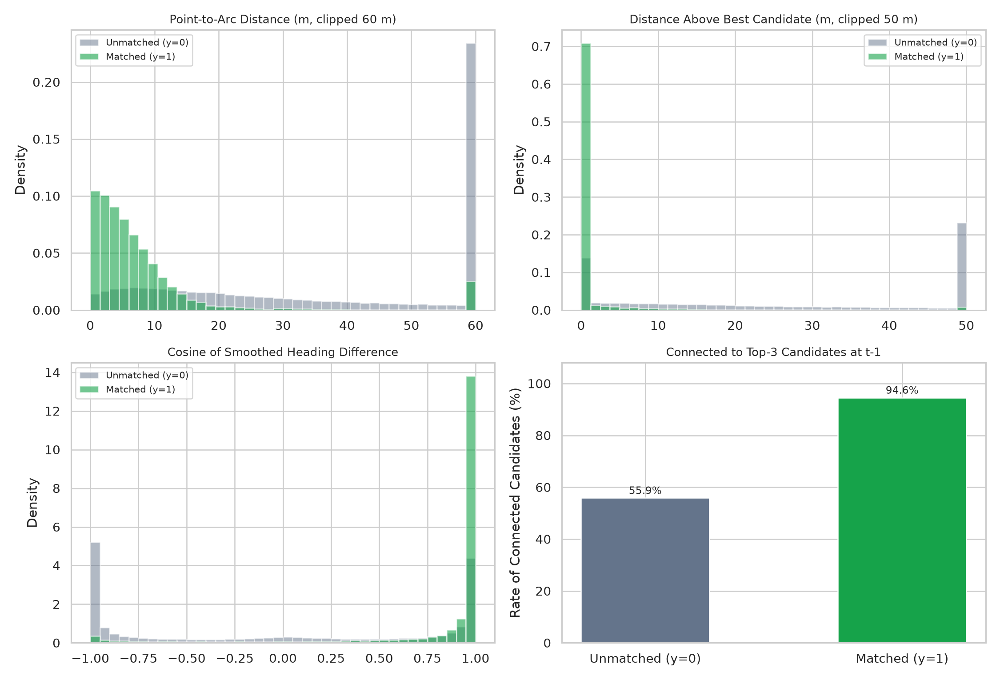
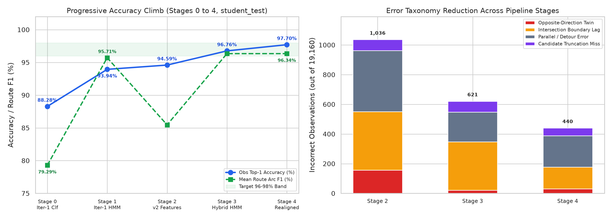

# PathSnap Technical Report: Group A-G14

**Course:** UE24CS352A Machine Learning  
**Team A-G14:** Andey Hemanth, Abhiroop, Abhirama H Y, Aman Rao U

---

## 1. Dataset Understanding and Exploratory Data Analysis

### 1.1 Data Preprocessing and Candidate Retrieval

When a vehicle drives through a city, its Global Positioning System (GPS) receiver logs coordinates once per second. Raw GPS points rarely fall on the exact road centerline because signal noise pushes positions several meters sideways.

On a two-way street or dense junction, snapping each ping to the closest arc fails often. Parallel lanes share nearly identical positions, so small lateral noise shifts points onto opposing lanes or side streets. Each reference route also stores an ordered sequence of traversed road arcs rather than point labels.

Our development data covers 80 trips in `train` (208,417 points) and 10 trips in `student_test` (19,160 points). Each trip records GPS pings alongside a directed road graph. Ground-truth routes are available offline for training and local validation. During preprocessing, we derive every input feature solely from the GPS stream and road network:

1. **Dynamic metric projection:** Each trip maps World Geodetic System 1984 (WGS84) degrees into its local Universal Transverse Mercator (UTM) meter plane. The European Petroleum Survey Group (EPSG) zone code is selected automatically from the trip centroid.
2. **Time-gap preservation:** All valid pings stay in temporal order. Tabular features cap elapsed gaps at 600 s, while sequential decoding keeps exact durations intact.
3. **Turnaround-aware velocity smoothing:** Fixed five-point velocity windows fail when vehicles wait at traffic lights. Stationary drift reverses the velocity vector into oncoming lanes, which dragged baseline accuracy on `student_test` trip `00000077` down to 74.7635% (Section 4.4). Instead, we smooth planar coordinates with a Gaussian filter (`sigma = 2.5`) and extend chords to 20 m. When arrival and departure chords oppose, incoming vectors govern pre-stop points while outgoing vectors govern post-stop points. On `train`, this spatial chord design keeps median matched heading error at 2.94 deg (91.04 deg unmatched). Instantaneous headings still use lighter coordinate derivatives (`sigma = 1.2`).
4. **Three-point spatial indexing:** Road segments reach 9,357.6 m in length across our road graphs. Indexing only arc midpoints misses true matches near highway junctions. We sample three evenly spaced points per segment inside a spatial search tree. Each ping queries 72 nearby sample points and keeps top `K = 8` unique arcs ranked by distance and heading alignment. As shown in Figure 1, setting `K = 8` holds the `student_test` candidate miss rate at 0.3862% (99.6138% recall).

For supervised training only, monotonic dynamic programming (DP) aligns GPS points against ground-truth routes. Allowing 0 to 15 segment steps with a `+50.0` fallback yields binary labels (`y = 1` or `0`) without altering inputs.

### 1.2 Data Exploration and Visual Checks

Before building features or classifiers, we audited data quality across all 90 trips in `train` and `student_test`. Together they contain 227,577 GPS observations and 34,813 ground-truth route segments. Those road networks span 2,024,174 vertices and 4,061,945 directed edges.

Integrity checks found zero missing or infinite values in any table. We also confirmed zero invalid node indices and zero non-monotonic timestamps. Table 1 summarizes dataset volume and timing gaps, while Figures 2 and 3 plot sampling intervals and trip lengths.

| Partition | Trips | Total GPS Obs | Obs per Trip (Min / Med / Max) | Total Nodes (Max per Trip) | Total Arcs (Max per Trip) | Steps with `dt = 1 s` | Gaps `> 60 s` (`dt_max`) | UTM Zones |
|---|---:|---:|---:|---:|---:|---:|---:|---:|
| `train` | 80 | 208,417 | 361 / 1,529.0 / 19,313 | 1,933,485 (155,003) | 3,876,904 (307,392) | 96.5037% | 69 (153,064.0 s) | 25 |
| `student_test` | 10 | 19,160 | 262 / 1,420.0 / 3,958 | 90,689 (26,635) | 185,041 (56,027) | 98.6214% | 1 (210.0 s) | 9 |

Geographic coordinates show why planar projection matters before distance calculation. Trip centroids span -100.35 deg to 137.22 deg longitude and -34.62 deg to 61.67 deg latitude across 25 UTM zones (Figure 4). Away from the equator, longitude degrees shrink noticeably. On `train` trip `00000001` near 50.09 deg N, one longitude degree spans 71,563.7 m against 111,230.8 m in latitude. That 35.66% compression causes isotropic degree distances to overestimate trip length by 11.81% (up to 27.91 m per step). Local UTM projection shrinks length error to 0.04% (under 3 cm per step).

Beyond coordinate scale, graph connectivity and GPS noise reveal three structural properties across Figures 5 and 6:

- **Network fragmentation:** Road graphs contain 1 to 421 weakly connected components in `train` (median 20). That range sits between 5 and 100 in `student_test` (median 11). Bidirectional streets account for 95.112% median in `train` and 93.261% in `student_test`, dropping to 35.133% on `train` trip `00000080`. Because vehicles spend several seconds per road arc, GPS points outnumber route edges by 5.289x median in `train` (4.635x in `student_test`).
- **Lateral noise and outliers:** Ordinary trips track reference paths closely. Median distance to ground truth sits at 4.503 m in `train` and 4.593 m in `student_test`. Per-trip 95th-percentile offsets have medians of 14.212 m and 15.798 m. Still, two `train` trips suffer global lateral shifts: `00000054` (median 138.59 m) and `00000033` (median 122.41 m). Trip `00000002` shows a sustained GPS excursion reaching 569.66 m (`p95 = 242.36 m`).
- **Route sequence breaks:** Reference ground truth contains disconnected edge jumps on 10 `train` trips (13 total jumps). Only `student_test` trip `00000076` shows one disconnected step.

To inspect these patterns at street resolution, Figures 7 and 8 present UTM trajectories and a Folium map on `train` trip `00000001`.

### 1.3 Feature Extraction and Selection Rationale

Exploration showed ~4.5 m typical noise and dense two-way lane ambiguity. We therefore extracted 24 candidate features solely from GPS coordinates and road geometry. Adding temporal context and graph chain margins separates true roads (`y = 1`) from false candidates (`y = 0`). Figure 9 confirms these class separations across `train`:

- **Spatial proximity (6 features):** Perpendicular distance has a matched median of 5.12 m against 33.42 m unmatched. Within-ping distance rank shows the strongest target correlation (`r = -0.4811`). Next strongest are the 10 m Gaussian emission prior (`r = +0.4726`) and within-ping z-score (`r = -0.4463`). Distance gap above best candidate (`22.17 m` unmatched median) and ratio to best capture relative closeness.
- **Projection and geometry (4 features):** Segment projection fraction locates where each ping falls along an arc. Endpoint vertex distances catch intersections, while arc length (`r = +0.1387`, 94.45 m vs. 51.94 m median) separates arterials from short connectors.
- **Heading and directionality (5 features):** Instantaneous heading cosine (`r = +0.3190`) and sine capture local travel angle. Smoothed 20 m chord cosine hits 0.9987 matched median against -0.0181 unmatched (`r = +0.3522`). Angular error drops to 2.94 deg matched vs. 91.04 deg unmatched, while a binary flag marks forward alignment (97.08% vs. 49.24%).
- **Kinematics and local window (5 features):** Raw GPS speed and elapsed interval `dt` model motion across sampling gaps. Adjacent smoothed distances (`t - 4` and `t + 4`) form a 3-point window margin (`0.0000 m` matched vs. `23.5209 m` unmatched).
- **Graph topology and continuity (4 features):** Endpoint in-degree and out-degree capture junction fan-in, while a binary indicator flags bidirectional streets. A two-sided connected-chain margin across `t - 3` and `t + 3` verifies edge continuity (`0.0000 m` matched vs. `42.6893 m` unmatched). Its target correlation reaches `r = -0.2143`.

---

## 2. Model Experimentation and Comparison

Consecutive 1 Hz pings stay on the same street at similar speed, so random cross-validation (CV) leaks adjacent rows across splits. To measure true cross-city generalization, we evaluate six distinct model families under 5-fold `GroupKFold` grouped by trip identifier.

Each CV fold fits on every third training observation and validates on 100% of held-out trips. Afterward, each model trains on the full strided `train` split and predicts all 10 `student_test` trips (19,160 observations, 153,280 candidate pairs). We score candidate predictions via Macro F1 and probability Log Loss. Sequential route quality uses observation Top-1 Accuracy and pooled Route Continuity (valid graph transitions between adjacent predictions).

### 2.1 Consolidated Model Comparison

Table 2 compares all six model families across `train` CV and `student_test`. Two behavioral patterns emerge across this benchmark. Tree ensembles separate integer distance ranks and node degrees better than linear or neural models. Naive Bayes, by contrast, suffers severe probability distortion despite competitive top-1 ranking.

| Model | Algorithm Family | Key Configuration | CV Macro F1 (Std) | Top-1 Acc (Test) | Route Continuity (Test) | Student-Test Macro F1 | Log Loss (Test) | Inference Time (10 trips) |
|---|---|---|---:|---:|---:|---:|---:|---:|
| Logistic Regression | Linear | StandardScaler + L2 `C=1.0`, `max_iter=500` | 0.9154 (0.0355) | 92.2651% | 93.3420% | 0.9320 | 0.0831 | 0.0254 s |
| Gaussian Naive Bayes | Probabilistic | StandardScaler + `GaussianNB(var_smoothing=1e-6)` | 0.7943 (0.0291) | 91.9676% | 92.4491% | 0.7957 | 1.3652 | 0.0695 s |
| Decision Tree | Tree-based | `max_depth=12`, `min_samples_leaf=50` | 0.9317 (0.0618) | 93.6273% | 95.1436% | 0.9627 | 0.0551 | **0.0065 s** |
| Random Forest | Ensemble Bagging | `n_estimators=80`, `max_depth=14`, `min_samples_leaf=20` | 0.9466 (0.0373) | 94.0292% | 95.2428% | 0.9630 | 0.0454 | 0.0998 s |
| **LightGBM** | **Gradient Boosting** | `n_estimators=200`, `lr=0.08`, `num_leaves=31`, `min_child=50`, `subsample_freq=1` | **0.9489 (0.0369)** | **94.4676%** | **95.9373%** | **0.9664** | **0.0418** | 0.1471 s |
| MLP Neural Network | Neural Networks | StandardScaler + `(64, 32)`, `early_stopping=True`, `batch=2048` | 0.9399 (0.0389) | 93.6534% | 94.4230% | 0.9549 | 0.0539 | 0.0404 s |

Two experimental details clarify Table 2. First, Fold 0 drops to 49.84% to 51.54% Top-1 Accuracy across all models, whereas Folds 1 to 4 score 82.16% to 95.10%. Group splitting isolates high-offset trip `00000054` (19,313 observations, 138.59 m median offset) inside Fold 0 without leaking its points into training. Second, LightGBM leads all 5 CV folds in Macro F1, though fold Top-1 winners differ slightly. Random Forest leads Folds 1 and 2, while Decision Tree leads Fold 4.

Also note how continuity is defined here versus Section 4. Sections 2 and 3 track pooled directed transitions across all 19,150 consecutive `student_test` pairs. Section 4 reports unweighted per-trip means and final continuous route continuity.

---

### 2.2 Individual Model Analysis

Below we examine each model family in detail using the metrics underlying Table 2.

#### 1. Logistic Regression (Linear)
- **A. Model Understanding:**
  - **Suitability:** Linear classifiers weight candidate rank and Gaussian priors into smooth log-odds probabilities. This creates a transparent baseline before testing nonlinear splits.
  - **Strengths and limitations:** The full refit finishes in 1.958 s with near-zero train-to-validation gap. Yet a single hyperplane cannot model nonlinear interactions during GPS dropouts or complex junctions.
- **B. Training and Configuration:**
  - **Hyperparameters:** Standardized inputs feed L2 `LogisticRegression(C=1.0, max_iter=500, random_state=42)`.
  - **Objective function:** Training minimizes L2-regularized binary cross-entropy loss.
- **C. Experimental Results:**
  - **Student-test behavior:** Inference finishes in 0.0254 s with balanced Positive Precision (`0.8865`) and Positive Recall (`0.8752`). Positive F1 reaches `0.8808`, while pooled Route Continuity hits `93.3420%`.
  - **Observation scores:** Scalar evaluation confirms linear limits on `student_test`. Top-1 Accuracy sits at 92.2651% (`0.9320` Macro F1) with 0.0831 Log Loss.
  - **Fit assessment:** Logistic Regression underfits relative to tree ensembles. Training Macro F1 (`0.9199`) closely matches CV (`0.9154`) and sits well below LightGBM (`0.9732`).

#### 2. Gaussian Naive Bayes (Probabilistic)
- **A. Model Understanding:**
  - **Suitability:** Fitting univariate class-conditional Gaussians provides a fast generative probability baseline.
  - **Strengths and limitations:** The full refit finishes in 0.676 s. Conditional independence fails because raw distance overlaps strongly with temporal window and graph chain margins. Multiplying correlated features drives confidence toward 0 or 1.
- **B. Training and Configuration:**
  - **Hyperparameters:** Scaled features feed `GaussianNB(var_smoothing=1e-6)`.
  - **Objective function:** Maximum likelihood estimates per-feature Gaussian class parameters via Bayes' rule.
- **C. Experimental Results:**
  - **Student-test behavior:** Saturated probabilities flood positive predictions (`0.9842` Positive Recall vs. `0.5039` Precision), dropping Positive F1 to `0.6665`. Pooled Route Continuity falls to `92.4491%` in 0.0695 s inference.
  - **Observation scores:** Per-ping argmax preserves 91.9676% Top-1 Accuracy, yet Macro F1 collapses to 0.7957 at 1.3652 Log Loss. Such overconfident log-probabilities would distort Hidden Markov Model (HMM) emission scoring during Viterbi sequence decoding.
  - **Fit assessment:** High structural bias causes severe underfitting across training (`0.7810` Macro F1) and validation (`0.7943`).

#### 3. Decision Tree (Tree-based)
- **A. Model Understanding:**
  - **Suitability:** Decision trees threshold discrete distance ranks and integer node degrees without scaling inputs.
  - **Strengths and limitations:** Depth-bounded rules yield our fastest inference latency (`0.0065 s` over 10 trips). Greedy axis splits still overfit regional fold differences, giving the largest CV fold standard deviation (`0.0618`).
- **B. Training and Configuration:**
  - **Hyperparameters:** We train `DecisionTreeClassifier(max_depth=12, min_samples_leaf=50, random_state=42)`.
  - **Objective function:** Recursive splits minimize node Gini impurity.
- **C. Experimental Results:**
  - **Student-test behavior:** Positive Precision reaches `0.9414` with `0.9279` Positive Recall (`0.9346` Positive F1). Pooled Route Continuity jumps to `95.1436%` over linear and naive baselines.
  - **Observation scores:** Candidate Macro F1 reaches `0.9627` at `0.0551` Log Loss. Observation Top-1 Accuracy climbs to `93.6273%`.
  - **Fit assessment:** Moderate overfitting separates training Macro F1 (`0.9643`) from CV (`0.9317`), creating higher fold variance than ensembles.

#### 4. Random Forest (Ensemble Bagging)
- **A. Model Understanding:**
  - **Suitability:** Averaging 80 bootstrap trees reduces split variance across congested multi-way junctions.
  - **Strengths and limitations:** Bagging reaches the highest Positive Precision across all models (`0.9544`) while tightening fold consistency. Its main practical cost is a 20.097 s refit time.
- **B. Training and Configuration:**
  - **Hyperparameters:** We evaluate `RandomForestClassifier(n_estimators=80, max_depth=14, min_samples_leaf=20, random_state=42)`.
  - **Objective function:** Bootstrap trees individually minimize node Gini impurity.
- **C. Experimental Results:**
  - **Student-test behavior:** Conservative splits yield `0.9351` Positive F1 (`0.9165` Positive Recall). Pooled Route Continuity reaches `95.2428%` in 0.0998 s.
  - **Observation scores:** Student-test Log Loss drops to `0.0454` at `0.9630` Macro F1. Top-1 Accuracy rises to `94.0292%`.
  - **Fit assessment:** Generalization holds steady between training Macro F1 (`0.9672`) and CV (`0.9466`, std `0.0373`).

#### 5. LightGBM (Gradient Boosting, Selected Model)
- **A. Model Understanding:**
  - **Suitability:** Histogram gradient-boosted trees optimize binary log loss directly, producing low-loss probability scores suited to HMM emissions.
  - **Strengths and limitations:** LightGBM leads all 5 CV folds in Macro F1 (`0.8716` to `0.9685`). Its full refit (`3.360 s`) runs 6.0x faster than Random Forest (`20.097 s`), with `0.1471 s` test inference. Its deeper tree capacity motivates hyperparameter tuning to improve Log Loss further.
- **B. Training and Configuration:**
  - **Hyperparameters:** We train `LGBMClassifier(n_estimators=200, learning_rate=0.08, num_leaves=31, min_child_samples=50, subsample=0.8, subsample_freq=1, colsample_bytree=0.8, random_state=42)`. Row subsampling stays active (`subsample_freq=1`) across experiments.
  - **Objective function:** Leaf-wise boosting minimizes binary cross-entropy loss.
- **C. Experimental Results:**
  - **Student-test behavior:** Positive Precision hits `0.9444` with `0.9378` Positive Recall (`0.9411` Positive F1). Pooled Route Continuity leads every model at `95.9373%`.
  - **Observation scores:** LightGBM wins both Top-1 Accuracy (`94.4676%`) and Macro F1 (`0.9664`). It also records our lowest Log Loss (`0.0418`).
  - **Fit assessment:** Aggregate generalization appears strong (`0.9732` training vs. `0.9489` CV). Looking at Fold 0's logged history in Figure 13, validation loss bottoms out early before climbing across later iterations. Section 3 searches LightGBM sampling and leaf-size settings.

#### 6. MLP Neural Network (Neural Networks)
- **A. Model Understanding:**
  - **Suitability:** Multi-Layer Perceptrons (MLPs) fit smooth continuous decision boundaries across standardized geometric features.
  - **Strengths and limitations:** Batch inference runs fast (`0.0404 s`) at `0.0539` Log Loss. Smooth activations still lag boosted trees slightly on discrete candidate distance ranks and integer node degrees.
- **B. Training and Configuration:**
  - **Hyperparameters:** Scaled features feed `MLPClassifier(hidden_layer_sizes=(64, 32), alpha=1e-4, learning_rate_init=1e-3, max_iter=35, batch_size=2048, tol=1e-3, early_stopping=True, validation_fraction=0.1, n_iter_no_change=4, random_state=42)`.
  - **Objective function:** Adam optimizes L2-regularized binary cross-entropy.
- **C. Experimental Results:**
  - **Student-test behavior:** Positive Precision reaches `0.9393` with `0.9030` Positive Recall (`0.9208` Positive F1). Pooled Route Continuity reaches `94.4230%`.
  - **Observation scores:** The network scores `0.9549` Macro F1 on `student_test` at `0.0539` Log Loss. Observation Top-1 Accuracy stands at `93.6534%`.
  - **Fit assessment:** Low variance separates training Macro F1 (`0.9498`) from CV (`0.9399`). Early stopping monitors internal validation accuracy across training epochs (Figure 13).

---

### 2.3 Model Visualizations

Beyond scalar tables, visual checks clarify where errors and log-loss behavior diverge across families. Figures 10 through 13 examine cross-partition accuracy and loss curves. They also compare candidate confusion matrices and measured training histories.

---

## 3. Bayesian Hyperparameter Optimization

LightGBM led every competing model in CV Macro F1 (`0.9489`) and Test Log Loss (`0.0418`). To improve cross-validation scores and probability Log Loss, we ran Optuna's Tree-structured Parzen Estimator (TPE) instead of grid search:

1. **Hyperparameters included:** Search dimensions cover tree count (`n_estimators`) and step rate (`learning_rate`). Capacity controls tune `num_leaves` plus `max_depth` (`min_child_samples` bounds leaf mass). Regularization tunes L2 `reg_lambda`. Subsampling tunes observation fraction `subsample` and feature fraction `colsample_bytree` (`subsample_freq=1` stays active).
2. **Search ranges:** Integer bounds sample `n_estimators` (`[120, 400]`) and `num_leaves` (`[15, 95]`). Depth limits span `max_depth` (`[4, 12]`) with `min_child_samples` (`[20, 150]`). Continuous sampling draws log-uniform `learning_rate` (`[0.02, 0.18]`) and `reg_lambda` (`[1e-3, 10.0]`), while `subsample` and `colsample_bytree` span `[0.65, 1.0]`.
3. **Objective function:** Trials maximize 5-fold `GroupKFold` out-of-fold Macro F1 on `train` using every fifth training observation. Final Table 3 evaluation fits untuned and tuned models identically on every third training observation. Both then evaluate over full validation folds and `student_test`. Standalone untuned timing yields `0.1461 s` inference (within `1 ms` of Table 2) and a `3.282 s` refit.
4. **Number of trials:** We ran 25 seeded Optuna TPE trials totaling `646.04 s` across all evaluations.
5. **Best hyperparameters:** Trial 19 reached the top search CV Macro F1 (`0.95054`). Its booster used `n_estimators=385` at `learning_rate=0.02365`, setting `num_leaves=88` (`max_depth=10`, `min_child_samples=97`). Sampling chose `subsample=0.67683` (`colsample_bytree=0.72281`, `reg_lambda=0.00105`).
6. **Did the tuned model outperform the untuned model?** Yes, across CV accuracy and Log Loss (Table 3 and Figure 14). Smaller gradient steps across 385 trees with stricter subsampling and larger leaf minimums cut CV Log Loss from `0.0836` to `0.0788`. On `student_test`, Log Loss drops from `0.0418` to `0.0404`. Top-1 Accuracy rises from `94.4676%` to `94.5929%`, lifting Macro F1 to `0.9674`. Evaluating 385 trees slows batch inference by `2.81x` (`0.4112 s` vs. `0.1461 s`). Macro F1 gains also sit inside fold variance (std `0.0363`), yet lower Log Loss gives cleaner margins for HMM decoding.

| Variant | CV Macro F1 (Std) | CV Top-1 Acc | CV Log Loss | Student-Test Macro F1 | Student-Test Top-1 Acc | Student-Test Log Loss | Route Continuity (Test) | Train Time | Inf Time (10 trips) |
|---|---:|---:|---:|---:|---:|---:|---:|---:|---:|
| Untuned LightGBM (`subsample_freq=1`) | 0.9489 (0.0369) | 82.9611% | 0.0836 | 0.9664 | 94.4676% | 0.0418 | 95.9373% | **3.282 s** | **0.1461 s** |
| **Tuned LightGBM (Optuna TPE)** | **0.9505 (0.0363)** | **83.1252%** | **0.0788** | **0.9674** | **94.5929%** | **0.0404** | 95.9373% | 10.848 s | 0.4112 s |

---

## 4. HMM and Viterbi Route Reconstruction

Independent ping classifiers ignore road graph connectivity between time steps. One noisy GPS reading can therefore trigger a sudden jump onto a side street. Decoding candidate sequences via Viterbi dynamic programming resolves that pointwise flaw.

### 4.1 Hidden States and Graph Transitions

We formulate sequence decoding over candidate road edges at each timestamp:

1. **Hidden states:** At every GPS index `t`, the `K = 8` hidden states represent the top-8 candidate segments returned by our spatial tree.
2. **Emission log-probabilities:** Emissions combine LightGBM probability `p[t, k]` with spatial distance `d_arc[t, k]` and 20 m smoothed chord alignment `cos_sm[t, k]`:
   `emit_log[t, k] = alpha_emit * log(clip(p[t, k], 1e-6, 1 - 1e-6)) - geom_weight * (d_arc[t, k] + 1.5 * (1 - cos_sm[t, k]))`.
3. **Transition log-probabilities:** Directed graph transitions compare physical route distance `d_road` against GPS displacement `d_gps` over elapsed interval `dt`. Let `f_prev` and `f_cur` be normalized projection fractions in `[0, 1]` along the previous and current segments:
   - Staying on arc `a` (`length = L_a`) sets `d_road = |f_cur - f_prev| * L_a`, paying no `switch_cost`. Its transition score is `-min(max_conn_penalty, beta_trans * |d_road - d_gps| / sqrt(dt)) - backtrack_cost * I(f_cur < f_prev - 0.12)`.
   - Switching from arc `a` (`u_a -> v_a`) to arc `b` (`u_b -> v_b` with length `L_b`) runs bounded Dijkstra from `v_a` to `u_b`. Up to `3,000` node pops find shortest gap length `d_sp`, giving `d_road = (1 - f_prev) * L_a + d_sp + f_cur * L_b`. Reachable switches score `-min(max_conn_penalty, beta_trans * |d_road - d_gps| / sqrt(dt)) - switch_cost - min(25.0, sp_weight * d_sp / sp_gap_scale) - uturn_cost * I(u_b == v_a and v_b == u_a)`. Indicator `I(...)` marks backward reversals or U-turns, while `sp_gap_scale` equals `1.0` up to `5 s` and `sqrt(dt / 5.0)` beyond.
   - Unreachable arc pairs incur a disconnected step score of `-gap_disc_pen`.

To keep `student_test` unseen during transition tuning, we tested six configs on 6 stratified `train` trips (`379` to `2,580` points). Config 1 led on Route F1 (`93.5408%`) and realigned Top-1 (`97.5965%`), reaching `99.6647%` continuity. Emission weights use `alpha_emit=1.0` (`geom_weight=0.5`), while step weights set `beta_trans=0.35` (`switch_cost=1.0`). Shortest-path bounds set `sp_weight=0.10` (`max_conn_penalty=30.0`, `disconnect_penalty=80.0`), with reversals penalized via `uturn_cost=8.0` and `backtrack_cost=4.0`.

### 4.2 GPS Gaps and Disconnected Routes

Real vehicle logs experience signal blackouts across tunnels and lose tiny junction connectors outside top-8 candidates. Our decoder handles both edge cases smoothly:

1. **Missing candidates and GPS blackouts:** Kinematic tolerance scales with `sqrt(dt)`, while `sp_gap_scale` widens as `sqrt(dt / 5.0)` beyond `5 s`. Bounded Dijkstra widens its search radius dynamically up to `3,500 m` across long gaps while keeping its `3,000`-pop limit. Gap disconnection penalty `gap_disc_pen` uses `max(max_conn_penalty + 35.0, disconnect_penalty / sp_gap_scale)`. Keeping that floor at `65.0` exceeds the `64.0` worst connected transition, so bridged paths beat disconnected teleports.
2. **Disconnected consecutive segments:** When a true connector drops out of top-8 candidates, Viterbi selects connected neighboring roads flanking the gap. Post-decoding cleanup removes consecutive duplicates and bridges hops up to `1,500 m` via shortest directed paths. Zero Dijkstra truncations occurred across all 10 `student_test` trips.
3. **Continuous boundary realignment:** Transition penalties make raw Viterbi delay some intersection switches by one or two seconds. Once our continuous route sequence finishes, boundary realignment runs monotonic DP exclusively along that predicted arc list. Only raw positions and smoothed chords guide that pass, so deleting ground-truth routes leaves all predictions unchanged.

### 4.3 Classifier Versus HMM Performance

Table 4 contrasts tuned LightGBM alone against pre-realignment HMM decoding and full boundary realignment on `student_test`. Alongside point Top-1 Accuracy, Table 4 reports set-level agreement over unique predicted arcs versus ground truth (Precision through Jaccard). Notice how strongly point accuracy diverges from route-level precision.

| Method | Weighted Obs Top-1 Acc | Mean Obs Continuity | Reconstructed Seq Continuity | Mean Route Arc Precision | Mean Route Arc Recall | Mean Route Arc F1 vs. Reference Route | Mean Route Jaccard | Total Inf Time (10 trips) |
|---|---:|---:|---:|---:|---:|---:|---:|---:|
| Classifier-Only (Upgraded Features + Tuned LightGBM) | 94.5929% | 95.7632% | 99.2015% | 76.5206% | 98.8867% | 85.4611% | 75.5332% | **0.4284 s** |
| Hybrid HMM/Viterbi (Pre-Realignment) | 96.7589% | **97.8494%** | **99.7940%** | **93.9500%** | **99.0493%** | **96.3390%** | **93.0827%** | 7.4079 s |
| **Hybrid HMM/Viterbi + Boundary Realignment** | **97.7036%** | 97.7155% | **99.7940%** | **93.9500%** | **99.0493%** | **96.3390%** | **93.0827%** | 7.4079 s |

**Did HMM decoding improve the final route?** Yes, across point accuracy and topological path quality. Standalone classification hits 94.5929% Top-1 Accuracy, yet momentary 1-second side-street detours drag Mean Route Arc Precision to 76.5206% (85.4611% Route F1). Adding Viterbi decoding with boundary realignment prunes those detours and lifts Top-1 Accuracy by +3.11 percentage points (`pp`) to 97.7036%.

Route-level gains are even larger, as plotted across trips in Figure 15. Mean Route Arc Precision climbs +17.43 pp to 93.9500%, raising Mean Route Arc F1 by +10.88 pp to 96.3390%. Reconstructed Sequence Continuity reaches 99.7940%, achieving 100.00% continuity on seven trips and above 98.98% on all others.

Three practical limitations remain after sequential decoding:

- **Higher inference latency:** Bounded Dijkstra queries raise 10-trip latency from 0.4284 s to 7.4079 s (roughly 741 ms per trip).
- **Dense two-way grids:** Tight urban grid trip `00000009` finishes at 92.6597% Top-1 Accuracy with 21 remaining opposite-lane points. On unseen trip `00000059` later (Section 6.2), raw HMM dips slightly below classifier accuracy (`95.0533%` vs. `95.1503%`). Boundary realignment still lifts final accuracy to `98.5451%`.
- **Short fillet step-over:** Monotonic boundary alignment lowers Mean Observation Continuity by 0.13 pp (`97.8494%` to `97.7155%`). Fast pings sometimes step directly across short intersection turn fillets that remain preserved in the continuous path list.

### 4.4 Incremental Gains Across Stages

To confirm that gains hold outside trip `00000077`, Table 5 splits `student_test` into trip `00000077` versus the remaining nine trips (`15,249` observations). Stages 0 through 4 trace each architectural milestone.

| Stage | Description | Weighted Top-1 Acc | Step Gain | Other-9 Trips Top-1 | Trip `00000077` Top-1 | Mean Route F1 | Candidate Misses | Opp-Twin Errors | Boundary Lag Errors | Other Detour Errors | Total Errors |
|---|---|---:|---:|---:|---:|---:|---:|---:|---:|---:|---:|
| Stage 0 | Iteration 1 Baseline Classifier | 88.2777% | 0.0000 pp | 91.7437% | 74.7635% | 79.2929% | 78 | | | | 2,246 |
| Stage 1 | Iteration 1 Baseline HMM | 93.9405% | +5.6628 pp | 95.7243% | 86.9854% | 95.7142% | 78 | | | | 1,161 |
| Stage 2 | + Upgraded Chord/Window/Chain Features (Clf) | 94.5929% | +0.6524 pp | 94.3603% | 95.4999% | 85.4611% | 74 | 157 | 394 | 411 | 1,036 |
| Stage 3 | + Hybrid Prob-Geom HMM (Raw) | 96.7589% | +2.1660 pp | 96.5834% | 97.4431% | **96.3390%** | 74 | **21** | 327 | **199** | 621 |
| **Stage 4** | **+ Continuous Route Realignment** | **97.7036%** | **+0.9447 pp** | **97.7113%** | **97.6732%** | **96.3390%** | **51** | 30 | **147** | 212 | **440** |

*Note on Error Breakdown:* Baseline Stages 0 and 1 logged candidate misses (`78` at `K=8`) alongside total point errors (`2,246` and `1,161`). Full four-bucket error tracking began at Stage 2.

Every upgrade transfers across the other nine trips as well (Figure 16). Outside trip `00000077`, classifier accuracy improves +2.62 pp from Stage 0 (91.7437%) to Stage 2 (94.3603%). HMM decoding lifts those nine trips further from 95.7243% (Stage 1) to 97.7113% (Stage 4). Trip `00000077` itself climbs +22.91 pp end-to-end (`74.7635%` to `97.6732%`). Across all 10 trips, Stage 4 flips 337 pings (`244` fixes against `63` regressions and `30` shifts). That final pass cuts boundary lag errors by 55.0% (`327` to `147`).

---

## 5. Geographical Visualization Using Folium

Aggregate tables cannot expose localized junction errors, so geographic plots let us audit reconstruction behavior directly on city streets. On `student_test` trip `00000000` (Figure 17), pruning momentary classifier detours lifts Top-1 Accuracy from 95.88% to 96.92%. Route Arc Precision jumps from 71.31% to 89.85%, raising Route F1 from 83.26% to 94.15%.

Interactive Folium maps cover representative trips across all partitions. Figures 8 and 18 render standalone map screenshots alongside Figure 20's interface view. Every map pairs OpenStreetMap street context with gray road-network arcs and raw GPS markers. Distinct thick green reference segments and dashed orange predictions sit behind a fixed legend and layer selector toggles.

---

## 6. Distributed API and Evaluation

### 6.1 System Architecture and Evaluator Interface

To isolate inference execution from inspection, **PathSnap** splits backend scoring and browser visualization across two machines over a local area network (LAN):

1. **Model Server (Laptop 1):** Runs a FastAPI backend exposing Representational State Transfer (REST) endpoints over Cross-Origin Resource Sharing (CORS). Frozen LightGBM weights and HMM parameters load once at startup as read-only inference state. Every request executes inside a label-free temporary folder holding only raw GPS coordinates and road geometry.
2. **Isolated Post-Prediction Scoring:** Feature extraction and Viterbi decoding never read reference paths. Only after prediction finishes and stops the timer does Laptop 1 check optional server-side reference routes. When available, those reference paths solely compute accuracy metrics and build Folium maps.
3. **REST Endpoints:** Health checks (`/api/health`) and trip discovery (`/api/trips`) support evaluator status queries. Single-trip inference (`/api/predict`) accepts raw GPS and graph payloads, while batch benchmarking (`/api/evaluate_all`) and interactive HTML map routing (`/api/map/{partition}/{trip_id}`) serve partition summaries.
4. **Evaluator Client (Laptop 2):** A browser client lets evaluators select trips across `evaluator_test` and `student_test` or upload raw unlabeled trips over HTTP. Results populate per-trip metric tables beside predicted road ID sequences. Proxied Folium maps display interactive route overlays directly on the page.

Figures 19 and 20 capture a live LAN run on blind trip `00000015` from both the server console and evaluator browser.

### 6.2 Blind Holdout Evaluation

Evaluating our frozen offline weights and HMM parameters with zero retraining on all 10 `evaluator_test` trips measures true out-of-sample generalization. Those ten unseen trips contain 19,674 GPS pings across graphs totaling 168,832 nodes and 338,528 arcs. Table 6 reports every per-trip metric, while Figure 21 compares aggregate holdout accuracy against `student_test`.

| Trip ID | Obs | Road Nodes / Arcs | Cand Recall (`K=8`) | Clf-Only Top-1 | Raw HMM Top-1 | Final HMM Top-1 | Route Arc Precision | Route Arc Recall | Route Arc F1 | Seq Continuity | Total Errors | Inf Time (s) |
|---|---:|---:|---:|---:|---:|---:|---:|---:|---:|---:|---:|---:|
| `00000015` | 6,854 | 1,571 / 3,225 | 99.8541% | 93.8722% | 95.2874% | **95.9877%** | 80.2395% | 98.5294% | **88.4488%** | 100.0000% | 275 | 2.2657 |
| `00000017` | 1,346 | 36,724 / 76,425 | 98.2169% | 91.1590% | 91.6790% | **95.6909%** | 88.2647% | 98.7430% | **93.2103%** | 100.0000% | 58 | 0.8178 |
| `00000023` | 458 | 5,053 / 10,596 | 96.9432% | 91.7031% | 92.5764% | **94.9782%** | 41.5493% | 100.0000% | **58.7065%** | 100.0000% | 23 | 0.1527 |
| `00000030` | 654 | 13,223 / 24,218 | 96.6361% | 84.8624% | 86.2385% | **89.2966%** | 92.1788% | 97.9228% | **94.9640%** | 100.0000% | 70 | 0.2882 |
| `00000049` | 2,642 | 23,165 / 47,542 | 100.0000% | 99.6972% | 99.9621% | **100.0000%** | 100.0000% | 99.7561% | **99.8779%** | 100.0000% | 0 | 1.0285 |
| `00000059` | 1,031 | 12,631 / 24,024 | 99.0301% | 95.1503% | 95.0533% | **98.5451%** | 86.3378% | 100.0000% | **92.6680%** | 100.0000% | 15 | 0.4834 |
| `00000067` | 916 | 2,265 / 4,485 | 100.0000% | 99.0175% | 99.6725% | **100.0000%** | 100.0000% | 98.7805% | **99.3865%** | 100.0000% | 0 | 0.2321 |
| `00000073` | 1,144 | 12,151 / 25,631 | 99.8252% | 98.1643% | 98.2517% | **99.4755%** | 99.1632% | 100.0000% | **99.5798%** | 100.0000% | 6 | 0.3835 |
| `00000087` | 1,399 | 55,234 / 107,451 | 99.8570% | 96.6405% | 99.4282% | **100.0000%** | 100.0000% | 99.7802% | **99.8900%** | 100.0000% | 0 | 0.6521 |
| `00000094` | 3,230 | 6,815 / 14,931 | 99.9071% | 96.2539% | 96.5015% | **98.6997%** | 90.9502% | 99.8344% | **95.1855%** | 100.0000% | 42 | 1.5093 |
| **Aggregate (Wtd / Mean)** | **19,674** | **168,832 / 338,528** | **99.5578%** | **95.2628%** | **96.1624%** | **97.5145%** | **87.8684%** | **99.3346%** | **92.1917%** | **100.0000%** | **489** | **7.8133** |

*Notes on Aggregate Row:* Point accuracy columns (`Cand Recall` to `Final HMM Top-1`) report observation-weighted means over 19,674 pings. The unweighted macro Final Top-1 mean is 97.2674%. Sequence Continuity (`100.0000%`) and route precision through F1 report unweighted 10-trip means (mean Route Jaccard `87.3165%`). Total Errors sum to `489` points (`66` candidate misses, `68` opposite twins). The remaining `355` errors split into `109` boundary lags plus `246` detours, solved in `7.8133 s` total (`0.7813 s/trip` mean).

Three key outcomes stand out in Table 6:

1. **Consistent holdout accuracy:** Weighted Top-1 Accuracy drops by only 0.19 pp from `student_test` (`97.7036%`) to blind `evaluator_test` (`97.5145%`). Classifier-Only Top-1 reaches `95.2628%` while candidate recall holds `99.5578%`. Three blind trips hit `100.0000%` Top-1 Accuracy with zero errors (Table 6), each exceeding `99.38%` Route Arc F1.
2. **Unbroken continuity on large graphs:** Sequence Continuity reaches `100.0000%` on every trip with zero Dijkstra truncations. Even the `107,451`-arc graph on trip `00000087` solves in `0.6521 s`.
3. **Diversion outlier on `00000023`:** Short trip `00000023` separates point Top-1 Accuracy (`94.9782%`) from Route Arc F1 (`58.7065%`). Predictions recover all `59` reference segments (`100.0000%` recall) with `23` total point errors (`18` detour errors). Continuous routing predicts `142` unique arcs across `144` steps, so `83` predicted arcs fall outside the reference route. That extra path length lowers precision to `41.5493%` on `00000023`, whereas the other nine trips hold `88.45%` to `99.89%` F1.

