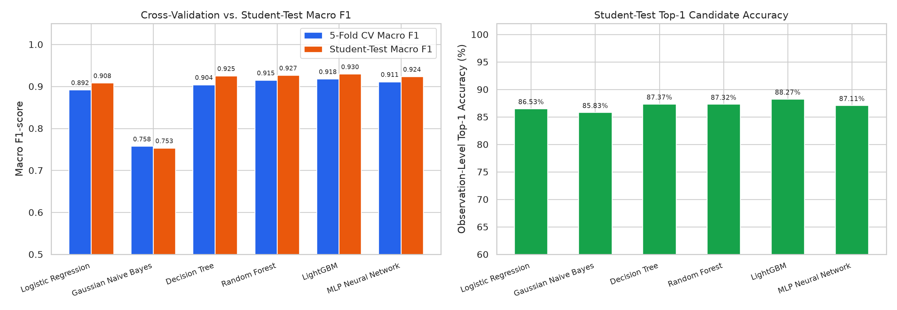
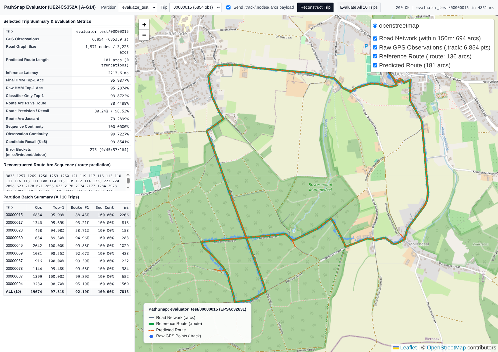

# PathSnap Technical Report (Phases 1 and 2): Group A-G14

**Course:** UE24CS352A: Machine Learning  
**Team A-G14:** Andey Hemanth, Abhiroop, Abhirama H Y, Aman Rao U

---

## 1. Setting Context: What is PathSnap Trying to Solve?

When a vehicle drives through a city, its GPS receiver logs noisy coordinates once every second or so. Those raw points do not sit neatly on the road centerline. Urban canyons, signal dropouts, and stationary jitter at traffic lights pull coordinates by several meters onto parallel lanes, opposite sides of a median, or intersecting side streets. PathSnap takes a noisy sequence of GPS pings and a directed road graph for that region and reconstructs the actual continuous road sequence the vehicle drove.

At first glance, it is tempting to ask: *"Why not just snap every GPS point to whichever road segment is closest?"* Try that on a two-way street or a dense city junction and it breaks immediately. Because a two-way street has overlapping directed arcs pointing in opposite directions at the exact same coordinates, spatial proximity alone flips coin-toss odds between riding in traffic and driving the wrong way. At intersections, snapping independently per ping bounces backward and forward onto cross-streets whenever GPS noise drifts 10 m sideways. Worse still, road networks contain up to 307,392 directed arcs per trip, and the reference ground truth only records the ordered list of traversed road segments rather than a 1-to-1 label for each GPS point.

To solve this cleanly without ever leaking ground-truth route labels into prediction inputs, we split the pipeline into four sequential stages (detailed in Sections 2 through 6) plus a two-laptop deployment stack (Section 7):

1. **Dynamic projection and spatial candidate retrieval:** Project each trip from World Geodetic System 1984 (WGS84) latitude-longitude degrees onto its local Universal Transverse Mercator (UTM) meter plane. Using Gaussian coordinate smoothing and turnaround-aware 20 m spatial-chord headings, retrieve the top K = 8 candidate road segments per ping with a 3-point k-dimensional spatial tree (`cKDTree`). During training only, align GPS pings monotonically along reference routes via dynamic programming (DP) to build binary candidate labels without touching input features.
2. **Leak-free 24-feature candidate scoring:** Extract 24 geometric, heading, temporal-window, and local graph continuity descriptors strictly from the GPS track and road graph. Compare six distinct classifier families under 5-fold trip-grouped cross-validation (`GroupKFold`, keeping entire trips intact within folds), then tune LightGBM using Optuna's Tree-structured Parzen Estimator (TPE).
3. **Hybrid probabilistic-geometric HMM and Viterbi decoding:** Fuse calibrated LightGBM log-probabilities with physical emission geometry and Newson-Krumm directed graph transitions. Viterbi sequence decoding with bounded Dijkstra shortest paths (capped at 3,000 node pops) turns noisy per-ping candidates into connected routes.
4. **Inference-only continuous route boundary realignment:** Monotonically re-align GPS pings onto the decoder's own continuous predicted route sequence without reading reference routes, removing 1-to-2 ping intersection switch lag.
5. **Distributed two-laptop deployment:** Host the frozen Phase 1 pipeline behind a FastAPI server on Laptop 1 with post-prediction server evaluation, driven over HTTP by a minimal web interface on Laptop 2.

Putting these four stages together yields a clear progression across unseen data. On the local holdout set (`student_test`, 10 trips, 19,160 GPS pings), Observation Top-1 Accuracy (the fraction of pings mapped to the aligned true road arc) climbs from 88.2777% (Iteration 1 Classifier-Only) and 93.9405% (Iteration 1 HMM) up to 94.5929% (upgraded Classifier-Only), 96.7589% (Hybrid HMM pre-realignment), and **97.7036%** after boundary realignment, with 96.3390% Mean Route Arc F1 and 99.7940% Reconstructed Sequence Continuity. Running the exact frozen Phase 1 model on the blind evaluation partition (`evaluator_test`, 10 trips, 19,674 GPS pings) achieves **97.5145% Observation Top-1 Accuracy** (+2.25 pp over Classifier-Only at 95.2628%), **92.1917% Mean Route Arc F1** (+8.63 pp over Classifier-Only at 83.5606%), and **100.0000% Sequence Continuity across all 10 trips** in 7.8133 s total inference time.

---

## 2. Dataset Understanding and Exploratory Data Analysis

### 2.1 Raw Structure and Data Quality

Before designing features or choosing a model family, we inspected what every trip actually contains. Each trip directory provides four headerless tables: timestamped GPS points (`track`: longitude, latitude, timestamp), road intersection coordinates (`nodes`), directed road segments (`arcs`: start node and end node indices), and the chronological list of traversed road arc IDs (`route`).

Across all 90 development and validation trips (80 trips in `train` and 10 in `student_test`, totaling 227,577 GPS observations, 2,024,174 nodes, 4,061,945 directed arcs, and 34,813 ground-truth route arcs), the raw files are structurally clean: 0 missing or infinite values, 0 out-of-range coordinates or node/arc indices, 0 isolated graph vertices, and 0 backward timestamps (`dt <= 0`). Table 1 breaks down sizes and timing intervals, while Figures 1 and 2 show sampling gaps and physical trip length distributions.

| Partition | Trips | Total GPS Obs | Obs per Trip (Min / Med / Max) | Total Nodes (Max per Trip) | Total Arcs (Max per Trip) | Steps with `dt = 1 s` | Gaps `> 60 s` (`dt_max`) | UTM Zones |
|---|---:|---:|---:|---:|---:|---:|---:|---:|
| `train` | 80 | 208,417 | 361 / 1,529.0 / 19,313 | 1,933,485 (155,003) | 3,876,904 (307,392) | 96.5037% | 69 (153,064.0 s) | 25 |
| `student_test` | 10 | 19,160 | 262 / 1,420.0 / 3,958 | 90,689 (26,635) | 185,041 (56,027) | 98.6214% | 1 (210.0 s) | 9 |

### 2.2 Spatial Projection and Network Patterns

The trips in this dataset do not live in one city; their centroids span -100.35 deg to 137.22 deg longitude and -34.62 deg to 61.67 deg latitude across North America, Europe, Asia, and the Southern Hemisphere (Figure 3). Why does that matter? Because longitude degrees compress as you move away from the equator. On `train` trip `00000001` (at 50.09 deg N), 1 degree of longitude measures 71,563.72 m while 1 degree of latitude measures 111,230.76 m (a 35.66% east-west compression). Computing Euclidean steps directly in degrees overestimates that 50,228.555 m geodesic trip by 11.80579%, introducing up to 27.91291 m of error on a single 1-second step. Projecting each trip dynamically to the European Petroleum Survey Group (EPSG) WGS84 UTM metric plane at its centroid shrinks length error to 0.03902% (under 3 cm max step error).

Looking closely at road topology and noise patterns (Figures 4 and 5), three practical quirks shape the rest of the system:

- **One-to-many observation-to-route cardinality:** Road graphs contain 1 to 421 weakly connected components in `train` (median 20) and 5 to 100 in `student_test` (median 11), with median bidirectional arc fractions of 95.112% and 93.261% (dropping as low as 35.133% in `train` trip `00000080`). Because vehicles spend several seconds on longer streets, `track` contains roughly five times more rows than `route` (median ratio 5.289x in `train`, 4.635x in `student_test`).
- **Typical GPS jitter vs. severe whole-trip offsets:** On ordinary trips, GPS pings sit close to the true route (median distance 4.503 m in `train` and 4.593 m in `student_test`; 95th-percentile medians 14.212 m and 15.798 m). However, two `train` trips suffer whole-trajectory lateral offsets (`00000054` at median 138.59 m, `p95 = 210.05 m`; `00000033` at median 122.41 m, `p95 = 142.06 m`), and `00000002` mixes a 5.67 m median with extreme outliers (`p95 = 242.36 m`, max 569.66 m). Any model trained on `train` must resist memorizing those shifted trajectories.
- **Imperfect reference continuity:** Ten `train` trips (13 steps) and `student_test` trip `00000076` (1 step) contain disconnected jumps inside the ground-truth `route` list itself, meaning our shortest-path transition model cannot assume perfect zero-gap ground truth.

Figures 6 and 7 zoom into a full UTM trip alongside its high-noise highway interchange and interactive Folium corridor layer.

### 2.3 Preprocessing and Candidate Generation

Suppose a road segment is 1,100 m long and we only index its midpoint in our spatial tree. A GPS point near either end of that highway segment sits closer to a cross-street midpoint 200 m away than to the highway's own midpoint 500 m away, causing the true road to miss the candidate set completely. Meanwhile, if you estimate vehicle heading using a fixed 5-point time window (`p[t+2] - p[t-2]`), GPS jitter of ~5 m while stopped at a red light randomly points the velocity vector backward into the oncoming lane. That single failure mode accounted for 69.9% of all baseline errors on `student_test` trip `00000077`.

To fix both problems at the source, preprocessing follows four steps:

1. **Dynamic per-trip UTM projection:** Convert raw track points and road nodes into the local UTM metric frame resolved from the trip centroid.
2. **Time-gap preservation:** Keep every valid ping intact and pass elapsed step intervals (`dt_prev_s`, capped at 600 s for tabular features and kept raw for sequential decoding).
3. **Turnaround-aware spatial-chord velocity smoothing:** Smooth planar coordinates (`sigma = 2.5`) and search backward and forward along the smoothed track until net displacement reaches 20 m. Whenever arrival and departure chords oppose (`dot(u_back, u_fwd) < -0.2`, signaling a stop or turnaround), the approach chord governs incoming points and the departure chord governs outgoing points. Stationary jitter can no longer invert heading; matched median heading error drops from 8.08 deg (naive baseline) down to 2.94 deg. Instantaneous velocities still use lighter `sigma = 1.2` coordinate derivatives.
4. **3-point `cKDTree` candidate generation and monotonic DP label alignment:** Sample 3 points per arc (`0.15`, `0.50`, `0.85`), retrieve the 72 nearest sample points per ping, compute exact point-to-segment distances, rank unique arc IDs by `dist + 0.5 * (1 - cos_heading_smooth)`, and retain the top K = 8 candidates. As shown in Figure 8, K = 8 cuts candidate miss rate on `student_test` to 0.3862% (99.6138% recall). On training and validation sets only, monotonic dynamic programming (`step in 0..15` plus `+50.0` gap jump) assigns target labels without altering any input feature.

### 2.4 Feature Engineering and Separability Analysis

Looking at why single-ping scoring still struggles at multi-lane junctions, we designed 24 leak-free features across five groups strictly from raw coordinates, road nodes, and directed arcs. Rather than relying solely on instantaneous distance to one ping, the upgraded feature set looks slightly ahead and behind along the smoothed track and checks local topological connectivity (Figure 9):

- **Spatial proximity (6):** Perpendicular point-to-segment distance `dist_to_arc_m`, within-ping candidate rank (`r = -0.4811` correlation with positive target), distance gap above the closest candidate, ratio to best candidate, within-ping distance z-score (`r = -0.4463`), and a 10 m Gaussian emission prior (`r = +0.4726`), reflecting the 5.1 m matched median distance.
- **Projection and geometry (4):** Normalized segment projection fraction, distances to start and end nodes, and arc length (`r = +0.1387`), separating tiny intersection fillets from main arterials.
- **Heading and directionality (5):** Instantaneous alignment cosine (`r = +0.3190`) and sine, smoothed 20 m chord cosine (`r = +0.3522`, median 0.9987 matched vs. -0.0181 unmatched), angular error in degrees (`r = -0.3672`, median 2.94 deg vs. 91.04 deg), and forward alignment flag (97.08% matched vs. 49.24% unmatched).
- **Kinematics and local window (5):** GPS speed, elapsed time `dt_prev_s`, smoothed `t - 4` and `t + 4` point-to-arc distances, and the 3-point smoothed window margin `mean_window3_dist_to_arc_m` above the local minimum (matched median 0.0000 m vs. 23.5209 m unmatched).
- **Graph topology and continuity (4):** Start in-degree, end out-degree, bidirectionality flag, and 2-sided local (`t - 3`, `t`, `t + 3`) connected-chain cost margin `prev_cand_connected` (matched median 0.0000 vs. unmatched median 42.6893, `r = -0.2143`).

---

## 3. Model Experimentation and Comparison

Consecutive GPS observations separated by 1 second belong to the same city, speed profile, and road corridor. Random K-Fold would leak nearly identical neighbors between train and validation folds and flatter the CV score. Instead, we ran **5-fold `GroupKFold` grouped strictly by `trip_id`** across all 80 `train` trips (fitting on `[::3]` strided training rows per fold and validating on 100% of each held-out fold), then refit each family on `train` (`[::3]`) and evaluated unstrided across all 10 `student_test` trips (19,160 observations / 153,280 candidate rows). Both Section 3.1 and Section 4 keep identical LightGBM subsampling settings (`subsample_freq = 1`).

### 3.1 Overall 6-Model Comparison (`train` CV and `student_test`)

Table 2 compares all six model families side by side. Looking at the numbers, a few clear patterns stand out: tree ensembles handle discrete distance ranks (`dist_rank`) and integer node degrees better than linear or MLP models, and Naive Bayes completely breaks down on probability calibration even though its ranking order looks respectable.

| Model | Algorithm Family | Key Configuration | CV Macro F1 (Std) | Top-1 Acc (Test) | Pooled Continuity (Test) | Student-Test Macro F1 | Log Loss (Test) | Inference Time (10 trips) |
|---|---|---|---:|---:|---:|---:|---:|---:|
| Logistic Regression | Linear | StandardScaler + L2 `C=1.0`, `max_iter=500` | 0.9154 (0.0355) | 92.2651% | 93.3420% | 0.9320 | 0.0831 | 0.0254 s |
| Gaussian Naive Bayes | Probabilistic | StandardScaler + `GaussianNB(var_smoothing=1e-6)` | 0.7943 (0.0291) | 91.9676% | 92.4491% | 0.7957 | 1.3652 | 0.0695 s |
| Decision Tree | Tree-based | `max_depth=12`, `min_samples_leaf=50` | 0.9317 (0.0618) | 93.6273% | 95.1436% | 0.9627 | 0.0551 | **0.0065 s** |
| Random Forest | Ensemble Bagging | `n_estimators=80`, `max_depth=14`, `min_samples_leaf=20` | 0.9466 (0.0373) | 94.0292% | 95.2428% | 0.9630 | 0.0454 | 0.0998 s |
| **LightGBM** | **Gradient Boosting** | `n_estimators=200`, `lr=0.08`, `num_leaves=31`, `min_child=50`, `subsample_freq=1` | **0.9489 (0.0369)** | **94.4676%** | **95.9373%** | **0.9664** | **0.0418** | 0.1471 s |
| MLP Neural Network | Neural Networks | StandardScaler + `(64, 32)`, `early_stopping=True`, `batch=2048` | 0.9399 (0.0389) | 93.6534% | 94.4230% | 0.9549 | 0.0539 | 0.0404 s |

Two subtle details in Table 2 deserve note. First, across every model family, Fold 0 drops to 49.84% to 51.54% validation Top-1 Accuracy compared to 82.16% to 95.10% in Folds 1 through 4 because `GroupKFold` puts the 138 m whole-trip offset trip `00000054` (19,313 observations) in Fold 0 and `00000033` in Fold 3. Keeping those outliers in `train` makes CV honest rather than artificially smooth. Second, `Pooled Continuity` in Sections 3 and 4 measures observation-level directed transitions pooled across all 19,150 steps (`sum(connected) / sum(total)`), whereas Section 5 reports both per-trip mean continuity and final route sequence continuity.

---

### 3.2 Individual Model Analysis

#### 1. Logistic Regression (Linear)
- **A. Model Understanding:**

    - **1. Suitability:** Fast linear baseline combining candidate rank, Gaussian emission prior, smooth heading alignment, and 2-sided chain margins to produce well-behaved sigmoid probabilities.
    - **2. Strengths and Limitations:** Fits in 1.958 s with almost zero variance (`train_fit_macro_f1 = 0.9199` vs. CV 0.9154), yet a single linear boundary cannot model nonlinear trade-offs between stopped jitter, sharp turns, and multi-second signal dropouts.

- **B. Training and Configuration:**

    - **3. Hyperparameters:** `StandardScaler()` followed by L2 `LogisticRegression(C=1.0, max_iter=500, random_state=42)`.
    - **4. Loss and Objective:** L2-regularized binary log loss.

- **C. Experimental Results:**

    - **5. Student-Test Summary:** 0.9320 Macro F1, 92.2651% Top-1 Accuracy, 93.3420% pooled Continuity (0.0254 s inference).
    - **6. Detailed Metrics:** Positive Precision 0.8865, Positive Recall 0.8752, Positive F1 0.8808, Log Loss 0.0831.
    - **7. Fit Assessment:** Clear underfitting relative to gradient-boosted trees (`train_fit` 0.9199 vs. LightGBM 0.9732; CV 0.9154 vs. LightGBM 0.9489).

#### 2. Gaussian Naive Bayes (Probabilistic)
- **A. Model Understanding:**

    - **1. Suitability:** Closed-form generative baseline modeling class-conditional Gaussian likelihoods per feature.
    - **2. Strengths and Limitations:** Fastest to fit (0.676 s), but conditional independence fails completely across correlated distance and local window features (`dist_to_arc_m`, `mean_window3_dist_to_arc_m`, `prev_cand_connected`). Multiplying redundant evidence pushes predicted probabilities toward extreme 0 or 1.

- **B. Training and Configuration:**

    - **3. Hyperparameters:** `StandardScaler()` followed by `GaussianNB(var_smoothing=1e-6)`.
    - **4. Loss and Objective:** Maximum-likelihood Gaussian density estimation via Bayes' rule.

- **C. Experimental Results:**

    - **5. Student-Test Summary:** 0.7957 Macro F1, 91.9676% Top-1 Accuracy, 92.4491% pooled Continuity (0.0695 s inference).
    - **6. Detailed Metrics:** Positive Precision 0.5039, Positive Recall 0.9842, Positive F1 0.6665, Log Loss 1.3652.
    - **7. Fit Assessment:** Severe underfitting and miscalibration (`train_fit` 0.7810, CV 0.7943, 18,493 false positives). Even when within-ping ranking stays decent (91.97% Top-1), a 1.3652 Log Loss would corrupt Viterbi emission scores downstream.

#### 3. Decision Tree (Tree-based)
- **A. Model Understanding:**

    - **1. Suitability:** Captures threshold interactions across candidate rank, chord heading cosine, and local chain continuity without scaling.
    - **2. Strengths and Limitations:** Fastest inference (0.0065 s across 10 trips), though single greedy splits overfit specific cities and widen fold variance (CV std 0.0618).

- **B. Training and Configuration:**

    - **3. Hyperparameters:** `DecisionTreeClassifier(max_depth=12, min_samples_leaf=50, random_state=42)`.
    - **4. Loss and Objective:** Gini impurity minimization.

- **C. Experimental Results:**

    - **5. Student-Test Summary:** 0.9627 Macro F1, 93.6273% Top-1 Accuracy, 95.1436% pooled Continuity (0.0065 s inference).
    - **6. Detailed Metrics:** Positive Precision 0.9414, Positive Recall 0.9279, Positive F1 0.9346, Log Loss 0.0551.
    - **7. Fit Assessment:** Moderate overfitting (`train_fit` 0.9643 vs. CV 0.9317, gap 0.0326) and weaker calibration than ensembles.

#### 4. Random Forest (Ensemble Bagging)
- **A. Model Understanding:**

    - **1. Suitability:** Averages 80 bootstrap trees to smooth away single-tree variance across dense street grids.
    - **2. Strengths and Limitations:** Achieves the highest Positive Precision (0.9544) among all six models and clean calibration (Log Loss 0.0454), at the steepest training runtime (20.097 s).

- **B. Training and Configuration:**

    - **3. Hyperparameters:** `RandomForestClassifier(n_estimators=80, max_depth=14, min_samples_leaf=20, random_state=42)`.
    - **4. Loss and Objective:** Bagged Gini impurity reduction across bootstrap samples.

- **C. Experimental Results:**

    - **5. Student-Test Summary:** 0.9630 Macro F1, 94.0292% Top-1 Accuracy, 95.2428% pooled Continuity (0.0998 s inference).
    - **6. Detailed Metrics:** Positive Precision 0.9544, Positive Recall 0.9165, Positive F1 0.9351, Log Loss 0.0454.
    - **7. Fit Assessment:** Well-controlled generalization (`train_fit` 0.9672 vs. CV 0.9466, std 0.0373), lifting CV F1 by +0.0149 over Decision Tree.

#### 5. LightGBM (Gradient Boosting, Selected Model)
- **A. Model Understanding:**

    - **1. Suitability:** Fits histogram-boosted trees directly to binary log loss, optimizing the exact calibrated log-probabilities consumed by the HMM emission term.
    - **2. Strengths and Limitations:** Ranks 1st across all 5 CV folds in Macro F1 (0.8716, 0.9544, 0.9685, 0.9609, 0.9676; while Random Forest edges ahead on per-fold Top-1 in Folds 1 and 2 and Decision Tree leads Fold 4), wins Test Macro F1 (0.9664), Test Top-1 (94.4676%), pooled Continuity (95.9373%), and lowest Log Loss (0.0418), while training 6.0x faster than Random Forest (3.360 s vs. 20.097 s). Leaf constraints still need tuning so late iterations do not memorize shifted `train` trips.

- **B. Training and Configuration:**

    - **3. Hyperparameters:** `LGBMClassifier(n_estimators=200, learning_rate=0.08, num_leaves=31, min_child_samples=50, subsample=0.8, subsample_freq=1, colsample_bytree=0.8, random_state=42)`.
    - **4. Loss and Objective:** Binary cross-entropy (`binary_logloss`) via leaf-wise boosting.

- **C. Experimental Results:**

    - **5. Student-Test Summary:** 0.9664 Macro F1, 94.4676% Top-1 Accuracy, 95.9373% pooled Continuity (0.1471 s inference).
    - **6. Detailed Metrics:** Positive Precision 0.9444, Positive Recall 0.9378, Positive F1 0.9411, Log Loss 0.0418.
    - **7. Fit Assessment:** Healthy generalization (`train_fit` 0.9732, CV 0.9489, Test 0.9664). On Figure 13, Fold 0 validation loss bottoms out (~0.160) around iteration 22 before drifting to ~0.221 by iteration 200 solely on noisy Fold 0 (`00000054`), which directly motivates the regularization search in Section 4.

#### 6. MLP Neural Network (Neural Networks)
- **A. Model Understanding:**

    - **1. Suitability:** Learns smooth nonlinear combinations across standardized spatial, angular, and graph continuity features.
    - **2. Strengths and Limitations:** Fast inference (0.0404 s across 10 trips) and smooth calibration (Log Loss 0.0539), though tree splits still separate discrete distance ranks (`dist_rank`) and integer node degrees more cleanly.

- **B. Training and Configuration:**

    - **3. Hyperparameters:** `StandardScaler()` + `MLPClassifier(hidden_layer_sizes=(64, 32), alpha=1e-4, learning_rate_init=1e-3, max_iter=35, batch_size=2048, tol=1e-3, early_stopping=True, validation_fraction=0.1, n_iter_no_change=4, random_state=42)`.
    - **4. Loss and Objective:** L2-regularized binary cross-entropy optimized via Adam.

- **C. Experimental Results:**

    - **5. Student-Test Summary:** 0.9549 Macro F1, 93.6534% Top-1 Accuracy, 94.4230% pooled Continuity (0.0404 s inference).
    - **6. Detailed Metrics:** Positive Precision 0.9393, Positive Recall 0.9030, Positive F1 0.9208, Log Loss 0.0539.
    - **7. Fit Assessment:** Low train-CV gap (`train_fit` 0.9498 vs. CV 0.9399), halting at epoch 9 under internal 10% random validation early stopping (Figure 13).

---

### 3.3 Model Visualisations

Figures 10 through 13 visualize the cross-validation and held-out model rankings, probability calibration vs. continuity, confusion matrices, and training loss curves for the iterative learners.

---

## 4. Bayesian Hyperparameter Optimisation (LightGBM)

With LightGBM beating all five competing families on CV Macro F1 (0.9489) and Test Log Loss (0.0418), the remaining bottleneck was probability calibration across noisy folds. An exhaustive 3-level grid over 8 tree hyperparameters would require `3^8 = 6,561` 5-fold runs, so we used Optuna TPE instead:

1. **Hyperparameters included:** Tree count (`n_estimators`), learning rate (`learning_rate`), leaf count (`num_leaves`), max depth (`max_depth`), minimum leaf size (`min_child_samples`), row subsampling (`subsample` with `subsample_freq=1`), feature subsampling (`colsample_bytree`), and L2 regularization (`reg_lambda`).
2. **Search ranges:** `n_estimators` integer `[120, 400]`; `learning_rate` log-uniform `[0.02, 0.18]`; `num_leaves` `[15, 95]` and `max_depth` `[4, 12]`; `min_child_samples` `[20, 150]` (regularizing outlier offset trips); `subsample` and `colsample_bytree` `[0.65, 1.0]`; and `reg_lambda` log-uniform `[1e-3, 10.0]`.
3. **Objective function:** 5-fold `GroupKFold` out-of-fold Macro F1 strictly on the 80 `train` trips (`[::5]` fit stride during search; final untuned vs. tuned comparison run identically at `[::3]` with `subsample_freq=1` over 100% validation and `student_test`).
4. **Trial budget:** 25 Optuna TPE trials (`TPESampler(seed=42)`), finishing in 646.18 s.
5. **Best hyperparameters (Trial 19, search CV Macro F1 = 0.95054):** `n_estimators=385`, `learning_rate=0.02365`, `num_leaves=88`, `max_depth=10`, `min_child_samples=97`, `subsample=0.67683`, `colsample_bytree=0.72281`, `reg_lambda=0.00105`, `subsample_freq=1`.
6. **Did tuning help?** Yes, on every selection and calibration metric, as summarized in Table 3 and Figure 14. Slower learning (`0.02365` vs. `0.08`) over more trees (`385` vs. `200`) with larger leaves (`min_child_samples=97`) and feature/row subsampling lowers CV Log Loss from 0.0836 to 0.0788 and Student-Test Log Loss from 0.0418 to 0.0404, lifting Top-1 Accuracy to 94.5929%. This comes with one modest caveat: scoring 385 trees at `0.4112 s` takes `2.81x` longer per batch than 200 trees (`0.1461 s`), and the Macro F1 gain lies inside fold standard deviation (`0.0363`), so the sharper probabilities matter mostly for downstream Viterbi emissions.

| Variant | CV Macro F1 (Std) | CV Top-1 Acc | CV Log Loss | Student-Test Macro F1 | Student-Test Top-1 Acc | Student-Test Log Loss | Pooled Continuity (Test) | Train Time | Inf Time (10 trips) |
|---|---:|---:|---:|---:|---:|---:|---:|---:|---:|
| Untuned LightGBM (`subsample_freq=1`) | 0.9489 (0.0369) | 82.9611% | 0.0836 | 0.9664 | 94.4676% | 0.0418 | 95.9373% | **3.282 s** | **0.1461 s** |
| **Tuned LightGBM (Optuna TPE)** | **0.9505 (0.0363)** | **83.1252%** | **0.0788** | **0.9674** | **94.5929%** | **0.0404** | 95.9373% | 10.848 s | 0.4112 s |

---

## 5. HMM and Viterbi Route Reconstruction

Even a 94.59% point classifier still picks candidates independently at each timestamp, leaving occasional 1-second jumps onto parallel alleys or cross-streets. To turn local candidate probabilities into a valid vehicle trajectory, we pass them into a directed Hidden Markov Model (HMM) decoded with Viterbi dynamic programming.

### 5.1 Hidden States, Emissions, and Transitions

Let's break down how the three pieces of the HMM fit together:-

1. **Hidden states:** At each GPS observation `t`, the K = 8 hidden states are the top-8 candidate road arcs retrieved by `cKDTree`.
2. **Hybrid emission scoring:** Instead of using raw classifier probabilities alone (which can saturate near 0 or 1), emissions combine calibrated Tuned LightGBM log-probabilities with explicit geometric distance and heading penalties:
   `emit_log[t, k] = alpha_emit * log(clip(p[t, k], 1e-6, 1 - 1e-6)) - geom_weight * (cand_dists[t, k] + 1.5 * (1 - cos_sm[t, k]))`.
3. **Transition scoring and stratified `train` tuning:** Transitions follow a directed Newson-Krumm formulation:

    - Staying on the same arc (`a = b`): `d_road = |t_cur - t_prev| * L_a`, adding `backtrack_cost` if projection regresses past `t_prev - 0.12`.
    - Switching arcs (`a != b`): bounded Dijkstra (`max_pops = 3000`) finds shortest directed distance `d_sp(v_a -> u_b)` so `d_road = (1 - t_prev) * L_a + d_sp + t_cur * L_b`.
    - Connected log-transition score is `-min(max_conn_penalty, beta_trans * |d_road - d_gps| / sqrt(dt)) - switch_cost - min(25.0, sp_weight * d_sp / sp_gap_scale) - uturn_cost * I(u_b == v_a and v_b == u_a)`.
    - Evaluating six parameter configs strictly on **6 stratified `train` trips** (`00000001`, `00000004`, `00000013`, `00000018`, `00000022`, `00000035`, covering 379 to 2,580 observations, 6.0k to 155k nodes, and 53.1% to 100.0% 1 Hz cadences) selected `config_id = 1` (`alpha_emit=1.0`, `geom_weight=0.5`, `beta_trans=0.35`, `switch_cost=1.0`, `sp_weight=0.10`, `uturn_cost=8.0`, `backtrack_cost=4.0`, `disconnect_penalty=80.0`, `max_conn_penalty=30.0`), achieving 93.5408% Route Arc F1, 97.5965% Realigned Top-1 Accuracy, and 99.6647% sequence continuity on that training slice while leaving `student_test` completely untouched.

### 5.2 Handling Missing Candidates, Gaps, and Disconnected Segments

Real GPS traces drop out under tunnels and brief candidate misses happen at complex interchanges. Three safeguards keep reconstruction continuous without reading reference routes:

1. **Multi-second GPS gaps:** Kinematic slack (`gap_scale = sqrt(dt)`) and shortest-path slack (`sp_gap_scale = sqrt(dt / 5.0)` for `dt > 5 s`) widen automatically across dropouts, Dijkstra's distance horizon scales via `ceil(max(200, min(55 * dt, 3500)) / 10) * 10`, and the disconnect penalty stays at least `65.0` (strictly above the worst connected penalty of `64.0`) so valid bridged paths never fracture needlessly.
2. **Candidate misses and shortest-path bridging:** When a true short connector arc misses the top-8 set, Viterbi tracks adjacent connected streets on either side and route reconstruction bridges multi-hop node gaps up to 1,500 m. Across all 10 `student_test` trips (19,160 observations), 0 Dijkstra truncations occurred.
3. **Stage 4 Continuous Route Boundary Realignment:** Because switching arcs incurs a `switch_cost` penalty in Viterbi, the raw decoded sequence occasionally delays an intersection handover by 1 or 2 pings. Once Viterbi fixes the continuous road sequence (`reconstructed_route`), Stage 4 runs monotonic alignment strictly along that predicted sequence using only raw GPS points and 20 m spatial chords. Removing reference routes completely from disk produces bit-for-bit identical output, confirming zero label leakage.

### 5.3 Classifier-Only vs. Hybrid HMM and Boundary Realignment

Table 4 and Figure 15 show what happens to prediction quality when sequential structure and boundary realignment sit on top of the tuned LightGBM scores on `student_test`.

| Method | Weighted Obs Top-1 Acc | Mean Obs Continuity | Reconstructed Seq Continuity | Mean Route Arc Precision | Mean Route Arc Recall | Mean Route Arc F1 vs. `.route` | Mean Route Jaccard | Total Inf Time (10 trips) |
|---|---:|---:|---:|---:|---:|---:|---:|---:|
| Classifier-Only (v2 Features + Tuned LightGBM) | 94.5929% | 95.7632% | 99.2015% | 76.5206% | 98.8867% | 85.4611% | 75.5332% | **0.4284 s** |
| Hybrid HMM/Viterbi (Pre-Realignment) | 96.7589% | **97.8494%** | **99.7940%** | **93.9500%** | **99.0493%** | **96.3390%** | **93.0827%** | 7.4079 s |
| **Hybrid HMM/Viterbi + Boundary Realignment** | **97.7036%** | 97.7155% | **99.7940%** | **93.9500%** | **99.0493%** | **96.3390%** | **93.0827%** | 7.4079 s |

Notice how the biggest jump in Table 4 is not just Observation Top-1 Accuracy (+3.11 pp, from 94.5929% to 97.7036%), it is **Mean Route Arc Precision (+17.43 pp, from 76.5206% to 93.9500%)** and **Route Jaccard (+17.55 pp, from 75.5332% to 93.0827%)**. Independent classification suffers a 76.52% precision drag because momentary 1-second mistakes introduce false side-street arcs that shortest-path stitching then has to detour through; HMM suppresses those spurious turns, raising Mean Route Arc F1 from 85.4611% to 96.3390%. Reconstructed Sequence Continuity hits 99.7940%, with 7 of 10 trips at 100.00% (`00000007`, `00000009`, `00000040`, `00000052`, `00000076`, `00000077`, `00000091`) and the remaining three above 98.98% (`00000000`: 98.9899%, `00000056`: 99.4792%, `00000065`: 99.4709%).

Three caveats remain: runtime sits at 7.4079 s (~741 ms/trip) due to bounded Dijkstra calls, dense-grid trip `00000009` ends at 92.6597% Top-1 Accuracy with 21 opposite-twin pings, and Stage 4 trims Mean Obs Continuity by 0.13 pp (97.8494% to 97.7155%) when fast pings step cleanly past short 5 to 15 m intersection fillets that still stay intact inside the reconstructed route sequence.

### 5.4 Incremental Accuracy Progression and Error-Bucket Ablation

A fair objection whenever accuracy climbs sharply is: *"Did one fixed outlier trip carry the entire gain?"* To test that directly, Table 5 and Figure 16 track all five development stages on `student_test` while splitting high-error Trip `00000077` away from the other 9 trips (15,249 observations).

| Stage | Description | Weighted Top-1 Acc | Step Gain | Other-9 Trips Top-1 | Trip `00000077` Top-1 | Mean Route F1 | Candidate Misses | Opp-Twin Errors | Boundary Lag Errors | Other Detour Errors | Total Errors |
|---|---|---:|---:|---:|---:|---:|---:|---:|---:|---:|---:|
| Stage 0 | Iteration 1 Baseline Classifier | 88.2777% | 0.0000 pp | 91.7437% | 74.7635% | 79.2929% | 78 | | | | 2,246 |
| Stage 1 | Iteration 1 Baseline HMM | 93.9405% | +5.6628 pp | 95.7243% | 86.9854% | 95.7142% | 78 | | | | 1,161 |
| Stage 2 | + v2 Chord/Window/Chain Features (Clf) | 94.5929% | +0.6524 pp | 94.3603% | 95.4999% | 85.4611% | 74 | 157 | 394 | 411 | 1,036 |
| Stage 3 | + Hybrid Prob-Geom HMM (Raw) | 96.7589% | +2.1660 pp | 96.5834% | 97.4431% | **96.3390%** | 74 | **21** | 327 | **199** | 621 |
| **Stage 4** | **+ Continuous Route Realignment** | **97.7036%** | **+0.9447 pp** | **97.7113%** | **97.6732%** | **96.3390%** | **51** | 30 | **147** | 212 | **440** |

*Note on Stage 0 and Stage 1 Error Sub-Buckets:* Iteration 1 baselines logged total mismatches (2,246 and 1,161) and candidate misses (78 at K = 8); exclusive four-bucket error decomposition starts at Stage 2 (1,036 to 621 to 440 errors).

The progression holds broadly across the dataset, not just on one trip:-

- **Steady climb outside Trip `00000077`:** On the other 9 trips combined, Classifier-Only accuracy improves from 91.7437% (Stage 0) to 94.3603% (Stage 2), and HMM sequence decoding improves from 95.7243% (Stage 1) to 96.5834% (Stage 3) and 97.7113% (Stage 4). Meanwhile, Trip `00000077` climbs +22.91 pp overall (74.7635% to 97.6732%).
- **Why Stage 4 adds +0.94 pp cleanly:** Realigning along `reconstructed_route` flips 337 total pings (244 wrong-to-right corrections vs. 63 right-to-wrong regressions, plus 30 wrong-to-wrong shifts, a +181 net error cut), slicing Intersection Boundary Lag errors by 55.0% (327 down to 147) and recovering 23 candidate-miss pings on bridged arcs.

---

## 6. Geographical Visualisation Using Folium

Aggregate numbers hide where errors actually sit on the street map, so we built interactive Folium corridor overlays for inspection. Figure 17 shows `student_test` trip `00000000` side by side before and after HMM decoding: pruning scattered Classifier-Only detours lifts Observation Top-1 Accuracy from 95.88% to 96.92% and Route Arc F1 from 83.26% to 94.15% (Precision 71.31% to 89.85%). Full interactive Folium HTML maps for representative training, validation, and evaluation trips are included in the repository and illustrated in Figures 7, 18, and 20, rendering OpenStreetMap tiles, corridor road networks, raw GPS pings layered beneath solid green reference routes and dashed orange predicted routes, floating legends, and interactive layer toggles.

---

## 7. API, UI, Two-Laptop Deployment, and Blind Evaluator Test Benchmark

### 7.1 Two-Laptop Distributed Deployment Architecture

During live demonstration and testing, PathSnap splits heavy inference and server-side scoring onto **Laptop 1 (Model Server)** while keeping trip selection and map exploration on **Laptop 2 (Evaluator Client)** over a local network:-

1. **Laptop 1 Model Server:** Loads the frozen Phase 1 Tuned LightGBM classifier and HMM configuration once at startup using FastAPI lifespan hooks, enables Cross-Origin Resource Sharing (CORS), and accepts trip selection requests or raw uploaded payloads over HTTP.
2. **Zero-leakage inference boundary:** Whenever inference runs on a trip, Laptop 1 stages only the raw GPS track, road nodes, and directed arcs inside an isolated temporary directory without any reference route file present, calling `predict_trip_route` with `include_labels=False`. No reference label touches feature computation, scoring, Viterbi decoding, or Stage 4 realignment.
3. **Post-prediction server evaluation:** Only after `predict_trip_route` finishes and stops the inference timer does Laptop 1 check if a server-side reference route exists for that trip, compute accuracy, route precision/recall/F1, Jaccard score, four-bucket error counts, formatted CMD terminal logs, and interactive Folium maps.
4. **Frozen weight verification:** Cryptographic SHA-256 digests verified before and after running `evaluator_test` confirmed that tuned classifier weights, untuned baseline weights, and HMM parameters stayed bit-for-bit unchanged from Phase 1.

### 7.2 FastAPI Endpoints and Receiving Laptop CMD Verification

The FastAPI service exposes five endpoints guarded by partition allow-lists and strict trip-ID validation:

- `GET /api/health`: Reports server readiness, loaded model identity, active HMM parameters, and detected partitions (`evaluator_test`, `student_test`).
- `GET /api/trips`: Lists trips in the chosen partition with observation counts, road graph sizes, and trip durations.
- `POST /api/predict`: Accepts either a partition and trip ID or an uploaded raw payload (raw GPS points, nodes, and arcs without reference routes), returns the full reconstructed arc sequence, runtime latency, post-prediction server metrics, and map URL, and prints a structured response summary on Laptop 1's console.
- `GET /api/evaluate_all`: Runs frozen batch inference over all 10 trips in a partition, persists CSV tables, and prints an aligned batch table on Laptop 1.
- `GET /api/map/{partition}/{trip_id}`: Serves or generates on demand the interactive Folium map with road corridor segments, GPS pings, ground-truth route, and dashed orange prediction.

Figure 19 captures Laptop 1's receiving terminal window after executing batch evaluation over `evaluator_test` and processing a live LAN payload request for trip `00000015`.

### 7.3 Minimal Evaluator Web Interface (Laptop 2)

For Laptop 2, we deliberately kept the web client stripped down and utilitarian: plain HTML tables, flat white and grey surfaces, 1 px borders, and clean system typography with zero gradients, drop shadows, pills, badges, or decorative bloat. An evaluator can switch partitions (`evaluator_test` or `student_test`), select any of the 10 trips, toggle explicit `.track`/`.nodes`/`.arcs` payload transmission over LAN without reference routes, reconstruct a single trip, or evaluate all 10 trips at once (clicking any table row opens that trip's map and metrics). Proxying the Folium map endpoint through Laptop 2 keeps the embedded `<iframe>` same-origin cleanly across LAN IPs. Figure 20 shows the live working UI on `evaluator_test` trip `00000015`.

### 7.4 Blind Holdout Evaluation on `evaluator_test` (10 Trips, 19,674 GPS Observations)

With everything frozen, we ran the exact Phase 1 model and HMM decoder across all 10 unseen `evaluator_test` trips (19,674 GPS observations, 168,832 nodes, and 338,528 arcs total). Table 6 reports every trip alongside aggregate metrics, and Figure 21 compares `evaluator_test` against `student_test`.

| Trip ID | Obs | Road Nodes / Arcs | Cand Recall (`K=8`) | Clf-Only Top-1 | Raw HMM Top-1 | Final HMM Top-1 | Route Arc Precision | Route Arc Recall | Route Arc F1 | Seq Continuity | Total Errors | Inf Time (s) |
|---|---:|---:|---:|---:|---:|---:|---:|---:|---:|---:|---:|---:|
| `00000015` | 6,854 | 1,571 / 3,225 | 99.8541% | 93.8722% | 95.2874% | **95.9877%** | 80.2395% | 98.5294% | **88.4488%** | 100.0000% | 275 | 2.2657 |
| `00000017` | 1,346 | 36,724 / 76,425 | 98.2169% | 91.1590% | 91.6790% | **95.6909%** | 88.2647% | 98.7430% | **93.2103%** | 100.0000% | 58 | 0.8178 |
| `00000023` | 458 | 5,053 / 10,596 | 96.9432% | 91.7031% | 92.5764% | **94.9782%** | 41.5493% | 100.0000% | **58.7065%** | 100.0000% | 23 | 0.1527 |
| `00000030` | 654 | 13,223 / 24,218 | 96.6361% | 84.8624% | 86.2385% | **89.2966%** | 92.1788% | 97.9228% | **94.9640%** | 100.0000% | 70 | 0.2882 |
| `00000049` | 2,642 | 23,165 / 47,542 | 100.0000% | 99.6972% | 99.9621% | **100.0000%** | 100.0000% | 99.7561% | **99.8779%** | 100.0000% | 0 | 1.0285 |
| `00000059` | 1,031 | 12,631 / 24,024 | 99.0301% | 95.1503% | 95.0533% | **98.5451%** | 86.3378% | 100.0000% | **92.6680%** | 100.0000% | 15 | 0.4834 |
| `00000067` | 916 | 2,265 / 4,485 | 100.0000% | 99.0175% | 99.6725% | **100.0000%** | 100.0000% | 98.7805% | **99.3865%** | 100.0000% | 0 | 0.2321 |
| `00000073` | 1,144 | 12,151 / 25,631 | 99.8252% | 98.1643% | 98.2517% | **99.4755%** | 99.1632% | 100.0000% | **99.5798%** | 100.0000% | 6 | 0.3835 |
| `00000087` | 1,399 | 55,234 / 107,451 | 99.8570% | 96.6405% | 99.4282% | **100.0000%** | 100.0000% | 99.7802% | **99.8900%** | 100.0000% | 0 | 0.6521 |
| `00000094` | 3,230 | 6,815 / 14,931 | 99.9071% | 96.2539% | 96.5015% | **98.6997%** | 90.9502% | 99.8344% | **95.1855%** | 100.0000% | 42 | 1.5093 |
| **Aggregate (Wtd / Mean)** | **19,674** | **168,832 / 338,528** | **99.5578%** | **95.2628%** | **96.1624%** | **97.5145%** | **87.8684%** | **99.3346%** | **92.1917%** | **100.0000%** | **489** | **7.8133** |

*Notes on Aggregate Row:* Candidate Recall, Classifier-Only Top-1, Raw HMM Top-1, and Final HMM Top-1 report observation-weighted means across all 19,674 pings (unweighted trip mean Final Top-1 is 97.2674%). Route Precision, Recall, F1 (mean Jaccard 87.3165%), and Sequence Continuity (100.0000%) report unweighted 10-trip means. Total Errors (489: 66 candidate misses, 68 opposite twins, 109 adjacent boundary lags, 246 detours) and Inference Time (7.8133 s, mean 0.7813 s/trip) are sums.

Looking closely at Table 6 and Figure 21, three points sum up how the frozen model held up:-

1. **Zero overfitting to `student_test`:** Weighted Observation Top-1 Accuracy shifts by only 0.19 pp between `student_test` (97.7036%) and unseen `evaluator_test` (97.5145%), while Classifier-Only Top-1 actually improves to 95.2628% and Candidate Recall holds at 99.5578%. Three trips (`00000049`, `00000067`, `00000087`) finish at 100.0000% Top-1 Accuracy with 0 errors and at least 99.38% Route Arc F1.
2. **100% Sequence Continuity on all 10 trips:** Every single reconstructed route forms an unbroken directed graph path (100.0000% continuity, 0 Dijkstra truncations), even on the 107,451-arc road network of trip `00000087` (0.6521 s).
3. **Why Trip `00000023` stands out:** Trip `00000023` is the one row where Observation Top-1 Accuracy (94.9782%) and Route Arc F1 (58.7065%) pull apart, and it is worth pinning down why. Raw HMM picks 65 unique arcs against 59 reference arcs, recovering 100.0000% of ground-truth arcs with only 23 errors (18 on a brief detour). When shortest-path bridging stitches that multi-hop local detour back to the main road, it inserts 83 unique off-route connector arcs (142 unique predicted arcs across 144 entries), cutting set precision to 41.5493% on that short trip while leaving the other nine trips between 88.45% and 99.89% F1.

