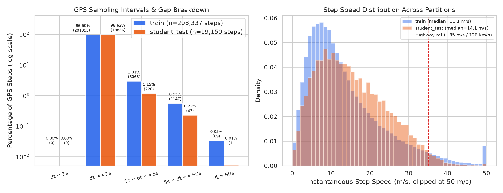
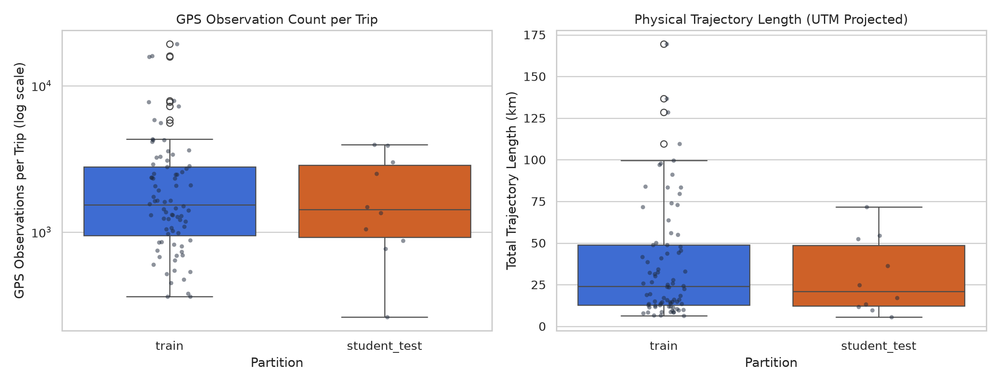
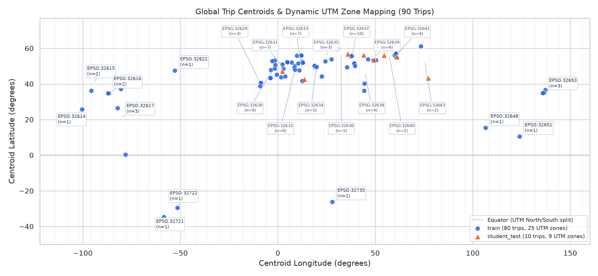
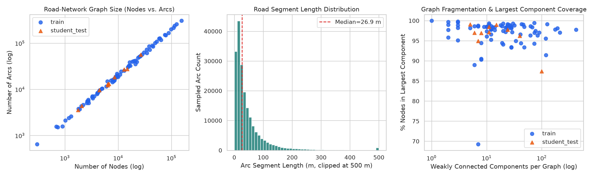
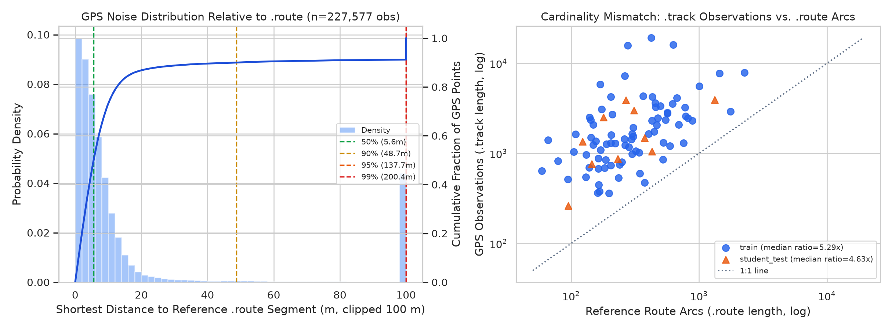
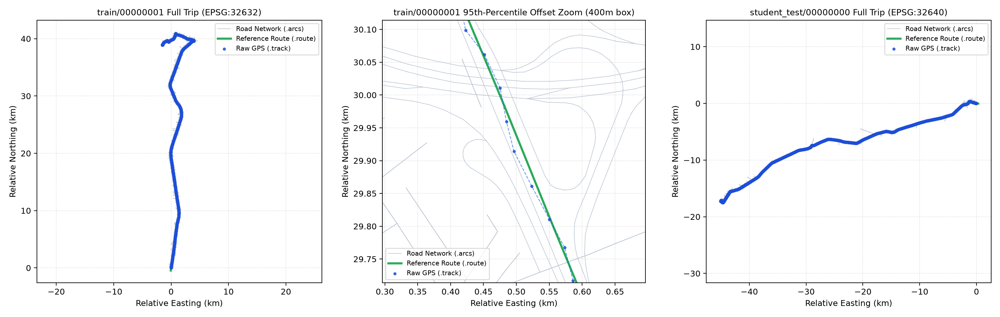

# PathSnap Exploratory Data Analysis (EDA) Summary Report: Group A-G14

**Course:** UE24CS352A: Machine Learning  
**Partitions inspected:** `train` (80 trips) and `student_test` (10 trips)  
**Leakage policy:** We keep all evaluator-testing data untouched during exploration and development. Every table, number, and plot in this report comes from `train` and `student_test` only.

---

## 1. Dataset Organization, File Types, and Scale

Before building any candidate generator or model, we inspected the raw files across all 90 available trips. Each trip sits in its own directory (`<trip_id>/`) and contains four headerless, whitespace-separated files:

1. `<trip_id>.track`: raw GPS observations as `float64` values (`longitude`, `latitude`, `timestamp` in seconds).
2. `<trip_id>.nodes`: road-network vertices as `float64` values (`longitude`, `latitude`), where the 0-based row index serves as `node_id`.
3. `<trip_id>.arcs`: directed road segments as `int64` values (`from_node_id`, `to_node_id`), where the 0-based row index serves as `arc_id`.
4. `<trip_id>.route`: reference path as `int64` values giving the chronological sequence of `arc_id` integers traversed by the vehicle.

Table 1 summarizes row counts and file sizes across both partitions. Road networks are large: one `train` trip contains up to 155,003 nodes and 307,392 arcs. Scanning every arc for every GPS point without spatial indexing would be too slow for live API inference.

| Partition | Trips | Total GPS Obs | Obs per Trip (Min / Med / Max) | Total Nodes (Med / Max per Trip) | Total Arcs (Med / Max per Trip) | Total Route Arcs (Med / Max) | Distinct UTM Zones |
|---|---:|---:|---:|---:|---:|---:|---:|
| `train` | 80 | 208,417 | 361 / 1,529.0 / 19,313 | 1,933,485 (9,608.0 / 155,003) | 3,876,904 (19,526.5 / 307,392) | 31,336 (280.0 / 2,266) | 25 |
| `student_test` | 10 | 19,160 | 262 / 1,420.0 / 3,958 | 90,689 (6,596.5 / 26,635) | 185,041 (13,145.0 / 56,027) | 3,477 (250.0 / 1,323) | 9 |

File sizes also vary widely across trips (`trip_inventory.csv`). In `train`, `.track` files range from 11,566 to 626,431 bytes (median 49,352 bytes, total 6,872,352 bytes), `.nodes` from 5,681 to 2,945,057 bytes (median 195,546 bytes, total 38,431,647 bytes), `.arcs` from 4,700 to 3,856,964 bytes (median 190,901.5 bytes, total 44,267,751 bytes), and `.route` from 253 to 12,121 bytes (median 1,397 bytes, total 165,702 bytes). In `student_test`, `.track` ranges from 8,278 to 133,479 bytes (median 45,983.5 bytes, total 625,911 bytes), `.nodes` from 35,400 to 532,700 bytes (median 131,930 bytes, total 1,822,179 bytes), `.arcs` from 30,902 to 624,245 bytes (median 127,358 bytes, total 1,902,157 bytes), and `.route` from 474 to 7,628 bytes (median 1,176.5 bytes, total 18,344 bytes).

*Source:* [partition_summary.csv](partition_summary.csv), [trip_inventory.csv](trip_inventory.csv)

---

## 2. Data Quality, Missing Values, and Time Gaps

### Schema and Index Checks
We ran automated integrity checks across all 90 trips (227,577 GPS observations, 2,024,174 nodes, 4,061,945 arcs, and 34,813 reference route entries):

- **Missing, NaN, or Inf values:** 0 across all `.track`, `.nodes`, `.arcs`, and `.route` files.
- **Invalid geographic coordinates** (`|lon| > 180` or `|lat| > 90`): 0.
- **Out-of-bounds graph indices** (`.arcs` pointing outside `[0, n_nodes - 1]` or `.route` pointing outside `[0, n_arcs - 1]`): 0.
- **Backward or duplicate timestamps** ($\Delta t \le 0$): 0. Every trajectory moves forward in time.

### Sampling Rate, Dropouts, and Speed Patterns
GPS tracking runs at nominally 1 Hz, though several trips contain long signal dropouts:

- In `train`, 96.50% of consecutive GPS steps have $\Delta t = 1.0\text{ s}$. The remaining 3.50% include 1,216 gaps longer than 5 s and 69 gaps longer than 60 s.
- Several `train` trips have multi-minute or multi-hour dropouts. Trip `00000090` has a single gap of `dt_max = 153,064.0 s` (about 42.5 hours), leaving 58.13% of its steps at 1 s. Trip `00000078` has `dt_max = 52,810.0 s` (75.52% at 1 s). Trips `00000042` and `00000081` contain 17 and 15 gaps longer than 60 s respectively.
- In `student_test`, 98.62% of steps are 1.0 s apart, with 44 gaps longer than 5 s and 1 gap longer than 60 s (`dt_max = 210.0 s`).
- Instantaneous step speeds ($v = \Delta d / \Delta t$) separate into two groups. Two trips in Germany show sustained highway driving above 50 m/s (180 km/h): `train/00000032` has a median speed of 41.04 m/s with 892 steps (36.22%) above 50 m/s (`max = 83.42 m/s`), and `train/00000001` has a median speed of 41.37 m/s with 340 steps (25.88%) above 50 m/s (`max = 72.42 m/s`). By contrast, peak step speeds reach 180.54 m/s in `train/00000079` (across 3 steps above 50 m/s, median 15.88 m/s), 141.84 m/s in `train/00000013` (112 steps, 4.34% above 50 m/s), and 131.73 m/s in `train/00000043` (34 steps, 1.46% above 50 m/s). In `student_test`, at most 3 steps in any trip exceed 50 m/s (`max = 72.97 m/s`).

Figure 1 shows the step-interval breakdown and speed distributions across both partitions. Because time gaps vary from 1 s to hours, the HMM transition model must scale reachable road distance by $\Delta t$.

*Source:* [anomalies_and_gaps.csv](anomalies_and_gaps.csv), [trajectory_dynamics.csv](trajectory_dynamics.csv)

---

## 3. Geographical Projection and Trajectory Extent

Longitude and latitude are angular coordinates on an ellipsoid, not flat Cartesian meters. If we compute Euclidean distance on `(lon, lat)` degrees and multiply by a constant (111,319.9 m/deg), east-west distances become distorted away from the equator because one degree of longitude shrinks by $\cos(\text{lat})$.

Across all 90 trips, trip centroids (`mean_lon`, `mean_lat`) span `-100.35°` to `137.22°` in longitude and `-34.62°` to `61.67°` in latitude. Coordinate bounding-box extremes (`lon_min` to `lon_max`, `lat_min` to `lat_max`) reach `-100.42°` to `137.24°` in longitude and `-34.64°` to `61.70°` in latitude (`61.70°` in `student_test/00000077`, while `train` reaches `61.27°`). Because the dataset spans North America, Europe, Asia, and the Southern Hemisphere (Figure 3), no single regional CRS fits all trips.

We tested three distance methods on `train/00000001` (centroid `8.605599° E, 50.088368° N`). At this latitude, 1 degree of longitude is 71,563.72 m while 1 degree of latitude is 111,230.76 m, giving a 35.66% directional anisotropy. Table 2 gives the comparison against the WGS84 geodesic reference.

| Method | Total Trip Length (m) | Relative Error vs. Geodesic | Max Step Error (m) |
|---|---:|---:|---:|
| WGS84 Geodesic (Reference) | 50,228.555 | 0.00000% | 0.00000 |
| **Dynamic Local UTM (`EPSG:32632`)** | **50,208.955** | **0.03902%** | **0.02822** |
| Naive Isotropic Degree Scaling (`111.32 km/deg`) | 56,158.431 | 11.80579% | 27.91291 |

Naive degree scaling overestimates the trip length by 11.806% and introduces up to 27.913 m of error in a single 1 s step. Resolving the local WGS84 UTM EPSG code (`32600 + zone` in the north, `32700 + zone` in the south) from each trip's centroid cuts the total error to 0.03902% (under 3 cm per step) while keeping fast planar math. This maps `train` across 25 UTM zones and `student_test` across 9 UTM zones.

In UTM meters, physical trajectory lengths range from 6.339 to 169.552 km in `train` (median 24.046 km) and 5.559 to 71.779 km in `student_test` (median 20.964 km). Per-trip bounding-box widths span 0.881 to 70.921 km in `train` (median 7.628 km) and 2.189 to 45.041 km in `student_test` (median 5.285 km); bounding-box heights span 0.872 to 75.082 km in `train` (median 5.311 km) and 1.808 to 27.077 km in `student_test` (median 5.914 km). Figure 2 compares observation counts and trip lengths across partitions, and Figure 3 maps every trip centroid to its UTM zone.

*Source:* [crs_distortion_comparison.csv](crs_distortion_comparison.csv), [trajectory_dynamics.csv](trajectory_dynamics.csv)

---

## 4. Road-Network Topology and Connectivity

We projected every road network into its trip's local UTM plane and computed graph statistics with `scipy.sparse`:

- **Segment lengths:** Per-trip median road segment length ranges from 6.751 to 85.138 m in `train` (median 24.578 m) and 15.845 to 53.337 m in `student_test` (median 31.946 m).
- **Isolated nodes:** 0 isolated nodes (`in_degree + out_degree == 0`) appear in any of the 90 trips.
- **Connected components:** Road networks contain multiple weakly connected components: 1 to 421 per trip in `train` (median 20) and 5 to 100 in `student_test` (median 11). Still, the largest weakly connected component covers 69.280% to 100.000% of nodes in `train` (median 98.107%) and 87.403% to 99.069% in `student_test` (median 97.061%).
- **One-way vs. two-way streets:** Most streets have two opposite directed edges (`(u, v)` and `(v, u)`). The median bidirectional arc rate is 95.112% in `train` and 93.261% in `student_test`. However, `train/00000080` drops to 35.133% bidirectional arcs, so HMM transitions must respect directed edges.

Figure 4 shows network sizes, segment lengths, and component coverage across both partitions.

*Source:* [network_topology_stats.csv](network_topology_stats.csv)

---

## 5. Reference Route Structure, Limitations, and GPS Noise

### One-to-Many Cardinality
Row `i` in `.track` does not correspond to row `i` in `.route`. `.route` lists the path of road arcs traversed (`arcs[route[i]].to_node == arcs[route[i+1]].from_node`), while `.track` samples GPS at about 1 Hz.

Across the 90 trips, the ratio `n_track / n_route` ranges from 1.261x to 56.978x, with a median of 5.289x in `train` and 4.635x in `student_test` (Figure 5, right panel). A vehicle often produces several 1 Hz points along one long arc, or crosses a short intersection arc between two pings. In addition, `arc_id` values repeat within `.route` in 10 trips: all 255 repeated route entries in `student_test` occur in trip `00000056` (1,323 entries, 1,068 unique arcs), while `train` has 67 repeated entries across 9 trips (led by 29 in `00000069` and 14 in `00000092`). Zero consecutive rows share the same `arc_id`.

### Reference Route Limitations and GPS-to-Route Distance
We computed the shortest Euclidean distance (clamped to segment endpoints, in UTM meters) from each GPS observation in `.track` to its nearest segment in `.route`. Two regimes appear:

1. **Typical trips:** Most trips stay close to `.route`. The median of per-trip median distances is 4.503 m in `train` and 4.593 m in `student_test`. The median of per-trip 95th-percentile distances is 14.212 m in `train` and 15.798 m in `student_test` (with a maximum per-trip `p95` of 26.162 m in `student_test`).
2. **Whole-trip offsets and route breaks:** Pooling observations by partition yields `p50 = 5.61 m`, `p90 = 74.73 m`, `p95 = 140.27 m`, `p99 = 203.67 m`, `max = 569.66 m` in `train` (`n = 208,417`), and `p50 = 5.16 m`, `p90 = 13.37 m`, `p95 = 16.78 m`, `p99 = 27.96 m`, `max = 105.91 m` in `student_test` (`n = 19,160`). Combined across both partitions (`n = 227,577`), percentiles are `p50 = 5.57 m`, `p90 = 48.69 m`, `p95 = 137.70 m`, `p99 = 200.44 m`, and `max = 569.66 m` (Figure 5, left panel). Three `train` trips drive that heavy tail: `00000054` (median 138.59 m, `p95 = 210.05 m`), `00000033` (median 122.41 m, `p95 = 142.06 m`), and `00000002` (`p95 = 242.36 m`, `max = 569.66 m`). Those three trips account for 11,313 of the 11,379 combined points above 137.70 m; without them, the combined `p95` drops to 17.52 m and `p99` drops to 38.72 m. In addition, 10 `train` trips (13 steps, led by 3 in `00000019` and 2 in `00000075`) and 1 `student_test` trip (`00000076`, 1 step) contain disconnected jumps in `.route` where `arcs[route[i]].to_node != arcs[route[i+1]].from_node`.

These findings confirm the data guide's caution: supplied `.route` files are reference annotations rather than error-free physical ground truth.

*Source:* [network_topology_stats.csv](network_topology_stats.csv)

---

## 6. Interactive Folium Maps and Sample Trajectories

Figure 6 overlays the corridor road network, reference route, and raw GPS points for `train/00000001` and `student_test/00000000`. The middle panel zooms 400 m around the 95th-percentile offset observation (12.43 m; interpolated p95 is 12.41 m) of `train/00000001` at a motorway interchange.

We also built three interactive Folium HTML maps using `OpenStreetMap` tiles, corridor filtering via `cKDTree` (sampling 5 points per arc within 150 m so most long segments are kept, and all reference route arcs are always included), toggleable `LayerControl`, a floating legend, and clickable observation popups:

- [trip_train_00000001.html](maps/trip_train_00000001.html)
- [trip_student_test_00000000.html](maps/trip_student_test_00000000.html)
- [trip_student_test_00000007.html](maps/trip_student_test_00000007.html)

The helper `create_trip_folium_map` in [folium_visualisations.py](../../src/eda/folium_visualisations.py) already supports an optional `predicted_arcs` layer. Once we train our classifier and HMM decoder in the next stage, we will render predicted routes alongside `.route` and include a Folium screenshot in the final PDF report.

---

## 7. Preprocessing and Feature Design (Deliverables Section 2.2)

### Q1: How Do We Preprocess the Data?
1. **Dynamic per-trip UTM projection:** Compute each trip's centroid (`mean_lon`, `mean_lat`), resolve the WGS84 UTM EPSG code, and transform both `.track` and `.nodes` into flat Cartesian meters before any geometry calculation.
2. **Quality validation:** Verify finite coordinates, valid node/arc indices, and positive time steps ($\Delta t > 0$), while flagging large time gaps ($\Delta t > 5\text{ s}$) for gap-aware transition handling instead of dropping observations.
3. **Candidate generation with fallback:** Retrieve top-$K$ nearest directed arcs within a 100 to 150 m radius of each GPS observation (falling back to the nearest $K$ arcs if the radius is empty). This keeps the Candidate Miss Rate low across typical trips (`p95 <= 26.16 m`) while leaving headroom for offset stretches.
4. **Sequential label alignment:** Align each `.track` observation monotonically to the nearest traversed arc in `.route` on `train` and `student_test` to construct supervised candidate labels without touching evaluator data.

### Q2: Which Patterns Observed in EDA Motivate Our Features?
1. **Point-to-arc proximity and relative rank:** Because typical GPS noise stays within 4.5 m median and 14 to 16 m `p95`, perpendicular distance $d_{\perp}$ (m), normalized distance $d_{\perp} / \sigma$, and candidate distance rank within the top-$K$ set form our primary spatial features.
2. **Heading alignment:** Instantaneous GPS bearing (smoothed over local windows to reduce multipath jitter) compared against the candidate arc's directed orientation ($\cos(\Delta\theta)$, $|\Delta\theta|$) resolves parallel opposing lanes on two-way streets (93% to 95% of arcs) and highway interchanges (Figure 6).
3. **Kinematics and time-gap context:** Step distance $\Delta d$, time interval $\Delta t$, instantaneous speed $v = \Delta d / \Delta t$, arc length, and node in/out degrees allow the classifier and HMM decoder to distinguish motorway speeds (~41 m/s) from urban intersections and handle multi-second dropouts.
4. **Graph-connectivity transitions:** Because graphs contain one-way ramps and multiple connected components, shortest-path road distance between consecutive candidates divided by straight-line GPS displacement provides the geometric transition feature for Viterbi decoding.
