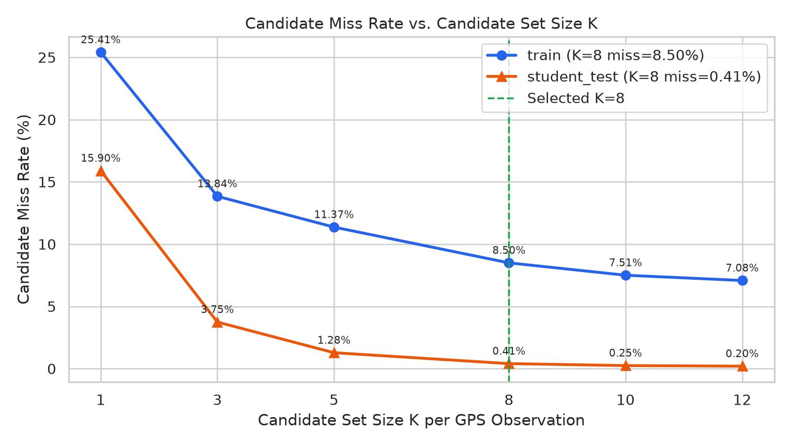
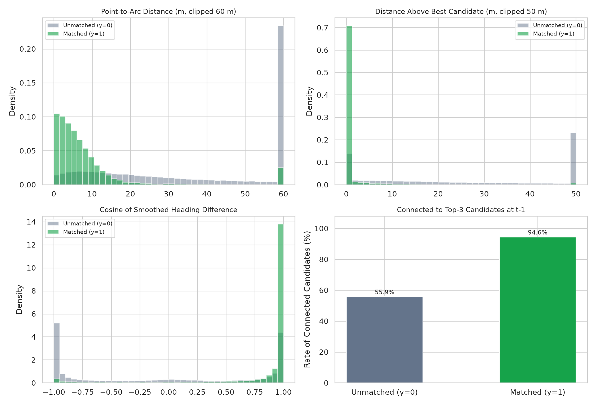

# PathSnap Candidate Generation and Feature Engineering Report: Group A-G14

**Partitions processed:** `train` (80 trips, 208,417 GPS observations) and `student_test` (10 trips, 19,160 GPS observations)  
**Leakage policy:** We generate all candidates and features from `.track`, `.nodes`, and `.arcs` only. Reference `.route` labels are stored separately as `y` and never enter `X`.

---

## 1. Candidate Generation and Route Alignment

In raw form, each trip holds up to 307,392 road arcs, while `.route` lists traversed `arc_id` values rather than per-observation labels. To convert map-matching into supervised classification plus sequential decoding, we run three pre-modeling steps:

1. **Turnaround-aware velocity smoothing (`compute_smoothed_velocities`):** Real urban GPS tracks frequently pause at intersections and turnaround stops where raw 5-point finite differences invert direction under 5 m GPS cloud jitter. We smooth planar UTM coordinates with a Gaussian filter (`sigma = 2.5`), extract backward and forward spatial chords at `R = 20 m`, and split opposing chords (`dot(ub, uf) < -0.2`) so arrival pings retain arrival heading and departure pings retain departure heading. Instantaneous derivatives (`sigma = 1.2`) supply local directional variation.
2. **Monotonic DP alignment (`align_route_to_observations`):** On labeled `train` and `student_test` trips, dynamic programming aligns each GPS observation `t` monotonically onto `.route` indices `j_t in [j_{t-1}, j_{t-1} + 15]` using point-to-arc distance plus heading alignment (`1.5 * (1 - cos_heading)`), with a `+50.0` prefix-minimum fallback for multi-minute GPS gaps.
3. **3-point spatial candidate generation (`generate_candidates`):** We index 3 points along every road arc (at fractions `0.15`, `0.50`, and `0.85`) in a `cKDTree` so long highway segments are covered alongside short intersections. For each GPS observation, we retrieve the 72 nearest sample points, compute exact point-to-segment distances, rank unique `arc_id` entries by `dist + 0.5 * (1 - cos_heading_smooth)`, and keep the top `K` candidates.

Table 1 and Figure 1 show Candidate Miss Rate across `K in {1, 3, 5, 8, 10, 12}`.

| Partition | K = 1 | K = 3 | K = 5 | **K = 8 (Selected)** | K = 10 | K = 12 |
|---|---:|---:|---:|---:|---:|---:|
| `train` Pooled Miss Rate | 22.1930% | 13.3837% | 10.9094% | **8.2604%** | 7.4212% | 7.0594% |
| `train` Median Trip Miss Rate | 12.0866% | 2.5474% | 0.8998% | **0.2927%** | 0.1395% | 0.0757% |
| `student_test` Pooled Miss Rate | 11.2265% | 2.9228% | 0.8299% | **0.3862%** | 0.2401% | 0.2035% |
| `student_test` Median Trip Miss Rate | 13.6779% | 3.1140% | 0.5465% | **0.2165%** | 0.1254% | 0.1166% |

At **K = 8**, `student_test` achieves a pooled Candidate Miss Rate of **0.3862%** (`19,086` of `19,160` observations captured, or **99.6138% recall**), with a median trip miss rate of `0.2165%` and worst trip miss rate of `1.8112%`. On `train`, the median trip miss rate is **0.2927%**, while two whole-trip offset outliers (`00000033` at `66.0678%` and `00000054` at `58.4477%`) account for `15,149` of the `17,216` `train` misses (`88.0%`) because more than 8 intermediate streets sit between their GPS tracks and `.route`. Choosing `K = 8` balances `99.61%` recall on `student_test` against an `8x8 = 64` transition branching factor per Viterbi step.

*Source:* [candidate_miss_rate_sensitivity.csv](candidate_miss_rate_sensitivity.csv), [per_trip_candidate_stats.csv](per_trip_candidate_stats.csv)

---

## 2. The 24 Engineered Features and Separability

We extract 24 leak-free features per `(observation, candidate)` pair across five groups in local UTM meters:

1. **Spatial Proximity (6):** `dist_to_arc_m`, `dist_rank`, `dist_diff_from_best_m`, `dist_ratio_to_best`, `dist_zscore_in_cands`, `gaussian_emission_prior` (`exp(-0.5 * (d / 10)^2)`).
2. **Segment Projection and Geometry (4):** `proj_fraction` (`t in [0, 1]`), `dist_to_from_node_m`, `dist_to_to_node_m`, `arc_length_m`.
3. **Heading and Directionality (5):** `cos_heading_diff_inst`, `sin_heading_diff_inst`, `cos_heading_diff_smooth` (turnaround-aware 20 m chord), `heading_diff_deg_smooth`, `is_forward_aligned`.
4. **Trajectory Kinematics and Local Window (5):** `gps_speed_mps` (clipped at 60 m/s), `dt_prev_s` (capped at 600 s), `dist_prev_obs_to_arc_m` (Gaussian-smoothed `t - 4`), `dist_next_obs_to_arc_m` (Gaussian-smoothed `t + 4`), `mean_window3_dist_to_arc_m` (relative window margin above best candidate across `t - 4`, `t`, `t + 4`).
5. **Graph Topology and Continuity (4):** `from_node_in_deg`, `to_node_out_deg`, `is_bidirectional_arc`, `prev_cand_connected` (2-sided local connected-chain cost margin across `t - 3`, `t`, and `t + 3` combining distance, heading, 1-hop directed connectivity, and U-turn penalty).

Table 2 reports selected high-signal features separating matched (`y = 1`) and unmatched (`y = 0`) candidates across all `1,667,336` `train` rows, and Figure 2 plots four key distributions.

| Feature | Matched Mean (Med) | Unmatched Mean (Med) | Corr with `y` |
|---|---:|---:|---:|
| `dist_rank` | 0.4370 (0.0000) | 3.8967 (4.0000) | -0.4811 |
| `gaussian_emission_prior` | 0.7618 (0.8772) | 0.2172 (0.0038) | +0.4726 |
| `dist_zscore_in_cands` | -1.1430 (-1.2067) | 0.1481 (0.3247) | -0.4463 |
| `heading_diff_deg_smooth` | 10.6927 (2.9352) | 93.4153 (91.0352) | -0.3672 |
| `cos_heading_diff_smooth` | 0.9244 (0.9987) | -0.0336 (-0.0181) | +0.3522 |
| `cos_heading_diff_inst` | 0.8014 (0.9937) | -0.0398 (-0.0509) | +0.3190 |
| `is_forward_aligned` | 0.9708 (1.0000) | 0.4924 (0.0000) | +0.3062 |
| `prev_cand_connected` | 3.1810 (0.0000) | 74.3727 (42.6893) | -0.2143 |
| `dist_to_arc_m` | 10.7467 (5.1179) | 69.5313 (33.4238) | -0.1834 |
| `dist_prev_obs_to_arc_m` | 24.8800 (8.5895) | 83.0430 (51.5271) | -0.1745 |

Replacing the 5-point velocity window with turnaround-aware 20 m spatial chords cut matched median heading error from `8.08 deg` to `2.94 deg`, lifted `cos_heading_diff_smooth` correlation from `+0.3117` to `+0.3522` (`pos_median = 0.9987`), and raised forward-aligned matched recall from `91.22%` to `97.08%`. Upgrading `prev_cand_connected` to a 2-sided chain margin yields a median margin of `0.0000 m` for matched arcs versus `42.6893 m` for unmatched arcs.

*Source:* [feature_statistics.csv](feature_statistics.csv)
